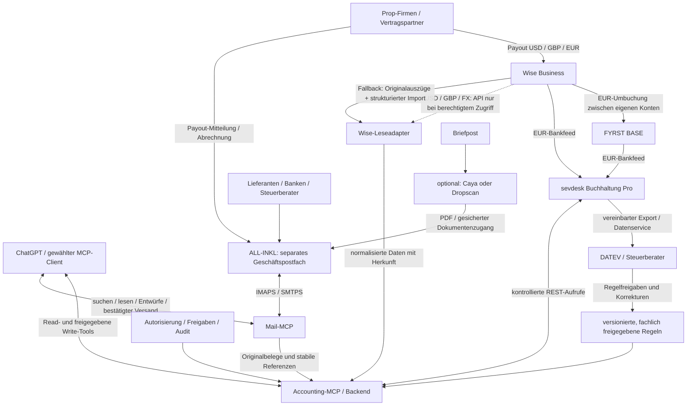

# ArchitekturDraft – Tradegazing Accounting & Backoffice

| Dokument | Angaben |
| --- | --- |
| Stand | 03.10.2026, Europe/Berlin |
| Version | 0.6 – Architekturentwurf ohne Pinning, mit VPN-/HTTPS-Optionen und Paketformat-Skizze |
| Auftraggeber / Kontext | Matthias; geplantes deutsches Prop-Trading-Einzelgewerbe im Tradegazing-Umfeld |
| Zweck | Projektstand in eine neue lokale Entwicklungssession und ein späteres GitHub-Repository übertragen |
| Referenz | ChatGPT-Chat „Buchhaltungssoftware mit MCP KI“, ID `6abcee6e-48e8-83ed-b004-a049848f412b` |
| Umsetzungsstand | Planung; keine Kontoeröffnung, produktive Integration oder steuerliche Freigabe durch dieses Dokument nachgewiesen |

> **Zielarchitektur:** FYRST BASE als deutsches EUR-Hauptkonto, Wise Business für internationale Payouts und Währungsumtausch, sevdesk Buchhaltung Pro als zentrale operative Buchhaltung. Ein eigener Accounting-MCP verbindet die Buchhaltung mit ChatGPT; ein Mail-MCP erschließt ein separates ALL-INKL-Geschäftspostfach. Steuerliche Entscheidungen kommen aus einer freigegebenen Regelbasis. DATEV und der Steuerberater bilden die fachliche Abschluss- und Übergabeschicht.

## 1. Leseschlüssel, Herkunft und Grenzen

Dieses Dokument vereint drei klar unterscheidbare Ebenen:

| Kennzeichnung | Bedeutung |
| --- | --- |
| **Planungsentscheidung** | Im abrufbaren Chat als Zielrichtung festgehalten oder im aktuellen Auftrag ausdrücklich vorgegeben; keine Aussage über bereits erfolgte Einrichtung |
| **Verifiziert** | Am Dokumentdatum durch die verlinkte öffentliche Anbieter- oder Gesetzesquelle gestützt; noch kein Funktionstest im konkreten Konto |
| **Entwurf** | Für die Umsetzung vorgeschlagene Ausgestaltung, etwa Toolnamen, Datenmodelle, Sicherheitsabläufe oder Repository-Struktur |
| **Offen** | Fachliche, vertragliche oder technische Prüfung fehlt; die neue Session darf die Angabe nicht als erfüllt behandeln |

Über `read_thread` waren fünf Gesprächsrunden abrufbar: Architektur/ChatGPT-Anbindung, schreibender TradegazingDesk-MCP, Tarifauswahl, ALL-INKL-Mail und die Übergabeanforderung. Die Rückgabe enthielt keinen weiteren Seiten-Cursor und keine Anhänge. Frühere Detaildiskussionen zum Gewerbe und zu Kontist/Qonto/FINOM/Holvi sind darin nicht enthalten. Das Zielbild wird deshalb zusätzlich aus dem aktuellen Nutzerauftrag übernommen; die Begründungen zu den Alternativen in Abschnitt 12 sind als Architekturabwägung rekonstruiert, nicht als wortgetreu belegte historische Aussagen.

FTMO, FXIFY und FundedNext wurden im Chat als Beispiele für unterschiedliche Prop-Firmen-Regeln genannt. Daraus folgt weder eine tatsächliche Geschäftsbeziehung noch eine geprüfte Zuordnung zu einem Land, Vertragspartner oder Steuerschlüssel. Alle Beträge und Identitäten in Beispielen dieses Dokuments sind fiktiv. Mailadressen unter `tradegazing.de` sind Namensvorschläge; ihre Existenz wurde nicht geprüft.

### 1.1 Zwei Korrekturen gegenüber Aussagen im Ausgangschat

1. **ChatGPT Pro ist nicht pauschal auf lesende Custom-MCPs beschränkt.** Die aktuelle OpenAI-Dokumentation nennt den Entwicklermodus im Web für Plus, Pro, Business, Enterprise und Education sowie die Nutzung schreibender Tools. Der tatsächliche Zugang und die Bestätigungseinstellungen müssen im gewählten Konto getestet werden. Business ist daher keine allein aus Write-Tools abgeleitete Pflicht. Quelle: [OpenAI: ChatGPT Developer mode](https://developers.openai.com/api/docs/guides/developer-mode).
2. **Ein kostenloser Wise-API-Token garantiert keinen vollständigen Zugriff auf deutsche Fremdwährungskonten.** Wise begrenzt persönliche Business-API-Tokens; Kontoauszüge über die API und Transferfinanzierung sind damit außerhalb bestimmter Regionen nicht unterstützt. Deutschland gehört nicht zur dort genannten Ausnahmeliste. Der direkte Wise-Lesezugriff bleibt Ziel, ist aber ein zentraler Machbarkeitsvorbehalt. Quellen: [Wise: Personal API tokens](https://docs.wise.com/guides/developer/auth-and-security/personal-api-token), [Wise: Get Balance Statement](https://docs.wise.com/api-reference/balance-statement/balancestatementget).

## 2. Zielbild und fachliche Abgrenzung

### 2.1 Prop-Trading-Einzelgewerbe

Das geplante Backoffice soll die wirtschaftlichen Vorgänge eines deutschen Einzelgewerbes abbilden: Vergütungen/Payouts von Prop-Firmen, Challenge- und Reset-Gebühren, Handelssoftware, Marktdaten, VPS/Hosting, Bank- und Zahlungsgebühren sowie weitere belegte betriebliche Ausgaben. Ob und wie ein konkreter Prop-Vertrag steuerlich einzuordnen ist, wird vor seiner Automatisierung mit dem Steuerberater geklärt.

Prop-Payouts werden im Zielmodell als gewerbliche Vergütungsvorgänge behandelt, soweit diese Einordnung für den jeweiligen Vertrag bestätigt ist. Sie werden nicht allein wegen der Wörter „Trading“, „Profit Split“ oder „Reward“ als private Kapitalerträge, steuerfreie Finanzumsätze oder gewöhnliche Dienstleistungsumsätze klassifiziert. Simulierte Handelskonten und Live-Verträge können unterschiedliche Vertragsgrundlagen haben.

### 2.2 Getrennte Buchhaltung

- Geschäftskonten, Belege und Geschäftspostfach sind organisatorisch vom Privatbereich getrennt.
- Privates Trading, private Depots und persönliche Korrespondenz gehören nicht in den Zugriff dieses Backoffice.
- Privateinlagen und Privatentnahmen erhalten eigene Kategorien; sie werden nicht als Erlöse oder Betriebsausgaben behandelt.
- Falls weitere Gewerbe oder Tätigkeiten bestehen, werden die organisatorische Abgrenzung und die steuerliche Zusammenfassung mit dem Steuerberater festgelegt. Ein separates Konto schafft keine eigenständige juristische Person. Für die Umsatzsteuer umfasst das Unternehmen grundsätzlich die gesamte unternehmerische Tätigkeit; die konkrete Anwendung bleibt zu prüfen. Quelle: [UStG, insbesondere § 2](https://www.gesetze-im-internet.de/ustg_1980/BJNR119530979.html).
- Gewinnermittlung per EÜR oder Bilanz, Kleinunternehmerstatus/Regelbesteuerung, Ist-/Sollbesteuerung und Kontenrahmen sind **offen**.

### 2.3 Rollen und Verantwortlichkeiten

| Ebene | Verantwortung |
| --- | --- |
| FYRST / Wise | Tatsächliche Geldbewegungen, Salden, Kontoauszüge und Zahlungsnachweise |
| sevdesk | Zentrale operative Beleg-, Rechnungs- und Buchhaltungsführung sowie Grundlage der Kanzleiübergabe |
| Accounting-Backend / MCP | Datenzugriff, Regelanwendung, Abstimmung, kontrollierte Schreibaktionen und Audit-Protokoll |
| Mail-MCP / ALL-INKL | Eingang und Versand geschäftlicher Korrespondenz sowie Zugriff auf Originalanhänge |
| ChatGPT | Dokumente verstehen, Vorgänge zuordnen, Aufgaben koordinieren, Entwürfe und verständliche Statusberichte erzeugen |
| Matthias | Geschäftliche Freigaben, Kontrolle außergewöhnlicher Vorgänge und Bankaktionen |
| Steuerberater / DATEV | Steuerliche Regeldefinition, Kontierungsvorgaben, fachliche Prüfung, Abschluss und vereinbarte Meldungen |

sevdesk ist die zentrale operative Buchhaltungsquelle. Bankauszüge bleiben die Nachweise für Geldbewegungen. Kanzleikorrekturen müssen anschließend in den vereinbarten Prozess zurückfließen; „zentrale Wahrheit“ bedeutet nicht, dass eine ungeprüfte sevdesk-Auswertung den fachlichen Abschluss ersetzt.

## 3. Entscheidungsregister

| ID | Entscheidung / Status | Begründung und verbleibender Vorbehalt |
| --- | --- | --- |
| D-01 | **Planungsentscheidung:** FYRST BASE als EUR-Hauptkonto | Deutsches Geschäftskonto mit geringer Grundkostenbelastung; Zulassung der konkreten Tätigkeit und Feed testen |
| D-02 | **Planungsentscheidung:** Wise Business für internationale Payouts/FX | Fremdwährungen empfangen, halten und umtauschen; Profilfreigabe, Kontodaten und Payout-Akzeptanz offen |
| D-03 | **Planungsentscheidung:** sevdesk Buchhaltung Pro | REST-API für eigenen MCP; Preis, Systemversion und konkrete Fremdwährungsabbildung prüfen |
| D-04 | **Planungsentscheidung:** FYRST → sevdesk und Wise EUR → sevdesk | Vorhandene Bankintegration statt eigenem FYRST-MCP; Vollständigkeit und Historie im Konto testen |
| D-05 | **Planungsentscheidung mit Machbarkeitsvorbehalt:** zusätzlicher Wise-Leseadapter | USD/GBP und FX-Belege ergänzen; persönlicher Token genügt für deutsche Kontoauszüge nicht als Zusage |
| D-06 | **Planungsentscheidung:** eigener Accounting-MCP mit Read/Write | Fachlich begrenzte Aktionen statt beliebiger API-Aufrufe; anfangs Entwürfe und kontrollierte Freigaben |
| D-07 | **Planungsentscheidung:** feste Steuerregeln je rechtlichem Vertragspartner | ChatGPT wendet geprüfte Regeln an; konkrete Regeln noch nicht freigegeben |
| D-08 | **Planungsentscheidung:** ALL-INKL statt Gmail | Bestehenden Mailanbieter und eigene Domain verwenden; kein Gmail-Konto erforderlich |
| D-09 | **Planungsentscheidung:** separates Geschäftspostfach und Mail-MCP | Zugriff auf geschäftliche Mail begrenzen; Adresse und Einrichtung offen |
| D-10 | **Planungsentscheidung:** DATEV-Übergabe primär aus sevdesk | Einheitliche Beleg- und Datenübergabe; Exportart und Kanzleiprozess offen |
| D-11 | **Optional:** Caya oder Dropscan | Briefpost in digitalen Eingang überführen; kein Anbieter ausgewählt |
| D-12 | **Offen:** ChatGPT-Web, Codex oder eigenes Agent-Backend als Laufzeit | MCP kann schreiben; Verfügbarkeit, Betrieb und Authentifizierung im tatsächlichen Client prüfen |
| D-13 | **Entwurf:** vorhandene TradegazingDesk-Infrastruktur nutzen | Im Chat erwähnter MCP; Code, Deployment und Sicherheitsmodell hier nicht geprüft |
| D-14 | **Vorhanden:** lokales Projekt und GitHub-Repo `Tradegazing/Office` | Ursprünglicher Arbeitsordner `/Users/matthiaspape/Tradegazing Office`; ab 04.11.2026 wird der Konzeptstand zusätzlich im neuen Repository `matthiaspape/tradegazingoffice` gespeichert; keine produktive Integration |
| D-15 | **Nutzerangabe:** ALL-INKL Privat mit 50 GB Webspace vorhanden | Bestehender Vertrag nicht eingesehen; öffentliche Tarifmerkmale im Dashboard-Plan geprüft |
| D-16 | **Gewünschte spätere Ausbaustufe:** privates Finanz-/Prop-Firmen-/MT5-Dashboard als Web-/App-Oberfläche | Nur für Matthias zugänglich; noch keine Website oder App implementiert |
| D-17 | **Nutzerangabe:** eigener Windows-VPS für MT5 | Instanzzahl, Ressourcen, bestehendes Monitoring und Terminalzuordnung offen |
| D-18 | **Entwurf:** direkte App-Abfrage lokaler VPS-APIs über VPN oder geschütztes HTTPS; ALL-INKL-Aggregator/Webansicht optional | Authentifizierter Abruf, lokale Historie und Backups, sichtbares Datenalter, getrennte Finanz-/Trading-Kennzahlen; Machbarkeit noch zu testen |
| D-19 | **Nutzeranforderung:** MT5-Messungen und aktive Anzeige alle fünf Minuten; gegebenenfalls zentrale Übertragung im selben Takt | Ersetzt 15–30 Sekunden; Deal-Historie nachholen, Equity-Zwischenspitzen bleiben unbekannt; keine garantierten iOS-Hintergrundabrufe |
| D-20 | **Nutzeranforderung:** Zugang ausschließlich für Matthias; **Entwurf:** Geräte-/API-Autorisierung oder Web-Passkey | Geschützte Einrichtung ohne Selbstregistrierung; VPN-/HTTPS-Geräteverfahren beziehungsweise Web-Login, Ersatzschlüssel, Wiederherstellung und Widerruf noch nicht eingerichtet |
| D-21 | **Entwurf aus Nutzeridee:** VPN optional; geschütztes HTTPS und zusätzliche App-Entschlüsselung als Alternative | Öffentliche Verschlüsselungsschlüssel auf VPS, private Schlüssel nur in geschützter Geräteablage; Autorisierung, Herkunft, Mehrgerätezugriff und Wiederherstellung noch zu prüfen |
| D-22 | **Nutzerentscheidung:** Certificate/Public-Key-Pinning verworfen; **Entwurf:** Datenkompression | Zusätzliche Komplexität und Wartung vermeiden; HTTPS mit normaler Zertifikatsprüfung und Geräteautorisierung. JSON/GZIP für Messpakete, ZIP eher für Mehrdateiexporte; Format noch offen |

## 4. Kontostruktur und Tarifauswahl

### 4.1 Aufgabenverteilung

| Konto / System | Zweck | Typische Vorgänge | Abgrenzung |
| --- | --- | --- | --- |
| FYRST BASE, EUR | Deutsches operatives Hauptkonto | EUR-Ausgaben, Lastschriften, Steuerberater, Zuflüsse von Wise, Privatentnahmen | Keine zweite Erlöserfassung für interne Zuflüsse |
| Wise Business, EUR | Internationale Zahlungsdrehscheibe in EUR | EUR-Payouts, Umtauschzuflüsse, Weiterleitung zu FYRST | Eigener Bestand und eigene Gebühren |
| Wise Business, USD | USD-Payouts und USD-Ausgaben | Vergütungen, US-Zahlungswege, FX | Nicht als vollständig durch sevdesk-EUR-Feed abgedeckt betrachten |
| Wise Business, GBP / weitere | Bei tatsächlichem Bedarf | GBP-Payouts und Fremdwährungsausgaben | Nur benötigte Währungen aktivieren und abstimmen |
| Rücklagenbereich | Liquidität für Steuern und Reserven | Interne Reservierung oder separates Konto | Noch keine Entscheidung für Unterkonto oder festen Prozentsatz |
| Privatkonten | Privatbereich | Entnahmen/Einlagen mit sauberer Kennzeichnung | Kein allgemeiner Mail-/Bankzugriff durch das Backoffice |

### 4.2 FYRST BASE

**Verifiziert:** FYRST nennt für natürliche Personen wie Einzelunternehmer 0 EUR monatlichen Grundpreis, 50 freie beleglose Buchungsposten pro Monat und 0,19 EUR pro weiterem Posten; eine Debit Mastercard ist enthalten. Dies betrifft die Kontoführung und die genannten Buchungsposten, nicht sämtliche möglichen Zusatzleistungen. Quelle: [FYRST BASE](https://www.fyrst.de/konten/geschaeftskonten/fyrstbase.html).

FYRST COMPLETE bleibt eine mögliche spätere Erweiterung bei höherem Buchungsvolumen oder Unterkontobedarf. Der Anbieter nennt 10 EUR monatlich, 75 freie Posten und ein BASE-Unterkonto. Quelle: [FYRST: Konten für Einzelunternehmer](https://www.fyrst.de/loesungen/einzelunternehmer.html).

Im Chat wurde außerdem das Gründerangebot angesprochen: Gründung höchstens 365 Tage zurückliegend, COMPLETE im ersten Jahr ohne Grundpreis und optionales sevdesk-Buchhaltungspaket. Der erforderliche Pro-API-Tarif ist nicht automatisch dadurch abgedeckt; Upgrade, Vertragslaufzeit und Folgepreise müssen gesondert geprüft werden. Quelle: [FYRST Gründerkonto](https://www.fyrst.de/konten/Gruenderkonto.html).

Eine zusätzliche direkte FYRST-DATEV-Anbindung ist im Zielbild nicht erforderlich, weil die Übergabe aus sevdesk erfolgen soll. Abweichende Kanzleiwünsche sind möglich, dürfen aber keine doppelte Verarbeitung desselben Zeitraums auslösen.

### 4.3 Wise Business

Wise Business ist die geplante internationale Ebene. Der deutsche Anbieterpreis nennt aktuell 55 EUR für eigene Empfangsbankverbindungen in 22 Währungen. Bestimmte lokale Eingänge sind kostenlos, während Wire-/SWIFT-Eingänge und Umtausch gebührenpflichtig sein können. Verfügbare Kontodaten hängen vom Profil und Zahlungsweg ab. Quelle: [Wise Business: deutsche Preisübersicht](https://wise.com/de/pricing/business).

Die Architektur setzt auf das Standard-Business-Konto ohne klassisches monatliches Kontoführungsabo; Konditionen sind bei der Eröffnung erneut abzugleichen. Vor einem echten Payout werden Rechtsname, Kontoempfänger, akzeptierte Zahlungswege und die Zulässigkeit der konkreten Prop-Tätigkeit bei Wise und der Prop-Firma geklärt. Wise wird nicht als pauschal gleichwertiger Ersatz für ein deutsches Bankkonto eingeplant; rechtlicher Kontostatus und Schutz der Guthaben sind separat zu prüfen.

Ein Wise-API-Zugang ist kein Beleg dafür, dass beliebige Kontodaten gelesen werden dürfen. Die Fremdwährungsintegration erhält daher einen offiziellen API-Weg **oder** einen nachvollziehbaren Auszugsimport als Datenquelle; siehe Abschnitt 7.

### 4.4 sevdesk Buchhaltung Pro

**Verifiziert:** Die REST-API steht laut sevdesk ab Buchhaltung Pro zur Verfügung; die Hilfe präzisiert die deutsche Systemversion 2.0. Die API ist der Grund für die Pro-Auswahl. Der einfachere Tarif „Buchhaltung“ bleibt im Projekt untergeordnet, solange er den benötigten API-Zugriff nicht bereitstellt. Quelle: [sevdesk API](https://hilfe.sevdesk.de/de/articles/9374668-sevdesk-api).

sevdesk soll Rechnungen, Belege, Kontakte, Zahlungszuordnungen und operative Buchhaltung bündeln. Der Chat nennt zusätzlich Online-Banking, Belegerkennung, EÜR/GuV, UStVA und Steuerberaterzugang. Die benötigten Funktionen müssen gegen den tatsächlich gebuchten Tarif und die Systemversion geprüft werden. Aktionspreise, Laufzeiten, Mehrwertsteuer und DATEV-Zusatzkosten sind noch nicht budgetiert.

**Besonderes Abnahmekriterium:** Eine USD-Rechnung ausstellen zu können, bedeutet nicht automatisch, dass ein gehaltenes USD-Guthaben einschließlich späterem FX, Gebühren und DATEV-Export vollständig abgebildet werden kann. Diese Kette muss vor produktiver Nutzung gemeinsam mit dem Steuerberater getestet werden.

## 5. Gesamtarchitektur und Datenflüsse



ASCII-Kurzbild für Markdown-Viewer ohne Mermaid:

```text
Prop-Payouts --> Wise Business -- EUR-Umbuchung --> FYRST BASE
                     |                                |
                 EUR-Feed                         EUR-Feed
                     +------------> sevdesk <---------+
                                       |
                                 DATEV / Kanzlei

Wise USD/GBP/FX --> API* oder Auszugsimport --> Accounting-MCP
                                                  |
ALL-INKL <--> Mail-MCP <--> ChatGPT <---------------+
                  ^                               |
          optional Briefpost                sevdesk REST-API
          via Caya/Dropscan                  Regeln / Freigaben

* API-Leserechte für deutsches Wise-Profil sind offen.
```

Die Geldpfeile, Datenfeeds und MCP-Aktionen sind unterschiedliche Vorgänge. Ein Bankfeed bewegt kein Geld. `create_internal_transfer` bezeichnet im geplanten Accounting-MCP ausschließlich die buchhalterische Dokumentation einer bereits erfolgten Umbuchung, keine Banküberweisung.

## 6. Bankfeeds und sevdesk-Integration

### 6.1 FYRST → sevdesk

Die Anbieter dokumentieren eine Verbindung zwischen FYRST und sevdesk. sevdesk beschreibt die Einrichtung von Onlinekonten über finAPI. Daher wird kein eigener FYRST-MCP vorausgesetzt. Quellen: [sevdesk: FYRST Banking](https://sevdesk.de/integrationen/fyrst-banking/), [sevdesk: Onlinekonto mit finAPI](https://hilfe.sevdesk.de/de/articles/9345270-onlinekonto-anlegen-mit-finapi).

**Offen im konkreten Konto:** korrekte Bankauswahl und Zugangsdaten, notwendiges Geschäftsprofil, verfügbare Historie, erneute Authentifizierung, Abrufverzögerung und API-Sichtbarkeit der importierten Bewegungen. Die freigeschaltete Verbindung wird gegen Originalauszüge abgestimmt; ein erfolgreicher Login allein ist kein Vollständigkeitsnachweis.

### 6.2 Wise EUR → sevdesk

**Verifiziert:** sevdesk beschreibt den automatischen Abruf von EUR-Transaktionen über das Wise-Konto mit europäischer IBAN. Die Produktseite ist keine Zusage für vollständige USD-/GBP-Kontofeeds. Wise bestätigt die Anbindung über Open Banking. Quellen: [sevdesk: Wise Business](https://sevdesk.de/integrationen/wise/), [Wise: sevdesk/FastBill-Anbindung](https://wise.com/help/articles/5A3bPljhzVni3QdT0YMeRC/how-to-manage-your-wise-account-with-sevdesk-and-fastbill).

Die dort beschriebene Umrechnung von Fremdwährungsbelegen beantwortet noch nicht die Verarbeitung eines zunächst in USD gehaltenen Payouts. EUR-Feed, USD-Beleg und tatsächlicher USD-Zufluss müssen als zusammengehörige, aber getrennte Informationen behandelt werden.

### 6.3 Import- und Abstimmungsprinzipien – Entwurf

| Thema | Vorgabe |
| --- | --- |
| Quellenpriorität | Für FYRST/EUR-Feeds ist sevdesk der operative Zugang; Originalauszüge dienen der Abstimmung |
| Fremdwährungen | Wise-Leseadapter ergänzt fehlende Daten; technische Import-/Verrechnungskonten in sevdesk erst nach Abnahme |
| Deduplizierung | Gleiche Wise-EUR-Bewegung aus Feed und Direktquelle wird einem Vorgang zugeordnet, nicht zweimal importiert |
| Identität | Anbieter-ID, Profil/Konto/Währung und Quellreferenz speichern; bloßer Betrag/Datum-Vergleich genügt nicht |
| Zustände | angekündigt, ausstehend, gebucht, storniert/rückbelastet getrennt führen |
| Vollständigkeit | Abrufzeitpunkt, abgedeckter Zeitraum, Pagination, fehlende Intervalle und SCA-Status ausweisen |
| Korrekturen | Änderungen protokollieren; freigegebene/festgeschriebene Vorgänge nicht still überschreiben |
| Fallback | Offizielle CSV-/PDF-Auszüge importieren; manuellen Prüfschritt und Herkunft sichtbar machen |

## 7. Direkter Wise-Zugriff und Fremdwährungslücke

### 7.1 Benötigte Daten

Der Accounting-MCP benötigt für die Abstimmung je Währung Anfangs-/Endsaldo, gebuchte Ein- und Ausgänge, Empfänger/Zahler soweit verfügbar, Referenzen, Transfer-/Payout-IDs, FX-Ausgang und FX-Eingang, tatsächlichen Kurs sowie separat ausgewiesene Gebühren. Kontostand und Transaktionsliste müssen denselben Zeitraum und Status berücksichtigen.

Die allgemeine Wise-Dokumentation beschreibt einen Balance-Statement-Endpunkt mit JSON-/CSV-/PDF- und weiteren Formaten sowie SCA-Schutz. Daraus folgt kein Zugriff mit dem persönlichen Token eines deutschen Business-Profils. Die aktuell dokumentierte regionale Einschränkung hat Vorrang vor der früheren Annahme „kostenlose API liefert alles“. Quellen: [Wise: Balance Statement](https://docs.wise.com/api-reference/balance-statement/balancestatementget), [Wise: Token-Beschränkungen](https://docs.wise.com/guides/developer/auth-and-security/personal-api-token).

### 7.2 Umsetzungswege

| Weg | Status / Prüfung |
| --- | --- |
| Berechtigter direkter Wise-API-Zugriff | Gewünschtes Ziel; passenden OAuth-/Partner-/sonstigen offiziellen Zugriff und tatsächlich erlaubte Daten mit Wise klären |
| Autorisierter Open-Banking-Anbieter | Prüfen, ob gewünschte USD-/GBP-Salden und Bewegungen unterstützt werden; eine bestehende EUR-Verbindung reicht nicht als Beleg |
| Offizielle Auszüge manuell exportieren und kontrolliert importieren | Vorgeschlagener MVP-Fallback; CSV für strukturierte Verarbeitung plus Originalauszug als Nachweis |
| Vollständigkeit nur aus E-Mails ableiten | Unzureichend: Payout-Mitteilungen beweisen weder Eingang noch Gebühren, Storno oder Saldo |

Das Backend stellt unabhängig vom Zugang denselben normalisierten Lesevertrag bereit. Es meldet `source = api | statement_import`, den Datenstand und die Abdeckung. Bei fehlenden Leserechten liefert es `CAPABILITY_UNAVAILABLE`; es behauptet keine leere oder vollständige Transaktionsliste.

**Nicht Teil des ersten Ausbaus:** Wise-Transfers auslösen, FX automatisch ausführen, Empfänger anlegen oder Geldbewegungen finanzieren. Die Integration dient zunächst der Buchhaltung und Abstimmung. Diese Begrenzung ist ein Architekturentwurf, keine Behauptung über generelle Wise-Fähigkeiten.

## 8. Accounting-MCP: konkrete Tool- und API-Skizze

Die folgende Schnittstelle ist ein **Entwurf des eigenen MCP**, keine Liste bereits implementierter Tools oder zugesicherter Anbieter-Endpunkte. Der MCP übersetzt fachliche Aktionen in geprüfte sevdesk-Aufrufe und hält eigene Vorgangs-, Freigabe- und Abstimmungsdaten. Er baut keine zweite steuerliche Hauptbuchhaltung.

### 8.1 Lesende Tools

| Tool | Wesentliche Eingaben | Ergebnis / Quelle |
| --- | --- | --- |
| `get_capabilities` | Keine fachlichen Parameter | Getestete Provider-Fähigkeiten, Versionen, Zugangsbeschränkungen |
| `get_accounts` | Filter nach aktivem Konto | sevdesk-Konten und normalisierte Wise-Währungskonten |
| `get_transactions` | Konto, Zeitraum, Cursor, Status | sevdesk-Bewegungen mit stabilen IDs und Herkunft |
| `get_unmatched_transactions` | Zeitraum, Konto | Nicht oder nur teilweise zugeordnete Zahlungen |
| `get_invoices` / `get_vouchers` | Zeitraum, Status, Kontakt | Rechnungen/Belege einschließlich Entwürfen und offenen Beträgen |
| `get_contacts` | Suche, Kontakt-ID | Rechtliche Vertragspartner aus sevdesk |
| `get_prop_company_rule` | Rechtlicher Partner, Leistungsart, Leistungsdatum | Genau eine freigegebene Regelversion oder Prüfbedarf |
| `get_wise_balances` | Profil, Währung, Stichtag | Nachgewiesene Salden mit Datenstand; API oder Auszug |
| `get_wise_transactions` | Profil, Währung, Zeitraum, Cursor | Normalisierte Wise-Bewegungen; Abdeckung explizit |
| `get_fx_details` | FX-/Transfer-Referenz | Beide Währungsseiten, Kurs, Gebühren und Originalnachweis |
| `get_month_status` | Monat | Vollständigkeit, Saldoabgleich, offene Belege, Steuerfragen, Exportstatus |
| `get_action_status` | `action_id` | Geplanter, freigegebener oder ausgeführter Vorgang mit Audit-Verweis |

### 8.2 Schreibende Tools und Freigabestufen

| Tool | Wirkung | Anfangs vorgesehene Grenze |
| --- | --- | --- |
| `create_invoice_draft` | Rechnungsentwurf aus freigegebener Partnerregel | Kein Versand und keine endgültige Rechnungsfreigabe |
| `create_voucher_draft` | Entwurf für Ausgabe/Einnahme/Self-Billing | Kategorie und Steuerregel müssen validiert sein |
| `upload_receipt` | Originaldatei in definierte Belegablage/sevdesk übernehmen | Dateityp, Prüfsumme, Dubletten und Zugriffsrechte prüfen |
| `create_contact_draft` | Neuen Vertragspartner vorbereiten | Zahlungs-/Adressdaten aus Mail nicht ungeprüft übernehmen |
| `link_transaction_to_invoice` | Zahlung einer Rechnung zuordnen | Bewusste Schreibaktion; kann Zahlungsstatus ändern |
| `link_transaction_to_voucher` | Zahlung einem Beleg zuordnen | Betrag, Währung, Gebühren und Restbetrag überprüfen |
| `create_internal_transfer` | Zwei vorhandene Kontobewegungen dokumentieren | Rein buchhalterisch; keine Überweisung |
| `import_wise_statement` | Freigegebenen Auszug im Backend erfassen | Staging, Herkunft und Dublettenprüfung; sevdesk-Import getrennt |
| `prepare_month_close` | Prüfbericht und Übergabepaket vorbereiten | Keine steuerliche Abgabe oder automatische Festschreibung |
| `finalize_invoice` | Geprüften Rechnungsentwurf finalisieren | Explizite Freigabe für genau die aktuelle Version |
| `prepare_datev_export` | Gewählten Zeitraum und Exportart vorbereiten | Fähigkeit/Exportweg prüfen; manueller sevdesk-Schritt möglich |
| `execute_approved_action` | Eine exakt freigegebene Aktion ausführen | Backend prüft Freigabe, Versionshash, Frist und Rechte |

Das Ablegen eines Entwurfs in sevdesk ist bereits ein Write. Der Startbetrieb sollte lesend beginnen und danach zunächst kontrollierte Entwürfe erlauben. Ob später bestimmte risikoarme Entwürfe ohne Einzelfreigabe gespeichert werden dürfen, ist eine gesonderte Policy-Entscheidung. Versand, finale Rechnungen, Festschreibung und Steuerübermittlung bleiben eigene Freigabeschritte.

### 8.3 Adapter zu den Anbietern

| Adapter | Geplante Anbindung | Vor Implementierung zu verifizieren |
| --- | --- | --- |
| sevdesk | REST-API; Konten/Transaktionen, Kontakte, Rechnungen, Belege, Dokumente, Zahlungszuordnung | Authentifizierung, konkrete Ressourcen und Methoden, Systemversion, Statusübergänge, Fremdwährungsfelder, Limits und Exportmöglichkeiten |
| Wise | Autorisierter Lesezugriff auf Profile/Salden/Auszüge, soweit erlaubt | Zugriffstyp, regionale Rechte, SCA, API-Version, verfügbare IDs, Paging und FX-/Gebührendaten |
| Wise-Fallback | Offizieller CSV-Import plus Originalauszug | Formatversion, Zeitzonen, Zahlenformate, Gebühren, Korrekturen und Saldoabgleich |
| ALL-INKL | IMAPS zum Lesen/Ordnerverwaltung; SMTPS zum Versand | Konkreter Host, Login, Postfachrechte, Ordner und Versandablage |
| DATEV | Übergabe aus sevdesk nach Kanzleivorgabe | Rechnungs- versus Buchungsdaten, Belegbilder, Konfiguration und tatsächlich nutzbarer manueller/API-Weg |

Provider-Endpunkte und Payloads werden erst nach Prüfung der jeweils aktuellen Referenz in Code festgelegt. Die [sevdesk-API-Referenz](https://api.sevdesk.de/) und die [Wise-API-Referenz](https://docs.wise.com/api-reference) sind Ausgangspunkte. Ein Toolname wie `prepare_datev_export` ist keine Behauptung, dass sevdesk dafür einen öffentlich nutzbaren API-Endpunkt anbietet.

### 8.4 Beispiel eines fachlichen Tool-Vertrags

Vorgeschlagenes JSON-Schema für einen Rechnungsentwurf; unbekannte oder zusätzliche Felder sind abzulehnen:

```json
{
  "name": "create_invoice_draft",
  "description": "Plant einen sevdesk-Rechnungsentwurf für einen belegten Prop-Vergütungsvorgang. Nutzt ausschließlich eine freigegebene Regelversion; versendet nichts.",
  "inputSchema": {
    "type": "object",
    "additionalProperties": false,
    "required": ["case_id", "contact_id", "rule_version", "currency", "gross_amount", "service_period", "evidence_ids", "idempotency_key", "dry_run"],
    "properties": {
      "case_id": {"type": "string"},
      "contact_id": {"type": "string"},
      "rule_version": {"type": "string"},
      "currency": {"type": "string", "pattern": "^[A-Z]{3}$"},
      "gross_amount": {"type": "string", "pattern": "^[0-9]+(\\.[0-9]{1,2})?$"},
      "service_period": {
        "type": "object",
        "additionalProperties": false,
        "required": ["from", "to"],
        "properties": {
          "from": {"type": "string", "format": "date"},
          "to": {"type": "string", "format": "date"}
        }
      },
      "evidence_ids": {"type": "array", "items": {"type": "string"}, "minItems": 1},
      "idempotency_key": {"type": "string"},
      "dry_run": {"type": "boolean"}
    }
  },
  "annotations": {
    "readOnlyHint": false,
    "destructiveHint": false,
    "idempotentHint": true,
    "openWorldHint": true
  }
}
```

Für den MVP werden Währungen mit höchstens zwei Nachkommastellen zugelassen; andere benötigen eine angepasste Währungsvalidierung. Beträge werden als Dezimalstrings verarbeitet, nicht als binäre Gleitkommazahlen. Positiver Betrag, Reihenfolge der Datumsgrenzen, erlaubte Währung, eindeutige Partnerregel und Eigentum an den Nachweisen werden zusätzlich serverseitig geprüft.

`idempotentHint: true` ist nur dann korrekt, wenn das Backend dieselbe Aktion anhand des Schlüssels dauerhaft wiedererkennt und nach einem Timeout den Anbieterzustand abgleicht. Der JSON-Vertrag ist noch keine entsprechende Implementierung. Metadaten helfen dem Client bei der Einordnung; sie ersetzen keine Berechtigungsprüfung.

Beispielantwort einer Vorschau:

```json
{
  "action_id": "act_example_001",
  "status": "awaiting_approval",
  "dry_run": true,
  "case_id": "payout_example_001",
  "payload_hash": "sha256:example",
  "rule_version": "partner-example/approved-v1",
  "changes": [{"system": "sevdesk", "operation": "create_invoice_draft"}],
  "warnings": [],
  "source_refs": ["evidence_example_001"],
  "provider_object_ids": []
}
```

Ein produktives Ergebnis enthält reale Referenzen, keine Beispiel-Hashes. Nach der Freigabe entstehen Anbieter-IDs und ein Rücklesebericht.

### 8.5 Kontrollierter Aktionsablauf

```text
Quellen lesen --> Vorgang identifizieren --> freigegebene Regel laden
      --> Vorschau mit Auswirkungen und Nachweisen
      --> authentifizierte Nutzerfreigabe für Payload-Hash / Version
      --> Backend prüft Rechte, Zeitraum und aktuellen Anbieterzustand
      --> genau einmal ausführen oder Ergebnis nach Timeout abgleichen
      --> Ergebnis zurücklesen --> Audit-Eintrag --> Statusbericht
```

Freigaben werden vom angemeldeten Menschen in einem vertrauenswürdigen Freigabeweg erteilt. Das Modell darf sich weder selbst als freigebender Nutzer ausgeben noch ein `approved = true` als Ersatz für den Nachweis setzen. Ändern sich Betrag, Empfänger, Steuerregel oder Entwurfsinhalt, ist die alte Freigabe ungültig.

## 9. Sicherheits- und Betriebsmodell

Diese Ausgestaltung ist ein **Entwurf**; im Chat waren kontrollierte Write-Tools, feste Steuerregeln, getrennte Mailbox und Bestätigung beim Mailversand als Richtung angelegt.

| Bereich | Vorgeschlagene Umsetzung |
| --- | --- |
| Zugriff | Nur eigenes Gewerbe, freigegebene Konten und Geschäftspostfach; Rollen für Lesen, Entwürfe, Finalisierung, Export |
| Anbieterzugänge | Im Backend speichern; soweit möglich getrennte Lese-/Schreibrechte; überbreite sevdesk-Zugänge durch serverseitige Toolgrenzen absichern |
| Secrets | Betriebssystem-Schlüsselbund oder geeigneter Secret Store; keine Tokens, Passwörter, privaten SSH-Schlüssel oder `.env`-Inhalte in Chat, Git oder Logs |
| MCP-Verbindung | Lokal mit passendem Client oder authentifiziertes Remote-MCP über TLS; konkrete Transport-/Hostingwahl offen |
| Toolumfang | Fachliche Allowlist; kein generisches „beliebige URL aufrufen“, SQL schreiben oder Provider-API ausführen |
| Dokumente | E-Mails, PDFs und Webseiten sind untrusted Input; enthaltene Anweisungen ändern keine Regeln, Freigaben oder Empfänger |
| Uploads | Dateityp/-größe prüfen, aktive Inhalte isolieren, Parser/OCR begrenzen, Prüfsumme und Original erhalten |
| Audit | Actor, Tool, Zeit, Objekt-IDs, Regelversion, Payload-Hash, Freigabe, Vorher/Nachher und Ergebnis protokollieren; Secrets redigieren |
| Wiederholungen | Persistente Idempotenzschlüssel, Statusabgleich nach Netzwerkfehlern, kein blindes Wiederholen von Writes |
| Nebenläufigkeit | Versionsprüfung/Sperre je Vorgang; kein paralleles Überschreiben durch Mensch und Agent |
| Abweichungen | Unbekannter Partner, widersprüchlicher Betrag oder fehlende Regel erzeugt Prüfbedarf; kein geratenes Kontieren |
| Betrieb | Statusmonitoring für Feeds, Importlücken, SCA und Fehler; konfigurierbarer Schreibstopp; manueller sevdesk-Zugang bleibt nutzbar |
| Datenhaltung | Anbieterbelege und Audit nach definierter Aufbewahrung; Backups und Wiederherstellung prüfen; Git dient der Entwicklung, nicht als Belegarchiv |
| Datenschutz | Auftragsverarbeitung, Speicherorte, Modell-/Client-Dateneinstellungen und Datenminimierung vor Echtdatenbetrieb klären |

Mailinhalte dürfen etwa einen neuen Zahlungsempfänger nennen; daraus darf der Agent keine automatische Änderung der Bank- oder Kontaktstammdaten ableiten. Ein Payout-Mailtext ist ein Suchhinweis und Belegbestandteil, aber kein Bankeingangsnachweis.

Rechnungsfinalisierung, Mailversand, Steuerabgaben und Geldbewegungen haben unterschiedliche Auswirkungen und erhalten getrennte Rechte. Im MVP werden keine Bankzahlungen angeboten. Fachliche Abschlussfreigabe und Client-Bestätigung sind ebenfalls getrennt: Ein erlaubter Toolaufruf macht eine ungeprüfte Steuerregel nicht gültig.

## 10. ALL-INKL-Mail und optionale Briefpost

### 10.1 Postfachentscheidung

**Planungsentscheidung:** Die bestehende ALL-INKL-Mailinfrastruktur bleibt erhalten. Gmail oder Google Workspace sind für diesen Aufbau nicht erforderlich. Vorgeschlagen wird ein echtes separates Postfach, beispielsweise `accounting@tradegazing.de`, `office@tradegazing.de` oder `buchhaltung@tradegazing.de`. Die konkrete Adresse bleibt offen.

Dort sollen Prop-Payouts, Abrechnungen, Rechnungen, Bank-/Wise-Mitteilungen, sevdesk-Korrespondenz, Kanzleipost und optional digitalisierte Briefe eingehen. Ein bloßer Alias auf das private Hauptpostfach erfüllt die gewünschte Zugriffstrennung nicht.

**Verifiziert:** ALL-INKL nennt IMAPS auf Port 993 und SMTPS auf Port 465. Der Host richtet sich nach dem konkreten KAS-Zugang, etwa `<kas-login>.kasserver.com`; tatsächliche Einstellungen und Postfach-Login werden aus der Verwaltung übernommen. Quelle: [ALL-INKL: Mailzugang und Ports](https://all-inkl.com/en/support).

| Einstellung | Ziel / Prüfung |
| --- | --- |
| Eingang | IMAP mit TLS, Port 993; nur das Geschäftspostfach |
| Ausgang | SMTP mit TLS, Port 465; authentifizierter Versand über dasselbe Postfach |
| Ordner | Eingang, Entwürfe, Gesendet, verarbeitet, prüfen; existierende Ordner prüfen |
| Versandidentität | Freigegebene Absenderadresse; SPF/DKIM/DMARC und Zustellung testen |
| Verarbeitungsidentität | Postfach + Ordner + UIDVALIDITY + UID; zusätzlich Message-ID/Dateihash zum Wiedererkennen |
| Ablage | Originalnachricht und Originalanhang mit Vorgangsreferenz erhalten; SMTP-Versand im Gesendet-Ordner nachweisbar machen |

### 10.2 Mail-MCP – Entwurf

| Tool | Art | Zweck / Grenze |
| --- | --- | --- |
| `mail_search` | Read | Zeitraum, Absender, Text, Anhänge im freigegebenen Postfach durchsuchen |
| `mail_read` | Read | Nachricht mit Headern, Datum und stabiler Referenz lesen |
| `mail_get_attachment` | Read | Originalanhang an kontrollierte Verarbeitung übergeben |
| `mail_create_draft` | Write | Antwort oder neue Geschäftsmail als Entwurf speichern |
| `mail_send` | Write, externe Wirkung | Genau freigegebenen Entwurf versenden; anfangs immer mit Bestätigung |
| `mail_move` | Write | Nachricht in erlaubten Ordner verschieben; keine stille Löschung |
| `mail_mark_processed` | Write | Verarbeitungsstatus mit zugehörigem Accounting-Vorgang speichern |

Beim Versand prüft das Backend Empfänger, CC/BCC, Absender, Betreff, Inhalt und Anhänge gegen die Freigabe. Versand nach einem Timeout wird zuerst abgeglichen; eine Wiederholung darf nicht versehentlich eine zweite Rechnung oder Antwort senden. Externe Anhänge werden nicht allein wegen einer Anweisung in der Mail weitergegeben.

Die Mailbox kann alternativ sevdesk-Belegeingangsfunktionen ergänzen. Werden sowohl direkte Belegweiterleitung als auch Mail-MCP verwendet, ist ein gemeinsamer Dublettenabgleich notwendig.

### 10.3 Caya / Dropscan

Beide Anbieter bleiben **optional**, ohne ausgewählten Tarif oder beauftragte Umleitung. Caya beschreibt Briefscans und eine Bereitstellung unter anderem per E-Mail; Dropscan beschreibt digitalisierte Post und Dokumentenverteilung. Quellen: [Caya Post Scan](https://www.caya.com/post-scan), [Dropscan](https://www.dropscan.de/).

Zielablauf: Briefpost → Scanservice → PDF/Originalreferenz → Geschäftspostfach oder kontrollierter Dokumentenimport → Mail-/Accounting-MCP → sevdesk beziehungsweise Prüfaufgabe. Eine reine Benachrichtigung mit Portal-Link ist noch kein importierter Beleg. Abrufweg und Tarif müssen geprüft werden.

Vor Auswahl klären: geschäftliche Postadresse/Nachsendeweg, Vollständigkeit und Scanqualität, Originalaufbewahrung/-rücksendung, Datenschutz, Exportmöglichkeiten, Kosten sowie fristgebundene oder förmlich zugestellte Schreiben. Solche Schreiben werden als Fristsache markiert und dem Menschen vorgelegt; ein Scan allein erledigt die Frist nicht.

## 11. Buchhaltungsabläufe und steuerliche Regelbasis

### 11.1 Feste Regeln pro Prop-Firma und Vertrag

Die Regelbasis wird mit dem Steuerberater eingerichtet und versioniert. Maßgeblich ist die **rechtliche Vertragspartei samt Vertrag und Leistungsart**, nicht lediglich der Markenname oder der Zahlungsdienstleister. Eine Firma kann verschiedene Vertragspartner, Leistungsmodelle oder Abrechnungsverfahren haben.

| Regelfeld | Zweck |
| --- | --- |
| `brand`, `legal_entity`, `country`, `address` | Marke von tatsächlich abrechnendem Vertragspartner unterscheiden |
| `contract_id`, `service_type`, `valid_from/to` | Regel auf Vertrag, Leistung und gültigen Zeitraum begrenzen |
| `business_status_evidence`, `vat_id`, `vat_check_ref` | Unternehmerstatus und erforderliche Steueridentität nachweisen |
| `invoice_mode` | Eigene Rechnung, vereinbartes Self-Billing/Gutschrift oder fachlich freigegebener anderer Belegweg |
| `invoice_template`, `mandatory_text` | Vertraglicher Leistungsnachweis und freigegebene Rechnungshinweise |
| `tax_rule_id`, `sevdesk_tax_mapping`, `datev_mapping` | Fachliche Regel in verifizierte Software-/Exportzuordnung übersetzen |
| `zm_required`, `ustva_mapping`, `input_vat_policy` | Meldepflichten und Vorsteuerbehandlung ausdrücklich hinterlegen |
| `currency_policy`, `recognition_policy`, `fx_policy` | Währung, maßgeblicher Zeitpunkt, EUR-Bewertung und Kursdifferenzen |
| `fee_policy`, `payment_provider` | Vergütung, Zahlstelle und Gebühren getrennt behandeln |
| `approval_status`, `approved_by`, `approved_at`, `version` | Freigabe nachweisen und alte Vorgänge reproduzieren |

Beispiel einer **noch nicht freigegebenen** Regel; die Nullwerte sperren steuerliche Writes:

```json
{
  "rule_id": "prop-example-contract-a",
  "version": "draft-1",
  "brand": "Example Prop",
  "legal_entity": null,
  "country": null,
  "contract_id": "contract-example-a",
  "service_type": null,
  "valid_from": null,
  "invoice_mode": null,
  "allowed_currencies": ["USD", "EUR"],
  "tax_rule_id": null,
  "sevdesk_tax_mapping": null,
  "datev_mapping": null,
  "zm_required": null,
  "fx_policy": null,
  "approval_status": "draft",
  "approved_by": null,
  "approved_at": null,
  "block_accounting_writes": true
}
```

FTMO, FXIFY und FundedNext erhalten erst nach Vertragsprüfung echte Datensätze. Insbesondere wird kein UAE-/EU-Land und kein Reverse-Charge-Schlüssel aus den Beispielen des alten Chats übernommen.

### 11.2 Reverse Charge, Drittland und Belege

Die folgenden Fälle sind **Prüfkategorien**, keine bereits freigegebenen Prop-Firmen-Zuordnungen:

| Fall | Zu prüfende Behandlung |
| --- | --- |
| Vergütung eines deutschen Partners | Leistungsart, Umsatzsteuerstatus und mögliche Sonderregeln klären |
| Sonstige B2B-Leistung an EU-Partner | Leistungsort und Voraussetzungen nach § 3a Abs. 2 prüfen; gegebenenfalls Empfänger-Steuerschuld, Rechnungshinweis/USt-IDs und ZM berücksichtigen |
| Sonstige B2B-Leistung an Drittlandspartner | Leistungsort kann im Ausland liegen; „im Inland nicht steuerbar“ von „steuerfrei“ unterscheiden; lokale Pflichten und Nachweise prüfen |
| Software, VPS, Challenge-/Reset-Gebühr aus dem Ausland | Eingangsleistung gesondert prüfen; bei inländischem Leistungsort kann deutsche Empfänger-Steuerschuld nach § 13b einschlägig sein |
| Self-Billing / Gutschrift | Vereinbarung, Aussteller, Leistungsinhalt und Pflichtangaben prüfen; nicht zusätzlich dieselbe eigene Rechnung ausstellen |
| Kleinunternehmerstatus | Einzelfallregeln zu Eingangsleistungen, Vorsteuer und Meldungen festlegen; keine pauschale Befreiung von allen Auslandssachverhalten annehmen |

Rechtsgrundlagen zur Prüfung: [§ 3a UStG – Leistungsort](https://www.gesetze-im-internet.de/ustg_1980/__3a.html), [§ 13b UStG – Leistungsempfänger als Steuerschuldner](https://www.gesetze-im-internet.de/ustg_1980/__13b.html), [§ 14 UStG – Rechnungen/Gutschriften](https://www.gesetze-im-internet.de/ustg_1980/__14.html), [§ 14a UStG – besondere Rechnungspflichten](https://www.gesetze-im-internet.de/ustg_1980/__14a.html), [§ 18a UStG – Zusammenfassende Meldung](https://www.gesetze-im-internet.de/ustg_1980/__18a.html).

Ein pauschales `reverseCharge = true` ist als gesamtes Steuermodell unzureichend. Ausgehende EU-B2B-Leistung und eingehende ausländische Leistung haben unterschiedliche Buchungs- und Meldefolgen. Zahlung in USD, ausländische IBAN oder Sitz eines Zahlungsabwicklers entscheiden darüber nicht. Ohne bestätigte Regel erstellt der Agent eine Prüfaufgabe statt einer steuerlichen Buchung.

### 11.3 Payout-Eingang

1. Mail, Prop-Portal-Abrechnung oder Self-Billing-Dokument als Quelle erfassen; Payout-ID und Leistungszeitraum extrahieren.
2. Rechtlichen Partner und Vertrag bestimmen; gültige freigegebene Regel laden.
3. Tatsächlichen Zahlungseingang anhand Wise/FYRST-Daten prüfen. Eine bloße Payout-Genehmigung ist noch kein Eingang.
4. Je Regel Rechnungsentwurf oder vorhandene Abrechnung als Beleg vorbereiten. Vertragsanforderungen können eine Rechnung bereits vor dem Payout verlangen.
5. Bruttovergütung, Abzüge, tatsächlich eingegangenen Betrag und Gebühren getrennt abgleichen; Teil-/Sammelzahlungen zulassen.
6. EUR-Bewertung nach bestätigter Methode und maßgeblichem Datum dokumentieren.
7. Nach Freigabe in sevdesk erfassen/zuordnen und Ergebnis zurücklesen.

Die spätere EUR-Umwandlung oder Überweisung nach FYRST verschiebt den tatsächlichen USD-Zufluss nicht einfach auf ein neues Einnahmedatum. Der relevante steuerliche Zeitpunkt richtet sich nach der festgelegten Gewinnermittlungs- und Umsatzsteuerregel. Technische Zahlungszuordnung und steuerlicher Erfassungszeitpunkt werden getrennt modelliert.

### 11.4 Eingangsrechnungen und Ausgaben

Mail-MCP findet etwa einen Software- oder VPS-Beleg → Original sichern → Lieferant, Datum, Leistungszeitraum, Betrag/Währung und Steuerangaben extrahieren → Betrieblichkeit und Regel prüfen → Dublette ausschließen → Belegentwurf anlegen → tatsächliche Zahlung zuordnen → prüfen/freigeben.

Fehlende Belege, gemischte private/betriebliche Nutzung, abweichende Rechnungsadresse, ausländische Umsatzsteuer oder §-13b-Fragen bleiben sichtbar. Eine Bankzahlung ersetzt nicht automatisch die Rechnung. Refunds, Challenge-Rückerstattungen und Chargebacks werden als eigene Korrekturvorgänge mit Bezug zum Ursprung verarbeitet.

### 11.5 FX und Wise → FYRST: keine doppelte Einnahme

Reines Rechenbeispiel, **keine Kurs- oder Kontierungsempfehlung**:

| Vorgang | Betrag | Bedeutung im Zielmodell |
| --- | --- | --- |
| Prop-Vergütung geht bei Wise USD ein | +10.000 USD | Ein Vergütungsvorgang; EUR-Bewertung gemäß freigegebener Methode |
| USD werden in EUR umgewandelt | −10.000 USD / +8.550 EUR vor Gebühr | Umschichtung des eigenen Guthabens; tatsächlicher FX-Nachweis erforderlich |
| Gesonderte Wise-Gebühr im Beispiel | −30 EUR | Gebührenvorgang gemäß Beleg und Regel |
| Verfügbarer EUR-Betrag | 8.520 EUR | Ergebnis des Beispielumtauschs |
| Wise EUR → FYRST | −8.520 EUR / +8.520 EUR | Interne Umbuchung; keine zweite Vergütung und keine Ausgabe aus dem Transferbetrag |

In echten Wise-Daten kann die Gebühr in der Ausgangswährung abgezogen oder bereits in den Nettobetrag eingerechnet sein. Der Adapter zerlegt den tatsächlichen Anbieterbeleg; er bucht dieselbe Gebühr nicht nochmals. Kursdifferenzen gegenüber der früheren EUR-Bewertung werden nach der abgestimmten Methode ermittelt und dürfen nicht mit Gebühren vermischt werden.

Die Umbuchungszuordnung benötigt den Nachweis eigener Konten, Referenzen, Betrag, Währung und passende Zeitpunkte. Gleich hoher Betrag und ähnliches Datum allein reichen nicht. Grenzüberschreitende Monatswechsel werden als Geld unterwegs/Verrechnung nach Kanzleivorgabe behandelt; der fehlende Gegeneingang ist kein zusätzlicher Umsatz.

### 11.6 Monatsabschluss und DATEV

| Schritt | Ergebnis / Abnahmekriterium |
| --- | --- |
| 1. Datenstand prüfen | Alle aktiven FYRST-/Wise-Währungskonten für den Monat abgedeckt; Abruf-/Importlücken bekannt |
| 2. Salden abstimmen | Anfangssaldo + gebuchte Bewegungen = Endsaldo je Währung; Abgleich mit Originalauszug |
| 3. Einnahmen prüfen | Payouts mit Rechnung/Abrechnung, Partnerregel, EUR-Bewertung und Zahlungszuordnung |
| 4. Ausgaben prüfen | Belege, Gebühren, Rückerstattungen und Steuerbehandlung vollständig oder ausdrücklich offen |
| 5. Umbuchungen/FX prüfen | Beide Seiten nachvollziehbar; keine Erlösdublette, Gebühren einmal erfasst |
| 6. Steuerfragen prüfen | Unbekannte Regeln und Sonderfälle geklärt; UStVA/ZM-Aufgaben nach Kanzleivereinbarung |
| 7. Freigabe vorbereiten | Bericht mit Summen, Datenstand, offenen Punkten und verwendeten Regelversionen |
| 8. sevdesk-Übergabe | Abgestimmter Export/DATEV-Datenservice einschließlich Belegbildern |
| 9. Kanzleirückmeldung | Importkontrolle, Korrekturen und erledigte Meldungen dokumentiert |

Statusfolge als Entwurf: `collecting → needs_review → ready_for_review → approved_for_handoff → handed_off`. Ein Monat mit fehlendem USD-Auszug wird nicht als vollständig bezeichnet. „Buchhalterisch vorbereitet“, „an DATEV übergeben“ und „steuerlich abgeschlossen/gemeldet“ sind getrennte Zustände.

sevdesk dokumentiert Datei-Exporte sowie DATEV-Rechnungsdatenservice 1.0 und Buchungsdatenservice. Der konkrete Inhalt unterscheidet sich: Belege/Rechnungsdaten sind nicht dasselbe wie ein Buchungsstapel. Mit der Kanzlei werden Exportmodus, Kontenrahmen, Berater-/Mandantennummer, Wirtschaftsjahr, offene Posten, Festschreibung und Gebühren abgestimmt. Quellen: [sevdesk: Export](https://hilfe.sevdesk.de/de/articles/9373838-export), [sevdesk: Export und DATEV-Import](https://hilfe.sevdesk.de/de/articles/9413041-export-aus-sevdesk-und-import-in-datev), [DATEV: sevdesk-Marktplatz](https://www.datev.de/web/de/marktplatz/sevdesk-rechnungs-und-buchhaltungssoftware).

Für die Fremdwährungskette ist ein Musterexport samt Importprüfung erforderlich. Wenn sevdesk eine benötigte Kontierung nicht vollständig unterstützt, wird ein ausdrücklich vereinbarter Kanzlei-Korrekturweg verwendet; der MCP darf die Lücke nicht mit erfundenen Buchungen kaschieren. Ein Exportsuccess allein bestätigt weder Vollständigkeit noch eine erfolgte Steuerabgabe.

## 12. Untergeordnete und nicht gewählte Alternativen

Die frühere vollständige Vergleichsdiskussion war nicht abrufbar. Diese Tabelle dokumentiert daher die **rekonstruierte Begründung aus dem gewählten Zielbild**, unterstützt durch aktuelle Anbieterbeschreibungen. Sie behauptet keine historisch belegte Funktionsunfähigkeit oder schlechtere Qualität der Alternativen.

| Alternative | Relevanter Ansatz | Warum im gewählten Aufbau untergeordnet | Wann erneut prüfen |
| --- | --- | --- | --- |
| Kontist | Geschäftskonto mit Steuer-/Rücklagenfunktionen | Der Nutzen automatischer Rücklagen ersetzt keine geprüfte, firmenbezogene Prop-Steuerlogik. Buchhaltung und Regeln sollen zentral in sevdesk/Backend liegen; ein zusätzliches System ist zunächst nicht begründet. | Wenn integrierte Rücklagen der entscheidende Bedarf werden und die Regeln/Integrationen den konkreten Verträgen entsprechen |
| Qonto | Banking plus Ausgaben-, Team- und Verwaltungsfunktionen | Für den geplanten Solo-Betrieb ist der Zusatznutzen gegenüber einfachem EUR-Konto + sevdesk + Wise noch nicht nachgewiesen. Tarifmehrwert, internationale Payouts und Betriebskosten wären separat zu vergleichen. | Bei mehreren Nutzern, Firmenkarten, Budgets, Unterkonten oder ausgeprägten Freigabeprozessen |
| FINOM | Banking, Rechnungen und Ausgabenmanagement | Überschneidung mit sevdesk und dem vorgesehenen Backoffice; zusätzliche Finanz-/Belegpflege soll vermieden werden. Ob ein bestimmter Tarif den Aufbau günstiger macht, wurde nicht abschließend geprüft. | Bei konkretem Bedarf an Karten-/Ausgabenfunktionen und nach vollständiger Gebühren-/Integrationsprüfung |
| Holvi | Geschäftskonto mit Rechnungs- und vorbereitenden Buchhaltungsfunktionen | Im Zielbild bleiben Rechnungen und Belege in sevdesk. Die gebündelten Funktionen liefern daher zunächst keinen zwingenden Architekturvorteil; Holvi bleibt eine mögliche Kontoalternative. | Wenn ein kombiniertes Konto-/Rechnungssystem gewünscht ist oder FYRST die konkrete Tätigkeit nicht akzeptiert |
| FYRST COMPLETE / Gründerangebot | Mehr Buchungsposten, Unterkonto, zeitlich begrenztes Paket | BASE ist für den Einstieg vorgesehen; Pro-Upgrade und Folgepreise eines Pakets sind offen. | Bei höherem Volumen, Rücklagen-Unterkonto oder tatsächlich passender Gründerberechtigung |
| sevdesk „Buchhaltung“ | Einfacherer Tarif | Benötigter REST-API-Zugang ist laut aktueller Hilfe ab Pro vorgesehen. | Wenn der eigene MCP entfallen soll oder der Anbieter die Tarifgrenze ändert |
| Gmail / Workspace | Mail über zusätzlichen Anbieter | ALL-INKL ist vorhanden und per Standardprotokollen anbindenbar; Weiterleitung erzeugt zusätzliche Datenkopien und Versandkonfiguration. | Wenn eine nachgewiesene betriebliche Anforderung den eigenen Mailadapter überwiegt |
| Direkter FYRST-MCP | Eigene Bankanbindung | Vorhandener sevdesk-Bankfeed deckt den geplanten Zugang ab; zusätzlicher Adapter ist zunächst unnötiger Betriebsaufwand. | Bei einem konkret nachgewiesenen Feed-/API-Defizit |
| Allgemeine „KI-Buchhaltung“ ohne eigene Regeln | Automatische Interpretation/Kategorisierung | Vertragsparteien, Self-Billing, FX und Umbuchungen erfordern nachvollziehbare feste Regeln und Abgleich. | Nur wenn diese Anforderungen transparent und kontrollierbar erfüllt werden |

Anbieterquellen zu den Funktionsansätzen: [Kontist: Steuerrücklagen](https://kontist.com/product/steuerschatzung-in-echtzeit/), [Qonto: Geschäftskonto und Verwaltungsfunktionen](https://qonto.com/de/open-an-account), [FINOM: Rechnungen und Ausgaben](https://finom.co/de-de/companies/), [Holvi: Geschäftskonto](https://www.holvi.com/de/geschaeftskonto/). Die Gründe für die Unterordnung sind Projektabwägungen, keine Anbieterbehauptungen. Ein pauschales „alle Alternativen sind teurer“ ist nicht belegt und wird nicht übernommen.

## 13. ChatGPT als Orchestrierungs- und Backoffice-Schicht

Der Mensch beschreibt ein Ziel, etwa „Prüfe die Buchhaltung für September“. ChatGPT liest den Datenstand, sucht fehlende Belege, lädt die freigegebenen Regeln, erstellt Vorschläge und führt erlaubte Aktionen über die MCP-Tools aus. Der dauerhafte Vorgangsstatus liegt im Backend/sevdesk, nicht ausschließlich im Chatverlauf.

| Beispielauftrag | Erwartetes Verhalten |
| --- | --- |
| „Prüfe den Monat.“ | Kontenabdeckung, Salden, unzugeordnete Transaktionen und offene Steuerfragen mit Quellen auflisten |
| „Bearbeite diesen Payout.“ | Partner/Vertrag bestimmen, Regel laden, Bankeingang prüfen, Rechnung oder Abrechnung als Entwurf vorbereiten |
| „Finde die VPS-Rechnung.“ | Geschäftsmail durchsuchen, Original übernehmen, Dubletten prüfen und Zahlungszuordnung vorschlagen |
| „Mach den Monat fertig.“ | Prüfbericht und Übergabe vorbereiten; fehlende Daten zeigen; erforderliche Freigaben gezielt einholen |
| „Antworte dem Steuerberater.“ | Antwortentwurf mit freigegebenen Anhängen erstellen; Versand separat bestätigen lassen |

ChatGPT erhält keine freie Zuständigkeit zur Änderung von Steuerregeln oder Ausführung von Bankzahlungen. Ein hoher Erkennungs- oder Matching-Score genügt nicht für eine fachliche Regeländerung. Geplante Hintergrundverarbeitung benötigt einen ausdrücklich eingerichteten, überwachten Dienst; ein offener Chat ist keine Zusage für dauerhafte Überwachung.

### 13.1 Client-/Laufzeitentscheidung

| Option | Eignung / offene Prüfung |
| --- | --- |
| ChatGPT im Web mit Entwicklermodus | Aktuelle Dokumentation beschreibt Read/Write; Remote-MCP, Authentifizierung und Kontoeinstellungen testen |
| Codex mit eigener MCP-Anbindung | Option für lokale Integration; tatsächliche Konfiguration, Geheimnisverwaltung und Freigabepolicy prüfen |
| Eigenes Agent-/Backend-System | Option für definierte Jobs und getrennten Betrieb; zusätzlicher Entwicklungs-/Hostingaufwand und gegebenenfalls API-Kosten |

Die aktuelle OpenAI-Dokumentation nennt für den Web-Entwicklermodus SSE/Streaming-HTTP und verschiedene Authentifizierungswege. Für Finanz-/Maildaten ist eine authentifizierte Verbindung vorgesehen. Die Auswahl von Business kann aus Organisations- oder Datenschutzanforderungen sinnvoll sein, folgt aber nicht allein aus dem Bedarf an Write-Tools. Quelle: [OpenAI: Developer mode](https://developers.openai.com/api/docs/guides/developer-mode).

Die im Chat erwähnte TradegazingDesk-MCP-Infrastruktur ist ein möglicher Wiederverwendungsbaustein. Laufzeit, API-Verträge, Sicherheitsmodell und Wartungszustand wurden hier nicht untersucht. Buchhaltungsregeln und Berechtigungen müssen unabhängig von einer technischen Wiederverwendung abgegrenzt bleiben.

## 14. Offene Punkte und Risiken

| ID / Priorität | Offener Punkt | Risiko / erforderlicher Nachweis | Zuständigkeit |
| --- | --- | --- | --- |
| O-01 / P0 | Rechtliche und steuerliche Einordnung jeder Prop-Leistung | Falsche Erlös-/USt-Behandlung; Verträge und Abrechnungen durch Kanzlei prüfen lassen | Matthias + Steuerberater |
| O-02 / P0 | EÜR/Bilanz, USt-Status, weitere Tätigkeiten, Kontenrahmen | Falsche Zeitpunkte, Meldungen oder Zuordnungen; dokumentierte Grundkonfiguration | Steuerberater |
| O-03 / P0 | Wise-API-Leserechte für deutsches Profil | Vollständige USD-/GBP-Abstimmung bisher nicht garantiert; erlaubten Zugang oder Auszugsfallback nachweisen | Entwicklung + Wise |
| O-04 / P0 | Fremdwährungskette in sevdesk und DATEV | EUR-Feed allein kann die Einnahme vor FX nicht vollständig erklären; Musterfall inklusive Kanzleiimport | Entwicklung + sevdesk + Steuerberater |
| O-05 / P0 | Akzeptanz von Gewerbe, Zahlungswegen und Kontoinhaber | Konto-/Payout-Eignung nicht aus allgemeinen Produktseiten ableiten; Onboarding/Vertragsprüfung | Matthias + Banken/Prop-Firmen |
| O-06 / P1 | FYRST- und Wise-EUR-Feed: Historie, SCA, Datenstand | Fehlende oder verzögerte Bewegungen; Auszugsabgleich und sichtbare Lücken | Entwicklung |
| O-07 / P1 | Konkrete sevdesk-API-Fähigkeiten | API-Tarif bedeutet nicht Abdeckung aller geplanten Tools; Endpoint-/Status-/Exporttests | Entwicklung |
| O-08 / P1 | Rechnung oder Self-Billing je Vertrag | Doppelte oder fehlende Abrechnung; feste Regel und Nachweise | Steuerberater + Matthias |
| O-09 / P1 | FX-/Gebührenmethodik und Zahlstelle versus Vertragspartner | Falsche EUR-Werte, doppelte Gebühren oder falscher Debitor; freigegebene Methode | Steuerberater |
| O-10 / P1 | Matching und Idempotenz | Doppelte Einnahmen/Belege durch Feed+API+Mail oder Retries; persistente Identitäten und Wiederholungstests | Entwicklung |
| O-11 / P1 | Client, Hosting, Freigabeweg und Secrets | Unkontrollierte Writes oder Datenzugriff; getestetes Berechtigungsmodell | Matthias + Entwicklung |
| O-12 / P1 | Aufbewahrung, Verfahrensdokumentation, Datenschutz und E-Rechnungen | Original-/Strukturverlust oder unklarer Zugriff; fachlich abgestimmtes Archiv- und Verarbeitungskonzept | Matthias + Steuerberater + Entwicklung |
| O-13 / P1 | DATEV-Exportart und Korrekturrücklauf | Belege ohne benötigte Buchungen oder doppelte Übergabe; abgenommener Export/Import | Steuerberater |
| O-14 / P2 | Genaue Mailadresse und Versandkonfiguration | Persönliche Mail vermischt, Doppelversand oder falsche Absenderidentität; separates Postfach testen | Matthias + Entwicklung |
| O-15 / P2 | Rücklagenkonto und Liquiditätsregel | Bankbestand ist nicht frei verfügbarer Gewinn; Regel nach individuellen Steuer-/Liquiditätsdaten | Matthias + Steuerberater |
| O-16 / P2 | Tarife, Laufzeiten und Betriebskosten | Aktionspreis mit Dauerpreis verwechselt; Budget nach tatsächlichen Angeboten | Matthias |
| O-17 / P2 | Caya versus Dropscan | Zusatzkosten, Originalverlust oder Fristprobleme; nur bei konkretem Postbedarf auswählen | Matthias |
| O-18 / P2 | TradegazingDesk-Wiederverwendung | Annahmen über vorhandenen MCP könnten falsch sein; bestehenden Code und Betrieb prüfen | Entwicklung |
| O-19 / P2 | Direkte VPS-App-Abfrage versus zentrale/Web-Variante | VPN-/HTTPS-Transport, lokale Historie/Backups und Teilfehler prüfen; ALL-INKL-Hosting nur bei Bedarf; App-Installation und Updates wählen | Matthias + Entwicklung |
| O-20 / P2 | MT5-Collector, Instanzidentität und EA-Status | Richtiges Konto lesen, Auswirkungen vermeiden, Erfassungslücken/EA-Signale im Fünf-Minuten-Takt prüfen; unabhängige Ausfallprüfung planen | Matthias + Entwicklung |
| O-21 / P2 | Eigentümer-/Gerätezugang und Wiederherstellung | VPN-/HTTPS-Geräteautorisierung beziehungsweise Web-Passkeys, sichere Einrichtung, fremde Geräte/Konten, Ablauf und Widerruf prüfen; bei App-Entschlüsselung zusätzlich Schlüsselverlust, Herkunft und historische Mehrgeräteabdeckung; bei Kompression Entpackgrenzen; ChatGPT-Website-Login nicht als verfügbar voraussetzen | Matthias + Entwicklung |

P0 wird vor produktiver buchhalterischer Automatisierung geklärt, P1 vor dem betreffenden Ausbau. Für P0-Lücken dürfen weiterhin Dokumente gesammelt und lesende Prüfberichte erstellt werden; die abhängigen steuerlichen Writes bleiben gesperrt.

## 15. Empfohlene Umsetzung und Abnahme

### Phase 0 – Projektübergabe und fachliche Grundlagen

- Dieses Dokument und den Einstieg im lokalen Checkout/GitHub-Repo versionieren.
- Vorhandenen TradegazingDesk-Code gezielt auf wiederverwendbare MCP-/Auth-Komponenten prüfen.
- Reale Prop-Firmen, Vertragspartner, Verträge, Länder, Zahlungswege und Abrechnungen sammeln; keine Echtdokumente in Git legen.
- Steuerberater zu Gewinnermittlung, Umsatzsteuer, Eingangsleistungen, Self-Billing, Währungen und DATEV konsultieren; Ergebnisse als versionierte freigegebene Regeln hinterlegen.
- FYRST/Wise-Onboarding und Payout-Akzeptanz klären; sevdesk-Tarif und Systemversion bestätigen.

### Phase 1 – Machbarkeit zuerst

- FYRST und Wise EUR mit sevdesk verbinden und einen Zeitraum gegen Originalauszüge prüfen.
- Wise-Zugriff für das konkrete deutsche Profil testen; bei fehlenden Rechten den offiziellen Auszugsimport umsetzen.
- Einen vollständigen USD-Payout-Fall mit FX, Gebühr und Transfer zu FYRST in sevdesk abbilden und von der Kanzlei im DATEV-Import prüfen lassen.
- Client-/MCP-Verbindung und Authentifizierung mit unkritischen Beispieldaten testen.

**Abnahme:** Keine unbekannte Lücke in der USD→EUR→FYRST-Kette; von der Kanzlei akzeptierter Abbildungsweg. Scheitert die sevdesk-Abbildung, Architektur anpassen, bevor umfangreiche Write-Automatisierung entsteht.

### Phase 2 – Lesender MVP

- Accounting-MCP mit Fähigkeitenabfrage, Konten, Transaktionen, Belegen und Monatsstatus bauen.
- Separate ALL-INKL-Mailbox anbinden; Suche, Lesen und Anhangsabruf zunächst ohne Versand.
- Datenherkunft, Importabdeckung, Dubletten und offene Fragen sichtbar machen.

**Abnahme:** Ein Bericht kann jede Aussage auf Kontobewegung, Auszug oder Originalbeleg zurückführen. Fehlende Daten führen zu „unvollständig“, nicht zu einem falschen Abschlussstatus.

### Phase 3 – Kontrollierte Entwürfe und Zuordnungen

- Rechnungs-/Belegentwürfe, Uploads, Zahlungszuordnung und buchhalterische Umbuchungsdokumentation ergänzen.
- Freigaben, Idempotenz, Versionsprüfung, Audit und Rücklese implementieren.
- Mailentwürfe ergänzen; `mail_send` erst nach separatem Versandtest mit Bestätigung aktivieren.

**Abnahme:** Wiederholte Bearbeitung desselben Vorgangs erzeugt keine Dublette; geänderte Payloads benötigen eine neue Freigabe; unbekannte Steuerregeln sperren abhängige Aktionen.

### Phase 4 – Monatsabschluss und laufender Betrieb

- Abschlusspaket und DATEV-Übergabe nach bestätigtem Kanzleiprozess einrichten.
- Korrekturrücklauf, Feed-/SCA-Fehler, Backup und Wiederherstellung testen.
- Nach stabiler manueller Nutzung gezielt wiederkehrende Prüfungen oder weitergehende Automatisierung entscheiden.
- Briefpostservice nur bei Bedarf ergänzen.

### Spätere Ausbaustufe – privates Dashboard und MT5-Monitoring

Matthias möchte ein privates Dashboard mit Einnahmen/Ausgaben, tatsächlichen Payouts pro Prop-Firma, Trades, Equity-Kurven und Problemen seiner MT5-Instanzen. Eine Webseite oder alternativ iOS-/Mac-Apps stehen als Oberflächen zur Diskussion; noch keine Variante ausgewählt. Laut Nutzer sind ALL-INKL Privat mit 50 GB Webspace und ein eigener Windows-VPS vorhanden.

Für das mögliche spätere Szenario drei VPS mit je drei MT5-Instanzen wird als kleiner Monitoring-Entwurf direkter iOS-/Mac-App-Zugriff auf lokale lesende APIs empfohlen. VPN ist optional; alternativ geschütztes HTTPS mit Geräteautorisierung, gegebenenfalls zusätzlich für die App verschlüsselte Pakete. Certificate/Public-Key-Pinning ist auf Nutzerentscheidung wegen zusätzlicher Komplexität verworfen. HTTPS mit normaler Zertifikatsprüfung und Geräteautorisierung bleibt vorgesehen; JSON/GZIP ist für Messpakete vorgeschlagen, ZIP eher für Exporte. Kompression erfolgt vor Nutzdatenverschlüsselung. Jeder VPS sammelt und speichert auch bei geschlossener App; die App führt die Ansichten mit sichtbaren Teilfehlern zusammen. ALL-INKL-Aggregation und Webansicht bleiben optional. Lokale Backups und ein gesonderter Meldeweg für proaktive Ausfallalarme sind nötig. Buchhaltungsansichten benötigen weiterhin einen eigenen sicheren Backend-Leseweg. Tradingdaten und Buchhaltungsdaten erhalten eigene Quellen und Definitionen. Der Nutzer hat für MT5-Messungen, aktive Abrufe und gegebenenfalls zentrale Übertragung **fünf Minuten** festgelegt, mit sichtbaren Lücken und Datenalter. Deal-Historie zwischen Abrufen wird nachgeholt; Equity-Zwischenspitzen werden dadurch nicht gemessen. iOS-Hintergrundabrufe haben keinen garantierten festen Takt. MT5-Ergebnis ist nicht automatisch Payout oder Betriebseinnahme. Die bisherige Architektur bleibt Planungsstand; es wurde keine Website oder VPS-Anbindung eingerichtet.

Anforderungen, Hostingprüfung, Diagramm, Collector-Optionen, Equity-Historie, Zugriffsschutz und Ausbaufolge stehen in [docs/DashboardPlan.md](docs/DashboardPlan.md). Zugang ausschließlich für Matthias ist vorgegeben. Direkter Zugriff erhält widerrufbare Geräte-/API-Berechtigungen; Passkeys mit Geräteprüfung und Ersatzschlüssel sind für Web-/zentrale Anmeldung empfohlen, Passwort plus TOTP bleibt dort Alternative. ChatGPT-Website-Login benötigt laut OpenAI aktuell einen registrierten Client und Zugang als ausgewählter Partner, hier nicht nachgewiesen. Login, Wiederherstellung, Laufzeit, Oberfläche, Instanzzahl und Benachrichtigungswege sind noch offen.

### Mindest-Testmatrix vor Echtdatenbetrieb

| Testfall | Erwartung |
| --- | --- |
| Ein USD-Payout bleibt bis Folgemonat in USD | Eingang und Bestand nachvollziehbar; nicht erst bei EUR-Transfer als Einnahme erscheinen |
| Derselbe Wise-EUR-Vorgang aus zwei Quellen | Ein fachlicher Vorgang, beide Quellen referenziert |
| Eigene Rechnung versus vereinbartes Self-Billing | Genau der freigegebene Abrechnungsweg, keine Doppelrechnung |
| Nettopayout mit separater oder eingebetteter Gebühr | Vergütung und Gebühren stimmen mit Originalen überein |
| Wise→FYRST über Monatsgrenze | Umbuchung/Verrechnung nachvollziehbar; keine zweite Einnahme |
| Teil-/Sammelzahlung, Storno und Rückerstattung | Restbeträge und Korrekturbezug bleiben nachvollziehbar |
| Unbekannter Partner oder abgelaufene Regel | Prüfaufgabe; keine steuerliche Finalisierung |
| Anbieter-Timeout nach Write | Zustand abgleichen; weder Doppelbeleg noch Doppelversand |
| Maliziöse Anweisung in Mail/PDF | Keine neue Berechtigung, Steuerregel oder Datenweitergabe |
| Lückenhafte Auszüge / abgelaufener Bankzugang | Monat als unvollständig kennzeichnen |
| DATEV-Testimport | Kanzlei bestätigt Belege, Beträge, Kontierung und Währungsdarstellung |

## 16. Repository- und Dokumentationsstruktur

**Aktueller Zielort seit Nutzerauftrag vom 04.11.2026:** [GitHub: matthiaspape/tradegazingoffice](https://github.com/matthiaspape/tradegazingoffice), HTTPS-Remote `https://github.com/matthiaspape/tradegazingoffice.git`, Standardbranch `main`; lokaler Checkout `/Users/matthiaspape/tradegazingoffice`. Die Dokumentgrundlagen stammen aus dem bisherigen Repository `Tradegazing/Office` im Arbeitsordner `/Users/matthiaspape/Tradegazing Office`; dessen Historie wird nicht als Historie des neuen Repositorys übernommen.

Der Dokumentstand enthält `ArchitekturDraft.md`, `README.md`, `AGENTS.md`, `.gitignore`, `docs/DashboardPlan.md`, die Fleet-Control-Desk-Konzept-/Reviewdokumente und die kopierte technische Grundlage in `docs/references/`. `design/fleet-control-desk/` enthält die editierbare Designstudie, eine direkt im Browser öffnungsfähige HTML-Vorschau, Screenshots und bereinigte Prüf-/Reviewbelege. Produktionsmodule sind damit nicht implementiert. `AGENTS.md` hält dauerhafte Arbeitsregeln fest und wird bei relevanten Änderungen gepflegt. Weitere Dateien in der folgenden Struktur sind **Vorschläge für spätere Entwicklung**, noch keine implementierten Module:

```text
Office/
├── README.md
├── AGENTS.md
├── ArchitekturDraft.md
├── .gitignore
├── docs/
│   ├── DashboardPlan.md     # vorhandener Ausbauentwurf
│   ├── decisions/           # Architekturentscheidungen und Begründungen
│   ├── integrations/        # getestete Anbieterfähigkeiten, Versionen, Limits
│   ├── workflows/           # Payout, FX, Posteingang, Monatsabschluss
│   └── operations/          # Betrieb, Freigaben, Backup, Verfahrensdokumentation
├── schemas/                 # validierbare Verträge für Regeln/Tools
├── config/examples/         # ausschließlich bereinigte Beispielkonfiguration
├── src/                     # spätere MCPs, Adapter, Regel-/Freigabelogik
└── tests/                   # fachliche Fälle und Integrationsprüfung
```

Quellcode, Dokumentation, bereinigte Beispiele und Regeländerungen gehören in Git. API-Schlüssel, Mailpasswörter, Bankzugänge, echte Rechnungen, Kontoauszüge, persönliche Verträge, Runtime-Daten und Backups gehören in eine getrennte geschützte Ablage. Ein privates Repository ersetzt diese Trennung nicht.

Jede Anbieterintegration sollte später einen kurzen Fähigkeitsnachweis mit Prüfdatum, Account-/Systemtyp, getesteten Funktionen und bekannten Einschränkungen erhalten. Steuerliche Freigaben brauchen neben der Regelversion einen nachvollziehbaren fachlichen Nachweis; Kommentare des Modells ersetzen ihn nicht.

## 17. Kompakter Übergabestand für die nächste Session

1. **Zielrichtung steht:** FYRST BASE + Wise Business + sevdesk Buchhaltung Pro + Accounting-MCP + ALL-INKL-Mail-MCP; DATEV-Übergabe über sevdesk.
2. **Trennung ist gewollt:** Gewerbe und Privatbereich organisatorisch trennen; weitere Tätigkeiten steuerlich abstimmen.
3. **Noch nicht als eingerichtet behandeln:** Konten, sevdesk, Mailbox, Provider-Zugänge, Regeln und MCP-Implementierung sind nicht nachgewiesen.
4. **Bankfeeds:** FYRST und Wise EUR sind vorgesehen; Fremdwährungsvollständigkeit folgt daraus nicht.
5. **Zuerst klären:** Wise-Leserechte und die gesamte Fremdwährungsabbildung in sevdesk/DATEV. Offizieller Auszugsimport ist der vorgeschlagene Fallback.
6. **Steuerlogik:** Nur freigegebene, versionierte Regeln zum realen Vertragspartner; keine Steuerschlüssel aus Markennamen oder Chatbeispielen ableiten.
7. **Geschäftsvorgänge:** Prop-Vergütung, FX/Gebühren und eigene Umbuchungen unterscheiden; Wise→FYRST erzeugt keine zweite Einnahme.
8. **Mail:** Kein Gmail nötig; separates echtes ALL-INKL-Postfach. Versand zunächst ausdrücklich bestätigen.
9. **Client bleibt offen:** Frühere Behauptung „Pro nur Read“ ist überholt; tatsächliche Write-Fähigkeit und Konfiguration testen.
10. **Projekt ist nun vorhanden:** `Tradegazing/Office` und der bestätigte lokale Ordner stehen für die Entwicklung bereit. Start mit Phase 0/1, nicht unmittelbar mit autonomen Buchungen.
11. **Späteres Dashboard gewünscht:** eigener Windows-VPS und mögliches Szenario 3 × 3; optionale iOS-/Mac-Apps mit direktem Zugriff über VPN oder geschütztes HTTPS, lokale Erfassung alle fünf Minuten und Zugang nur für Matthias. ALL-INKL bleibt Mailanbieter; zentrale Sammlung/Webansicht ist optional. Geräte-/API-Zugang beziehungsweise Web-Passkeys sind noch nicht eingerichtet. Details in `docs/DashboardPlan.md`; Umsetzung noch nicht begonnen.

## 18. Quellen und Aktualisierung

### Ergänzung vom 04.11.2026: Fleet Control Desk

Auf ausdrücklichen Nutzerauftrag ergänzt [Fleet Control Desk](docs/FleetControlDeskKonzept.md) das Zielbild um ein privates Trading Journal für Flotten-EAs und deren Strategievarianten. Priorität haben Mehrflottenübersicht, zurechenbare Nettoergebnisse, beobachteter Drawdown, gebundene Poolressourcen, Varianten-/Revisionsdetails sowie Betrieb und Datenqualität. Die technische Grundlage aus dem Tradegazing-Projekt wird als lesender Datenvertrag berücksichtigt; eine vollständig implementierte neue Monitoring-API ist damit nicht nachgewiesen. Der vorhandene Fünf-Minuten-Takt bleibt bestehen. Der grafische Draft ist eine klickbare Designstudie mit fiktiven Daten und liegt mit einer HTML-Vorschau in `design/fleet-control-desk/`; Collector, Login, API und Hosting sind nicht eingerichtet. Der [Reviewnachweis](docs/FleetControlDeskReview.md) hält die historische Dreamteam-Entscheidung und die danach eingearbeiteten Präzisierungen ohne neue Abnahme fest. Der Buchhaltungsentwurf und dessen Freigabegrenzen bleiben fachlich eigenständig.

Ausgangsquelle ist der oben identifizierte Chat plus der aktuelle Nutzerauftrag einschließlich des Folgeauftrags zum lokalen Repository. Öffentliche Fakten wurden am 03.10.2026 anhand der direkt in den jeweiligen Abschnitten verlinkten Primärquellen geprüft. Es wurden keine Bank-/sevdesk-/Mailkonten für diese Prüfung geöffnet und keine produktiven Anbieter-APIs ausgeführt.

Preise, Tarifgrenzen, Bankfeeds, API-Rechte und Client-Funktionen können sich ändern. Vor Vertragsabschluss beziehungsweise Implementierung wird der betreffende Nachweis aktualisiert. Die technischen Tool- und Datenmodelle dieses Dokuments sind eigene Entwürfe; die steuerlichen Prüfbereiche ersetzen keine freigegebene Einzelfallentscheidung.

| Version | Änderung |
| --- | --- |
| 0.1 / 03.10.2026 | Erster strukturierter Übergabeentwurf; Chat-/Quellenabgleich; Wise-API-Vorbehalt und Korrektur zur ChatGPT-Write-Verfügbarkeit; Repository-Ziel und gepflegte AGENTS.md aus Folgeaufträgen ergänzt |
| 0.2 / 03.10.2026 | ALL-INKL Privat und eigener Windows-VPS als Nutzerangaben aufgenommen; späteres privates Finanz-/Prop-Firmen-/MT5-Dashboard mit eigenem Plan verknüpft; Arbeitsregeln ergänzt |
| 0.3 / 03.10.2026 | Nutzeranforderung fünf Minuten ersetzt früheren Intervallentwurf; Eigentümerzugriff und Passkey-Empfehlung ergänzt; direkte VPS-/App-Abfrage für das mögliche 3 × 3-Szenario als Monitoring-Entwurf ergänzt; ALL-INKL-Aggregator/Webansicht optional; aktuelle Grenzen von ChatGPT-Website-Login und iOS-Hintergrundabrufen festgehalten |
| 0.4 / 03.10.2026 | VPN als optionale Transportwahl präzisiert; geschütztes öffentliches HTTPS und zusätzliche gerätebezogene App-Entschlüsselung dokumentiert; Herkunft, Klartextgrenzen, Mehrgerätezugriff, Schlüsselverlust und Wiederherstellung ergänzt |
| 0.5 / 03.10.2026 | Damalige Pinning-Option ergänzt, ab Version 0.6 auf Nutzerentscheidung verworfen; JSON/GZIP gegenüber ZIP-Exporten eingeordnet; Kompression vor App-Verschlüsselung und kontrolliertes Entpacken dokumentiert |
| 0.6 / 03.10.2026 | Certificate/Public-Key-Pinning auf Nutzerentscheidung wegen zusätzlicher Komplexität verworfen; zugehörige Planungs- und Abnahmeschritte entfernt; HTTPS-Zertifikatsprüfung und Geräteautorisierung beibehalten |
