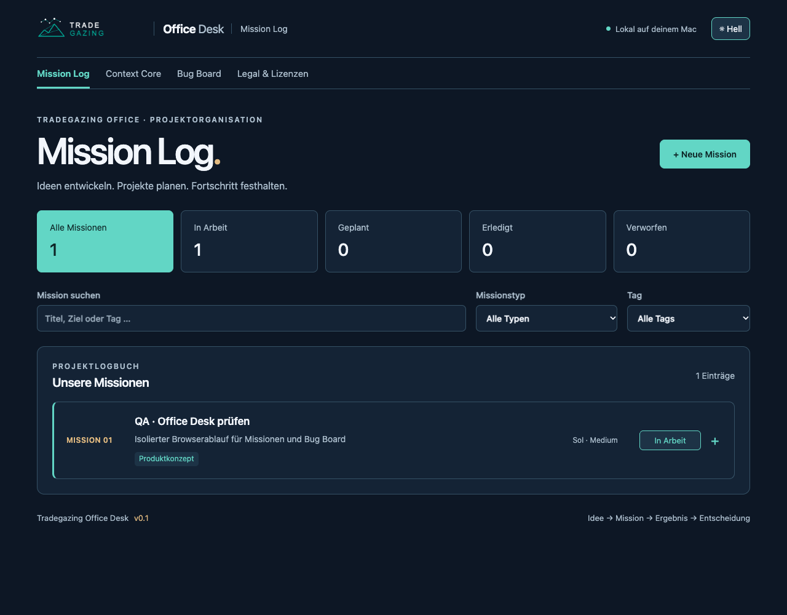
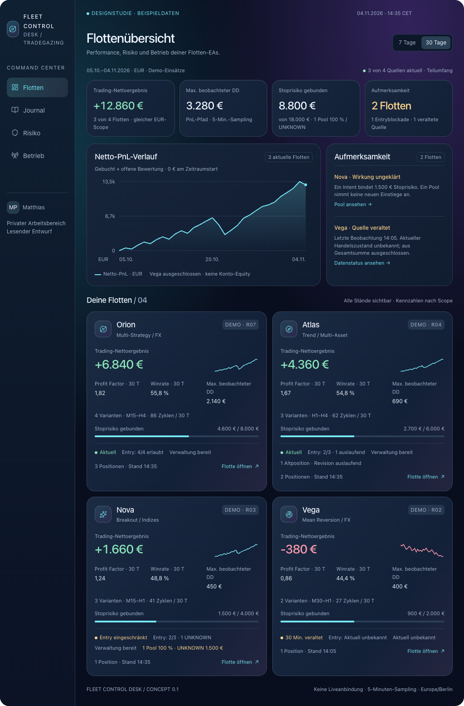

# Tradegazing Office

Backoffice und Buchhaltungsintegration für das geplante Prop-Trading-Einzelgewerbe von Matthias.

Repository: [matthiaspape/tradegazingoffice](https://github.com/matthiaspape/tradegazingoffice) · Standardbranch: `main`.

## Tradegazing Office Desk

Das lokale Desk verbindet Controlling und Projektmanagement. Aus dem Aunerio-Desk übernommen, mit dem Tradegazing-Bug-Board und den originalen Tradegazing-Logos ergänzt. Eigene SQLite-Datenbank und Zugangsschlüssel; keine übernommenen Missions-/Researchbestände.

**Controlling** steht vor **Projektmanagement**. [Fleet Control](http://127.0.0.1:43120/) ist die Startseite und dient zunächst als Platzhalter. Unter **Projektmanagement** liegen [Mission Log](http://127.0.0.1:43120/missions), Context Core, [Bug Board](http://127.0.0.1:43120/bugs) und Legal & Lizenzen.

Start, MCP/CLI, Datenablage und Prüfbelege: [TradegazingOfficeDesk/README.md](TradegazingOfficeDesk/README.md). Auf diesem Mac: `cd TradegazingOfficeDesk` und `./desk launch`; die Abhängigkeiten, Einrichtung und der Build müssen vorhanden sein. Die lokale Projektmanagement-Laufzeit ist Node.js 24+ mit React/vinext und SQLite.

Arbeitsweise seit Nutzerauftrag vom 04.11.2026: Neue Aufgaben erhalten automatisch eine thematische Mission; abgeschlossene Zwischenstände werden zeitnah committet. Nach fachlichem Abschluss folgen geordnetes Cleanup, finaler Commit/Push und administrativer Missionsabschluss. Details und Grenzen stehen in [AGENTS.md](AGENTS.md) und im [Missionsworkflow](TradegazingOfficeDesk/docs/MISSION_WORKFLOW.md).



## Fleet Control Desk

Erster Konzept- und Designstand vom 04.11.2026 für ein privates Trading Journal zur Kontrolle von Flotten-EAs und ihren Strategievarianten. Die klickbare Designstudie zeigt Flottenübersicht, Varianten, Risiko, Journal, Analyse und Betriebsdaten in Space-Glass-Optik. Alle Handelsdaten sind fiktiv.



- [HTML-Vorschau](design/fleet-control-desk/index.html): nach dem Checkout im Browser öffnen; kein Build oder Backend erforderlich.
- [Editierbare Entwurfsquelle](design/fleet-control-desk/fleet-control-desk.html), [Flottendetail](design/fleet-control-desk/fleet-detail-preview.png) und [mobile Risikoansicht](design/fleet-control-desk/mobile-preview.png).
- [Produkt- und Kennzahlenkonzept](docs/FleetControlDeskKonzept.md), [technische Datengrundlage](docs/references/FLEET_CONTROL_DESK_TECHNISCHE_GRUNDLAGE.md) und [Review-/Prüfbelege](docs/FleetControlDeskReview.md).

Die vorhandenen 39 Browserprüfungen und das unabhängige Dreamteam-Konzeptreview sind dokumentiert. Die historische Reviewentscheidung ist `CHANGES_REQUESTED`; nachfolgende Präzisierungen sind keine neue unabhängige Abnahme. Hosting, Collector und Liveanbindung sind noch nicht eingerichtet. Der Entwurf und die Projektgrundlagen wurden aus dem bisherigen Arbeitsordner übernommen; dessen Git-Historie gehört nicht zu diesem neuen Repository.

Backoffice und Trading Journal bleiben Architektur-/Designentwürfe. Das lokale Projektmanagement ist implementiert; daraus folgt keine Einrichtung von Bank-, Buchhaltungs-, Mail- oder MT5-Integrationen und keine Freigabe steuerlicher Regeln.

## Einstieg

- [ArchitekturDraft.md](ArchitekturDraft.md): Zielbild, Entscheidungen, Bank-/Mailanbindung, Tool-Skizze, steuerliche Prüfbereiche, Risiken und Umsetzungsschritte.
- [AGENTS.md](AGENTS.md): Arbeitsregeln für neue Entwicklungssessions und Pflege der Projektunterlagen.
- [DashboardPlan.md](docs/DashboardPlan.md): späteres privates Dashboard als Web-/App-Variante, Fünf-Minuten-Monitoring auf dem Windows-VPS und Login-Entwurf.
- [FleetControlDeskKonzept.md](docs/FleetControlDeskKonzept.md): Konzept vom 04.11.2026 für das private Flotten-EA-Journal „Fleet Control Desk“, Kennzahlen, Detailansichten und Space-Glass-Design. [Review und Prüfbelege](docs/FleetControlDeskReview.md) halten die unabhängige Konzeptprüfung und ihre Grenzen fest. Der grafische Draft verwendet fiktive Daten; keine Liveanbindung.

## Geplante Architektur

```text
FYRST BASE -------- EUR-Bankfeed -------+
                                       v
Wise Business ----- EUR-Bankfeed ---> sevdesk Pro ---> DATEV / Kanzlei
      |
      +-- USD/GBP/FX: berechtigte API oder Auszugsimport
                                       |
                                  Accounting-MCP <--> ChatGPT / gewählter Client
                                                           |
ALL-INKL Geschäftspostfach <---------- Mail-MCP <------------+
```

Wise → FYRST ist eine Umbuchung zwischen eigenen Geschäftskonten und keine zweite Einnahme. Die Steuerlogik wird anhand tatsächlicher Verträge vom Steuerberater freigegeben.

## Nächster fachlicher Schritt

Zuerst die Vertrags-/Steuerregeln und die vollständige Fremdwährungskette prüfen: USD-Payout → Wise-Bestand → FX/Gebühr → EUR-Umbuchung → sevdesk → DATEV-Testimport. Der direkte Wise-Lesezugriff für ein deutsches Profil ist offen; ein gewöhnlicher API-Token garantiert diesen Zugriff nicht.

Danach folgen ein lesender Accounting-/Mail-MVP und kontrollierte Entwürfe. Es gibt noch keine festgelegte Programmiersprache, Laufzeit oder Testanweisung.

Als spätere Ausbaustufe ist ein privates Dashboard gewünscht. Für das mögliche spätere Szenario drei VPS mit je drei MT5-Instanzen wird direkter iOS-/Mac-App-Zugriff auf lokale lesende VPS-APIs empfohlen. Der Transport ist offen: VPN oder öffentliches HTTPS mit Geräteautorisierung. Optional verschlüsselt der VPS Datenpakete für öffentliche Geräteschlüssel; private Entschlüsselungsschlüssel verbleiben in der geschützten Geräteablage. Mehrgerätezugriff und Wiederherstellung sind dabei noch zu klären. Auf Nutzerentscheidung verzichten wir auf Certificate/Public-Key-Pinning. Für Messpakete sind JSON und bei Bedarf GZIP vorgeschlagen, ZIP eher für Exporte. Die VPS sammeln alle fünf Minuten auch bei geschlossener App; die App führt die Ansichten zusammen. ALL-INKL bleibt Mailanbieter und optionaler Kandidat für zentrale Sammlung oder Webansicht. Nur Matthias soll Zugriff erhalten: widerrufbare Geräte-/API-Berechtigungen bei direktem Zugriff, Passkeys als Empfehlung für eine Web-/zentrale Anmeldung. Varianten und Login sind noch nicht umgesetzt oder abschließend ausgewählt. Handelsergebnis, genehmigter Payout, tatsächlicher Geldeingang und gebuchte Einnahme werden getrennt dargestellt. Umsetzung und Bereitstellung sind noch nicht gestartet.

## Daten und Zugänge

Dieses Repository enthält Quellcode, Dokumentation und bereinigte Beispiele. Zugangsdaten, echte Kontoauszüge, Rechnungen, persönliche Verträge und Laufzeitdaten werden in einer getrennten geschützten Ablage verwahrt. Die `.gitignore` unterstützt diese Trennung, ersetzt aber keine Prüfung vor jedem Commit.

Backoffice-Grundlagen: 03.10.2026; Fleet-Control-Desk-Konzept und lokales Office-Projektmanagement ergänzt am 04.11.2026. Ausführliche Quellen und offene Punkte stehen in den verlinkten Unterlagen. Eine produktive Backoffice-/Tradinganbindung und deren Produktionslaufzeit sind weiterhin offen.
