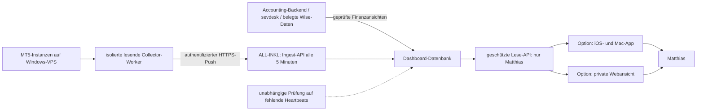
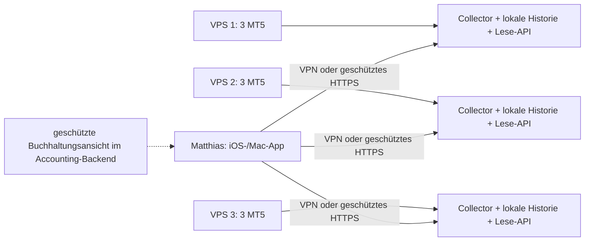

# Privates Office-Dashboard: Web-/App-Varianten und MT5-Monitoring

| Stand | 03.10.2026 |
| --- | --- |
| Status | Spätere Ausbaustufe; Anforderungen aufgenommen, technische Umsetzung als Entwurf |
| Grundlage | [ArchitekturDraft.md](../ArchitekturDraft.md), Nutzerangaben zu ALL-INKL Privat, eigenem Windows-VPS, Fünf-Minuten-Takt und möglicher iOS-/Mac-App |
| Umsetzung | Noch keine Webseite oder App, kein Collector, kein Login und keine Verbindung zu Hosting-/VPS-Konten eingerichtet |

## 1. Gewünschtes Zielbild

Matthias möchte später ein nur für ihn zugängliches Dashboard für die Finanzen seines Gewerbes und den Betrieb seiner MT5-Instanzen. Zunächst wurde eine Webseite gewünscht; alternativ werden jetzt eine iOS- und eine Mac-App mit ALL-INKL als Datenaggregator betrachtet. Die Wahl der Oberfläche ist noch offen. Der Nutzer hat einen Aktualisierungstakt von **fünf Minuten** festgelegt. ALL-INKL wird bereits für Mail genutzt; laut Nutzer besteht der Tarif **Privat** mit 50 GB Webspace. Die MT5-Instanzen laufen laut Nutzer auf einem **eigenen Windows-VPS**. Anzahl und Ressourcen der Instanzen sind noch offen.

| Bereich | Gewünschte Ansicht |
| --- | --- |
| Finanzübersicht | Einnahmen und Ausgaben nach Zeitraum, Entwicklung, offene Belege und Datenstand |
| Prop-Firmen | Tatsächliche Payouts je Firma; Zuordnung zu rechtlichem Partner, Vertrag und gegebenenfalls Trading-Konto |
| Trading-Übersicht | Konten, Balance, Equity, offene Positionen, Ergebnis und Drawdown |
| Handelsverlauf | Ausgeführte Deals, daraus abgeleitete Trades/Positionen, Kosten und Verlauf |
| Betrieb | MT5-Instanzen, Brokerverbindung, letzte Messung, VPS-Zustand und erkennbare Probleme |
| Detailansicht | Konto-/Instanzfilter, Equity-/Balance-Kurven, Ereignisse und bestätigte EA-Statusdaten |

Die Web-/App-Oberfläche ist eine zusätzliche Ansicht auf Buchhaltungs- und Monitoringdaten. sevdesk bleibt die zentrale operative Buchhaltung. Das Monitoring bekommt keine Handelssteuerung; der Dashboard-Zugriff dient zunächst ausschließlich dem Lesen.

Ergänzung vom 04.11.2026: Das [Fleet-Control-Desk-Konzept](FleetControlDeskKonzept.md) konkretisiert den Trading-/EA-Teil mit Mehrflottenübersicht, Strategievarianten, Poolrisiko, Journal und Betriebsdaten. Der klickbare grafische Draft ist eine Designstudie mit fiktiven Daten. Er ist keine produktive Website, native App oder vorhandene Monitoringanbindung; Hosting-/Clientwahl und der Fünf-Minuten-Takt werden dadurch nicht verändert.

## 2. Kennzahlen mit eindeutiger Bedeutung

| Kennzahl | Quelle / Definition |
| --- | --- |
| MT5-Handelsergebnis | Handelsdaten des jeweiligen Kontos; Kontowährung, Gebühren und Zeitraum ausdrücklich anzeigen |
| Erwartete Vergütung | Nur bei bekanntem Vertrag berechenbare Schätzung, etwa nach Profit Split; noch kein Geldeingang |
| Genehmigter Payout | Prop-Abrechnung/Bestätigung; noch nicht automatisch bei Wise/FYRST eingegangen |
| Tatsächlicher Payout | Mit Wise-/FYRST-Daten belegter Vergütungseingang, dem rechtlichen Partner zugeordnet |
| Gebuchte Betriebseinnahme | Nach fachlich freigegebener Regel in sevdesk erfasster Vorgang |
| Ausgaben / Kosten | Belegte betriebliche Ausgaben; Zahlungsabfluss und buchhalterische Erfassung unterscheidbar |
| Kontenliquidität | Nachgewiesene Bank-/Wise-Guthaben; eigene Umbuchungen nicht als zusätzliche Einnahme zählen |

Ein simuliertes Prop-Konto mit positivem MT5-Ergebnis ist kein entsprechendes Bankguthaben. Profit Split, Gebühren, Auszahlungsbedingungen und Abzüge können den tatsächlichen Payout beeinflussen. Das Dashboard darf aus MT5-PnL keine automatische Buchung ableiten.

Konten verschiedener Währungen werden einzeln gezeigt. Eine Gesamtsumme benötigt eine dokumentierte Umrechnung mit Kursdatum und muss als Auswertung gekennzeichnet sein. Trading-Performance und steuerliche EUR-Bewertung erhalten getrennte Regeln. Nettosummen, Umsatzsteuerstatus und Definition des Zeitraums werden sichtbar gemacht; das Dashboard ist keine ungeprüfte steuerliche Gewinnberechnung.

## 3. Hosting und vorgeschlagene Aufgabenverteilung

**Verifiziert in der öffentlichen Tarifbeschreibung:** ALL-INKL Privat nennt 50 GB Webspace, PHP, fünf MySQL-/MariaDB-Datenbanken und `.htaccess`. SSH ist nicht enthalten; Cronjobs und Let's-Encrypt-Unterstützung sind dort mit Aufpreis ausgewiesen. Der tatsächlich bestehende Vertrag und bereits gebuchte Optionen wurden nicht eingesehen. Quelle: [ALL-INKL Privat](https://all-inkl.com/webhosting/privat).

**Variante A, optionaler zentraler Aggregator:** ALL-INKL stellt eine geschützte Daten-API und eine Datenbank mit vorverarbeiteten Ansichten bereit; eine Webseite kann ergänzt werden. Der eigene Windows-VPS übernimmt die Datenerfassung alle fünf Minuten und gegebenenfalls periodische Backend-Aufgaben. Eine konkrete Sprache für die Webseite oder den Collector ist noch nicht verbindlich ausgewählt; PHP/MariaDB und die MT5-Python-Anbindung sind hier Machbarkeitskandidaten.



Der öffentliche Webspace wird nicht als vorausgesetzte Laufzeit für dauerhaft laufende Python-/Node-Prozesse oder einen persistenten WebSocket-Server betrachtet. Solche Fähigkeiten sind im bestehenden Tarif nicht nachgewiesen. Der Entwurf kommt zunächst mit kurzen HTTPS-Anfragen und regelmäßigen Abrufen durch die jeweilige Oberfläche aus. Build-Schritte können später lokal stattfinden; im Hosting werden nur benötigte Laufzeitdateien bereitgestellt.

50 GB sind für ein kompaktes Dashboard ein plausibler Ausgangspunkt. Entscheidend für die Machbarkeit sind zusätzlich Datenbankgrenzen, Anfragefrequenz, Rechenzeit und Indexierung. Tickdaten, komplette Terminal-Logs und unbegrenzte Messreihen sind nicht als dauerhafte Webspace-Ablage vorgesehen. Kostenpflichtige Optionen werden nicht durch dieses Dokument bestellt.

### 3.1 Variante: ALL-INKL als Aggregator, iOS-/Mac-App als Oberfläche

**Neue Nutzeridee, noch keine Entscheidung:** ALL-INKL kann ausschließlich Annahme, Speicherung und Bereitstellung der Daten übernehmen. Die Clients verbinden sich per HTTPS mit dieser API und niemals direkt mit der öffentlich freigegebenen Datenbank. Bank-/Mail-/MT5-Zugänge bleiben bei den jeweiligen Backend-Adaptern.

| Variante | Nutzen | Aufwand / offene Punkte |
| --- | --- | --- |
| Geschützte responsive Webseite | Eine Oberfläche für mehrere Geräte; zentral aktualisierbar | Browserdarstellung und Hosting prüfen |
| Native iOS- und Mac-App | Gute Geräteintegration und mögliche gemeinsame UI-/Modellbasis | Zwei Plattformen, Signierung, private Installation und Updates klären |
| Gemeinsame API, Apps und optionale Webansicht | Backend und Datenmodell bleiben für alle Oberflächen gleich | Weitere Oberfläche erst bei tatsächlichem Bedarf bauen |

**Gemeinsames Vorgehen als Entwurf:** Zuerst Collector, Datenmodell und geschützte API unabhängig von Oberfläche und zentraler Sammlung prüfen. Danach einen kleinen Client bauen; Swift/SwiftUI ist ein Kandidat für gemeinsame iOS-/macOS-Komponenten, noch keine festgelegte Laufzeit. ALL-INKL bleibt Hosting-Kandidat, keine bereits getestete Backend-Plattform. Lang laufende Synchronisation und unabhängige Ausfallprüfung benötigen weiterhin passende Dienste; die Apps werden nicht zu den zentralen Datensammlern.

Eine iOS-App kann während ihrer sichtbaren Nutzung alle fünf Minuten abrufen und beim Öffnen aktualisieren. Ein exakter Hintergrundtakt wird nicht zugesichert: iOS entscheidet über die Ausführung. Spätere Push-Meldungen benötigen einen gesonderten serverseitigen Meldeweg und sind keine garantierte Hintergrundmessung. Quelle: [Apple: Choosing Background Strategies](https://developer.apple.com/documentation/backgroundtasks/choosing-background-strategies-for-your-app).

### 3.2 Variante B: Apps fragen jeden VPS direkt ab

**Aktuelle Empfehlung als Entwurf, Transport noch offen:** Für einen Eigentümer und das mögliche spätere Szenario **drei VPS mit je drei MT5-Instanzen** ist eine zentrale ALL-INKL-Sammlung für das reine Monitoring nicht erforderlich. Diese neun Instanzen sind keine bestätigte Installation. Jeder VPS erhält lokale Erfassung, persistente Historie und eine kleine lesende API. Die App fragt die drei APIs parallel mit begrenzten Wartezeiten ab und führt die Ansichten zusammen.



Die Collector messen alle fünf Minuten **auch bei geschlossener App** und holen Deal-Historie nach. Die App liest gespeicherte Daten; sie spricht weder das Terminalprotokoll noch eine freigegebene Datenbank direkt an. Ohne lokale Erfassung würde während geschlossener Apps die Equity-Historie fehlen. Zwei Geräte dürfen dieselbe Historie unabhängig lesen. Lokaler Speicher ist noch auszuwählen.

| Frage | Direkte VPS-Abfrage | Zentrale Sammlung, zum Beispiel ALL-INKL |
| --- | --- | --- |
| Zusätzlicher Hosting-/Ingest-Betrieb | Entfällt für Monitoring | Zusätzliche API, Datenbank und Synchronisation |
| Quellen für die App | Drei einheitliche APIs; Teilfehler behandeln | Eine gemeinsame API mit Quellenstatus |
| Ein VPS fällt aus | Dessen nicht gecachte Historie vorübergehend unerreichbar | Bereits übertragene Historie bleibt verfügbar |
| Geschlossene App | Lokale Erfassung läuft weiter | Erfassung und Übertragung laufen weiter |
| Geräte und Backups | Gerätezugang und Historienbackup je VPS verwalten | Zusätzlich zentrale Ablage und Zugriff verwalten |
| Proaktive Alarme | Immer laufender Melde-/Prüfdienst zusätzlich nötig | Zentraler Dienst kann prüfen; muss tatsächlich laufen |
| Webansicht / weitere Clients | Zusätzliche Lösung erforderlich | Gemeinsame Quelle vereinfacht Ausbau |

**Option privates Netz:** Nur registrierte Eigentümergeräte erreichen die Lese-APIs über ein VPN; in dieser Variante werden Monitoring-API-Ports nicht frei ins Internet gestellt. Ein VPN ist keine Pflicht: geschütztes öffentliches HTTPS ist die Alternative aus Abschnitt 3.3. WireGuard unterstützt Windows, macOS und iOS. Tailscale ist ein weiterer Kandidat mit steuerbaren Netzwerkzugriffen; Anbieterabhängigkeit, geschäftliche Tarifnutzung, Gerätezahl und Erreichbarkeit sind vor Auswahl zu prüfen. Quellen: [WireGuard](https://www.wireguard.com/), [Tailscale: ACL policy examples](https://tailscale.com/docs/reference/examples/acls). Hier wird kein VPN eingerichtet.

Das VPN sichert den Netzweg; jede API muss zusätzlich Matthias' zugelassenes Gerät mit widerrufbaren Berechtigungen prüfen. Geräteverlust erfordert netz- und anwendungsseitigen Widerruf. Face ID / Touch ID kann lokal den Zugriff auf Zugangsnachweise schützen, ersetzt diese Prüfung aber nicht. Ein zentraler Website-Login ist für diese Variante nicht vorausgesetzt. Das konkrete Geräte-/API-Verfahren bleibt offen; Passkeys sind die Empfehlung für eine mögliche Web-/zentrale Anmeldung.

Die App zeigt je VPS Messzeit, Abrufzeit und Erreichbarkeit. Ausfälle sind keine Nullwerte oder vollständige Gesamtsumme. Beim Öffnen lädt sie sofort, während aktiver Nutzung alle fünf Minuten; ein lokaler Cache bleibt als veraltet erkennbar. Konto-/Deal-IDs, Historienseiten und Zeitzonen sind über alle VPS einheitlich. Ein VPS-Wechsel darf keine doppelte Kontohistorie erzeugen.

**Grenzen:** Lokale Historie braucht eigene Backups; VPS-Verlust darf nicht die einzige Datenkopie vernichten. Eine geschlossene App erkennt ohne unabhängigen laufenden Dienst keine Ausfälle und sendet keine verlässlichen Alarme. Andere VPS können einen einzelnen Host prüfen, aber keinen gemeinsamen Gesamtausfall zuverlässig melden. Für spätere Push-Alarme, unabhängige Ausfallkontrolle oder geräteunabhängige Historie kann ein kleiner zentraler Dienst sinnvoll werden; der muss nicht bei ALL-INKL laufen.

ALL-INKL bleibt der vorhandene **Mailanbieter**. Einnahmen, Ausgaben und tatsächliche Payouts kommen aus der Buchhaltungskette, nicht aus den MT5-VPS. Die App benötigt dafür einen separaten geschützten Backend-Leseweg; dessen Betriebsort bleibt offen. Provider-Secrets werden nicht in die Apps verlagert.

### 3.3 Alternative ohne VPN: HTTPS und optional nur in der App entschlüsselbare Daten

**Nutzeridee / geprüfte technische Grundlage, noch keine ausgewählte Umsetzung:** Eine öffentlich erreichbare, geschützte HTTPS-Lese-API kann VPN-Zugriff ersetzen. Gerätefreigabe bleibt erforderlich. Zusätzliche Nutzdatenverschlüsselung ist ein eigener Schutz für gespeicherte und übertragene Pakete; sie ist kein Ersatz für HTTPS oder Autorisierung. Für einen kleinen MVP genügt grundsätzlich HTTPS mit geprüftem Gerätezugang. Die zusätzliche Verschlüsselung wird nach dem gewünschten Schutz der historischen Daten gewählt.

```text
MT5 -> Collector -> Datenpaket -> Verschlüsselung mit öffentlichem Geräteschlüssel
                                          |
                              geschützte HTTPS-Lese-API
                                          |
                        iOS-/Mac-App: privater Schlüssel
                                          |
                              entschlüsseln und anzeigen
```

**Schlüsselmodell:** Die App erzeugt ein individuelles Schlüsselpaar je zugelassenem Gerät. Der VPS erhält nur dessen öffentlichen Verschlüsselungsschlüssel. Der private Entschlüsselungsschlüssel bleibt in der geschützten Geräteablage, gegebenenfalls mit einem gesondert vereinbarten verschlüsselten Wiederherstellungsbackup. Kein gemeinsamer Schlüssel wird im App-Code ausgeliefert. iPhone und Mac brauchen eine festgelegte Mehrgeräte-Lösung: Pakete werden für beide registrierten Empfänger verschlüsselt beziehungsweise ihr Inhaltsschlüssel für beide verpackt. Schlüssel für Entschlüsselung, Geräteanmeldung und VPS-Signaturen werden getrennt verwendet.

Geprüfte Verfahren aus einer gepflegten Bibliothek verwenden und ein versioniertes Paketformat festlegen; keine eigene Kryptografie entwerfen. libsodium Sealed Boxes zeigen beispielsweise Verschlüsselung mit dem öffentlichen Empfängerschlüssel und Entschlüsselung nur mit dem privaten Schlüssel. Sie beweisen allein aber nicht den Absender. Quelle: [libsodium: Sealed boxes](https://doc.libsodium.org/public-key_cryptography/sealed_boxes). Bibliothek, Plattformunterstützung und konkretes Format sind noch offen.

| Schutz / Verhalten | Vorgeschlagene Ausgestaltung |
| --- | --- |
| Transport und Gerätezugang | Gültiges HTTPS-Zertifikat, serverseitige Autorisierung und widerrufbare Geräteberechtigung; mTLS-Gerätezertifikate sind ein Kandidat. Nur lesende Monitoring-Endpunkte öffentlich bereitstellen |
| Inhalt und Herkunft | Authentisierte Verschlüsselung; zur unabhängig prüfbaren VPS-Herkunft zusätzlich Signaturen mit zuvor vertrauenswürdig eingerichteten VPS-Prüfschlüsseln |
| Aktualität | VPS-/Konto-ID, Paket-ID, Schema-/Schlüsselversion, Messzeit und Sequenz abgesichert mitführen; alte, doppelte oder fremde Pakete nicht als aktuelle Messung anzeigen |
| Geräteablage | Private Schlüssel im Apple-Schlüsselbund; Zugang und lokale Caches passend schützen. Face ID / Touch ID kann die Schlüsselnutzung absichern, ersetzt Geräteautorisierung nicht |
| Öffentlicher Betrieb | Server aktuell halten, Anfragen/Größen begrenzen, Authentifizierungsfehler behandeln und Admin-/Handelsendpunkte geschlossen halten |

Quellen: [OWASP: REST Security](https://cheatsheetseries.owasp.org/cheatsheets/REST_Security_Cheat_Sheet.html), [libsodium: Signatures](https://doc.libsodium.org/public-key_cryptography/public-key_signatures), [Apple: Keychain services](https://developer.apple.com/documentation/security/keychain-services/).

**Speicherung und Grenzen:** Nur nach diesem Verfahren abgelegte Pakete sind auf dem VPS ohne privaten Empfängerschlüssel nicht wieder entschlüsselbar. MT5 und der Collector sehen die Daten bei der Erfassung weiterhin im Klartext. Terminalhistorie, unverschlüsselte Collector-Datenbanken, Logs oder Backups werden dadurch nicht automatisch geschützt; ihre tatsächliche Speicherung ist separat zu prüfen. Ein kompromittierter Quell-VPS kann neue Messwerte verfälschen. Signaturen beweisen die eingerichtete Quelle, nicht die Wahrheit des Handelszustands. Die Verschlüsselung versteckt außerdem nicht sämtliche Metadaten wie Paketgrößen oder Abrufzeiten und verhindert keinen Serverausfall.

**Schlüsselverlust und neue Geräte:** Ohne passenden privaten Schlüssel oder vorbereiteten Wiederherstellungsweg bleibt verschlüsselte Historie unlesbar. Ein neues Gerät kann alte Pakete nicht allein mit einem neu registrierten Schlüssel öffnen; ein vorhandenes berechtigtes Gerät oder ein vereinbarter Wiederherstellungsweg muss den Zugriff ermöglichen. Beim Geräteverlust werden API-Zugang und künftige Empfängerschlüssel widerrufen. Bereits kopierte Pakete können mit einem gestohlenen alten Schlüssel weiterhin lesbar sein; Rotation löscht diese Fähigkeit nicht rückwirkend. Quelle: [OWASP: Key Management](https://cheatsheetseries.owasp.org/cheatsheets/Key_Management_Cheat_Sheet.html).

**Offene Abnahme:** Geräteaufnahme und Widerruf auf allen VPS; Zertifikatserneuerung; Manipulation, falsche Quelle und Replay; iPhone-/Mac-Zugriff auf dieselben Zeiträume; Wiederherstellung und Aufnahme eines neuen Geräts; Klartextreste und Backups. Kein Server wird durch diesen Entwurf öffentlich geschaltet. Die bisherige Empfehlung „VPN erforderlich“ ist ersetzt durch die Wahl zwischen VPN und abgesichertem HTTPS; zusätzliche App-Entschlüsselung bleibt optional.

### 3.4 HTTPS ohne Pinning und komprimierte Datenpakete

**Nutzerentscheidung:** Certificate/Public-Key-Pinning wird wegen zusätzlicher Komplexität und Wartung verworfen. Die bisherige Pinning-Option samt Ersatz-Pins, Pin-Updates und gesonderten Rotationstests entfällt. HTTPS mit normaler Zertifikatsprüfung einschließlich Zertifikatskette, Hostname und Gültigkeit sowie serverseitige Geräteautorisierung bleiben vorgesehen. Zusätzliche App-Entschlüsselung ist weiterhin ein separater Entwurf.

**Paketempfehlung als Entwurf:** Regelmäßige Fünf-Minuten-Messungen als versionierte JSON-Daten; Kompression nur bei messbarem Nutzen. Für größere Historienseiten ist GZIP ein Kandidat, ZIP für Exporte mit mehreren Dateien. Änderungen seit dem letzten Abruf vermeiden wiederholten Vollversand. Format, Grenzen und Performance sind noch nicht getestet.

```text
JSON -> optional GZIP -> authentisiert verschlüsseln / Herkunft absichern -> HTTPS
App: Herkunft/Integrität prüfen und entschlüsseln -> begrenzt entpacken -> Schema prüfen
```

ZIP/GZIP ist Kompression beziehungsweise Verpackung, kein Ersatz für das vereinbarte Verschlüsselungsverfahren. Nutzdaten werden vor zusätzlicher App-Verschlüsselung komprimiert; verschlüsselte Bytes lassen sich gewöhnlich kaum sinnvoll verkleinern. Schema- und Kompressionsversion sowie Größenlimits gehören zum geprüften Paketvertrag. Keine Zugangstokens oder sonstigen Secrets in die komprimierten Messdaten aufnehmen.

Bei reinen JSON-HTTPS-Antworten kann `Content-Encoding: gzip` die HTTP-Kompression kennzeichnen. Bei zusätzlich verschlüsselten Paketen bleibt die innere Kompression Teil des verschlüsselten Paketformats; der gesamte Ciphertext wird nicht fälschlich als GZIP-Antwort deklariert. Quelle: [RFC 9110: Content-Encoding](https://www.rfc-editor.org/rfc/rfc9110.html#section-8.4).

Beim Entpacken gelten überprüfte Grenzen für Übertragungsgröße, tatsächlich entpackte Bytes und Ressourcenverbrauch. Falls ZIP genutzt wird: nur erwartete Dateien zulassen, keine Pfadüberschreibung außerhalb des Zielbereichs, keine ausführbaren Inhalte oder beliebige verschachtelte Archive. Kleine Archive können sehr große entpackte Daten erzeugen. Quelle: [OWASP: File Upload / Größenlimits](https://cheatsheetseries.owasp.org/cheatsheets/File_Upload_Cheat_Sheet.html).

## 4. Datenerfassung auf dem eigenen Windows-VPS

### 4.1 Kandidat: separater Collector mit MT5-Python-Anbindung

Die offizielle MetaQuotes-Dokumentation beschreibt eine lokale Terminalanbindung und unter anderem `account_info`, `terminal_info`, `positions_get`, `orders_get`, `history_orders_get` und `history_deals_get`. Quellen: [MT5-Python-Integration](https://www.mql5.com/en/docs/python_metatrader5), [Kontoinformationen](https://www.mql5.com/en/docs/python_metatrader5/mt5accountinfo_py), [Terminalinformationen](https://www.mql5.com/en/docs/python_metatrader5/mt5terminalinfo_py).

Vorgeschlagene Umsetzung:

- Je Terminal ein isolierter Worker mit eindeutigem Terminalpfad, Datenverzeichnis und erwartetem Konto/Brokerserver. Vor jeder Zuordnung die tatsächliche Identität prüfen.
- Vorhandene Instanzen lesen; kein Login-Wechsel, kein Neustart und kein unerwarteter Terminalstart als Nebenwirkung der Erfassung. Initialisierungsverhalten im Versuch gezielt prüfen.
- Lokale persistente Historie unabhängig von App-Abrufen. Bei zentraler Variante zusätzlich Warteschlange und asynchrone Übertragung außerhalb des Handelsprogramms.
- Bei zentraler Variante und Ausfall des Hostings weiter lokal puffern, begrenzt wiederholen und fehlende Historie später abgleichen.
- CPU/RAM/Datenträger und Prozesszustand zusätzlich vom Betriebssystem beziehen, sofern Rechte und Ressourcen geprüft sind.
- Zulässigkeit gemäß Prop-Vertrag und Auswirkungen auf das VPS-System vor Einsatz prüfen.

Ein externer Collector vermeidet Änderungen am vorhandenen Handels-EA. Die API enthält auch Handelsfunktionen; der eigene Adapter bietet ausschließlich die benötigten Leseoperationen an. Eine laufende Terminalverbindung ist kein Beweis dafür, dass ein bestimmter EA auf einem Chart aktiv ist oder korrekt arbeitet.

### 4.2 Optionale EA-Telemetrie

Für genaue EA-Heartbeats, Strategieversion, letzte erfolgreiche Verarbeitung oder interne Fehler kann ein kleiner Telemetriebaustein beziehungsweise ein gesonderter Monitoring-EA sinnvoll sein. Ob dessen Status die relevante Handelsstrategie tatsächlich repräsentiert, muss geprüft werden. Das ist eine spätere, ausdrücklich abgestimmte Integration.

MQL5 unterstützt Handelsereignisse über `OnTradeTransaction`. Die Ereignisfolge ist nicht garantiert; eine Handelsaktion kann mehrere Ereignisse auslösen. Deshalb bleiben stabile Deal-/Order-/Positions-IDs und ein Historienabgleich nötig. Quelle: [MQL5: OnTradeTransaction](https://www.mql5.com/en/docs/event_handlers/ontradetransaction).

`WebRequest` ist synchron und benötigt freigegebene Ziel-URLs. Netzwerkübertragung wird deshalb nicht blockierend im Handelsereignis-Handler der Strategie eingeplant. Quelle: [MQL5: WebRequest](https://www.mql5.com/en/docs/network/webrequest).

## 5. Was „Live“ bedeuten soll

| Datenklasse | Vorgeschlagenes erstes Ziel | Wichtige Anzeige |
| --- | --- | --- |
| Equity, Balance, Positionen, Instanzzustand | Alle fünf Minuten, vom Nutzer festgelegt | Messzeitpunkt und Empfangszeitpunkt |
| Neue Deals / Handelsereignisse | Alle fünf Minuten: Historie seit dem letzten bestätigten Abruf abgleichen | Erfassungsverzögerung und letzte Historienabdeckung |
| Broker-/EA-/VPS-Status | Fünf-Minuten-Heartbeat und getrennte Signale, soweit verfügbar | Verbunden, veraltet, gestört oder unbekannt |
| Buchhaltung und Payouts | Separater regelmäßiger Abgleich entsprechend der Quellen | Letzter Bankfeed-/API-/Importstand |
| Web-/App-Darstellung | Alle fünf Minuten bei aktiver Nutzung; zusätzlich beim Öffnen / manuell | Kein eigener vollständiger Provider-Sync bei jedem Abruf |

Der Fünf-Minuten-Takt ersetzt den früher vorgeschlagenen Takt von 15–30 Sekunden. Er gilt für MT5-Messungen, aktive Abrufe und gegebenenfalls zentrale Übertragung; Buchhaltungsquellen behalten ihre eigenen Aktualisierungsgrenzen. Messung, Übertragung und Anzeige werden zeitlich aufeinander abgestimmt, damit sich Wartezeiten nicht unnötig addieren. Datenalter bleibt sichtbar; Netzwerkfehler oder inaktive Apps können zusätzliche Verzögerung verursachen. Warnschwellen für fehlende Heartbeats werden mit Toleranz oberhalb des normalen Takts separat festgelegt. Das Dashboard darf bei ausbleibenden Messungen nicht den letzten grünen Zustand als aktuell darstellen.

Der Historienabruf soll auch Deals erfassen, die vollständig zwischen zwei Messungen stattfinden. Dazu braucht er einen persistenten Abrufstand, überlappende Zeitfenster und Dublettenabgleich. Eine nur kurz offene Position kann in den Positions-Snapshots fehlen, obwohl ihr Deal in der Historie erscheint. Fünf-Minuten-Equity bildet Zwischenhochs/-tiefs nicht vollständig ab; daraus folgt keine lückenlose Überwachung von Prop-Risikolimits.

Überwachung besteht aus unabhängigen Signalen: Collector erreichbar, Terminalprozess vorhanden, Broker verbunden, Marktdaten frisch, EA bestätigt aktiv. „Kein Trade“ ist ohne Strategie-/Handelszeitkontext kein Fehler. Am Wochenende können alte Kurse normal sein, während ein fehlender System-Heartbeat weiterhin einen Ausfall anzeigen kann.

Ein Messdienst auf dem VPS kann einen vollständigen Ausfall seines eigenen Hosts nicht selbst melden. Für proaktive Ausfallalarme ist daher eine Prüfung außerhalb dieses VPS erforderlich, beispielsweise ein passend gebuchter Hosting-Cronjob oder ein anderer unabhängiger Dienst. Ohne diese Prüfung erkennt die Web-/App-Oberfläche veraltete Daten erst beim nächsten Abruf. Versandkanal und Benachrichtigungsregeln sind offen; hier wird keine laufende Überwachung oder Automation eingerichtet.

## 6. Equity-Kurven und Historie

- Equity und Balance werden als getrennte zeitgestempelte Messreihen je Konto gespeichert.
- Aus abgeschlossenen Deals lässt sich keine exakte historische Intraday-Equity samt zwischenzeitlichen offenen Verlusten rekonstruieren. Die gemessene Equity beginnt mit der Erfassung; vorherige Zeiträume und Lücken werden sichtbar markiert.
- Einzahlungen, Auszahlungen, Gebühren, Kontoresets und neue Challenge-/Funded-Phasen werden als eigene Ereignisse geführt. Kontowechsel erhalten getrennte Segmente.
- Rohkurven und um Cashflows bereinigte Performance werden unterscheidbar angezeigt. Die Berechnungsmethode wird dokumentiert.
- Deals bleiben Originalereignisse; „Trade“/„Position“ wird daraus definiert abgeleitet. Teilfüllungen und Teilglattstellungen dürfen die Zählung nicht verfälschen.
- Drawdown wird für eine definierte Kurve berechnet. Prop-Vertragslimits benötigen eigene Regeln einschließlich Tagesgrenze, Zeitzone, Equity/Balance-Basis und gegebenenfalls trailing/static-Mechanik. Es wird kein universelles Firmenlimit angenommen.
- Fünf-Minuten-Messwerte werden nach definierter Frist verdichtet. Maxima/Minima und die Auflösung bleiben nachvollziehbar; Spitzenverluste zwischen zwei Messungen sind nicht sicher erfasst.

## 7. Schnittstelle und Datenmodell – Entwurf

| Datensatz | Mindestinformationen |
| --- | --- |
| `instance` | Stabile Instanz-ID, VPS-ID, erwarteter Terminalpfad/Konto/Broker, Status |
| `account_mapping` | Trading-Konto → Prop-Marke → rechtlicher Partner/Vertrag; gültiger Zeitraum und Challenge-/Funded-Phase |
| `account_snapshot` | Kontowährung, Balance, Equity, Margin, freie Margin, offene PnL, `observed_at`, `received_at`, Datenqualität |
| `deal` | Konto/Brokerserver + Deal-ID, Order-/Positions-ID, Typ, Symbol, Volumen, Zeit, Ergebnis, Kommission, Swap und sonstige Gebühren |
| `health_event` | Signaltyp, Schweregrad, Beginn/Ende, Instanzbezug, bereinigte Diagnose und letzter Heartbeat |
| `finance_summary` | Zeitraum, Regel-/Quellstand, tatsächliche Payouts, gebuchte Einnahmen, Ausgaben, offene Belege, Währungsbasis |

HTTP-Skizze für eigene Endpunkte, keine vorhandene API. Bei direkter Abfrage stellt jeder VPS seine MT5-Leseendpunkte bereit. Finanz-/Gesamtansichten gehören gegebenenfalls zu einem separaten Backend; Ingest- und Passkey-Endpunkte gelten nur für die entsprechende zentrale/Web-Variante:

```text
POST /api/ingest/mt5/batches        # nur registrierte Collector; keine Handelsbefehle als Antwort
GET  /api/dashboard/overview       # nur angemeldeter Nutzer
GET  /api/dashboard/prop-firms     # Payouts und Buchhaltung nach Partner/Marke
GET  /api/mt5/instances            # Status und Datenalter
GET  /api/mt5/accounts/{id}/equity # Zeitraum, Auflösung, Lücken
GET  /api/mt5/accounts/{id}/deals  # paginiert, stabile IDs
GET  /api/monitoring/incidents    # Probleme und Auflösungen
POST /auth/passkey/options       # kurzlebige, einmalige Anmelde-Challenge
POST /auth/passkey/verify        # Prüfung und eigene Sitzung
POST /auth/logout               # Sitzung serverseitig widerrufen
```

Eine optionale zentrale Ingest-API akzeptiert begrenzte Batches mit Schemaprüfung, Collector-Authentifizierung, Zeit-/Replay-Prüfung und Idempotenz. Eine eingehende Meldung wird nicht allein aufgrund einer Konto-ID einem fremden Konto zugeordnet. Mess- und Empfangszeit bleiben getrennt; technische Speicherung erfolgt mit eindeutiger UTC-Zeit, Anzeige für Matthias standardmäßig Europe/Berlin. Broker-/Prop-Tagesgrenzen werden separat abgebildet.

## 8. Privater Zugang und Datenhaltung

„Privat“ heißt hier angemeldeter, autorisierter Zugriff auf Seiten **und alle Datenendpunkte**. Eine schwer zu erratende Subdomain, `robots.txt` oder eine Login-Seite vor ansonsten frei zugänglichen JSON-Dateien genügt nicht.

### 8.1 Web-/zentrale Anmeldung nur für Matthias – Empfehlung, noch nicht eingerichtet

Direkter App-Zugriff nutzt stattdessen das Geräte-/API-Modell aus Abschnitt 3.2 beziehungsweise 3.3. Die folgenden Anmeldeverfahren sind keine Pflicht für jeden einzelnen VPS.

| Verfahren | Einordnung für dieses Projekt |
| --- | --- |
| Passkey mit verpflichtender Geräteprüfung | Bevorzugter Entwurf: Geräte-PIN oder Biometrie; phishingresistente Anmeldung ohne Website-Passwort |
| Passwort + TOTP aus Authenticator-App | Alternative mit zwei Faktoren; mehr Eingaben und anfälliger für Phishing. Kein automatisch aktivierter Ersatzweg |
| Sign in with ChatGPT | Website-OIDC ist dokumentiert, benötigt aber einen registrierten Client. Aktuell ausgewählte kommerzielle Partner / Warteliste; Zugang für dieses Projekt nicht nachgewiesen |

Passkeys verbinden Geräteschlüssel mit Benutzerprüfung. Für dieses Projekt wird `userVerification=required` vorgeschlagen. Ein zweiter Passkey beziehungsweise ein separater Sicherheitsschlüssel dient als Ersatz bei Geräteverlust; der Wiederherstellungsweg muss vor Betrieb geprüft werden. Quelle: [OWASP: Multifactor Authentication](https://cheatsheetseries.owasp.org/cheatsheets/Multifactor_Authentication_Cheat_Sheet.html).

Die Registrierung des einzigen Eigentümerkontos erfolgt über einen geschützten Einrichtungsweg; danach keine öffentliche Selbstregistrierung. Das Backend erlaubt ausschließlich diesem Konto den Zugriff. Weitere Passkeys werden erst nach erneuter Anmeldung hinzugefügt; unbekannte Konten bleiben gesperrt. Ein gültiger Login allein ersetzt diese Autorisierung nicht.

Apple beschreibt Passkeys für native Apps über AuthenticationServices und eine zugeordnete Domain. Die App benötigt passende Associated Domains und der Server die Domain-Zuordnung; im gewählten Hosting und auf den vorgesehenen Geräten testen. Quelle: [Apple: Supporting passkeys](https://developer.apple.com/documentation/authenticationservices/supporting-passkeys). Face ID / Touch ID zum Entsperren einer App allein ersetzt keine serverseitige Anmeldung.

Für ChatGPT-Website-Login gelten OAuth/OIDC, Tokenprüfung und anschließend eine eigene Anwendungssitzung. Nur eine explizit verknüpfte, geprüfte externe Identität dürfte auf Matthias' Konto zugreifen; ein E-Mail-Match genügt nicht. Kein beliebiges ChatGPT-Konto bekommt Zugang. Der gesonderte Open-Source-App-Flow zur Nutzung des ChatGPT-Plans wird nicht als Freischaltung des Website-Logins behandelt. Quellen: [OpenAI: On your website](https://developers.openai.com/siwc/website), [OpenAI: Request a client ID](https://developers.openai.com/siwc/request-client-id). Wegen des offenen Anbieterzugangs wird dieser Login nicht als Voraussetzung eingeplant.

### 8.2 Sitzungen und getrennte Zugänge – Entwurf

HTTPS ist für alle Clients erforderlich. Browser erhalten eine serverseitig widerrufbare Sitzung mit `Secure`, `HttpOnly` und passendem `SameSite`-Cookie sowie Schutz zustandsändernder Anfragen. Ablaufzeiten und erneute Anmeldung werden serverseitig geprüft; automatische Fünf-Minuten-Abrufe dürfen eine Sitzung nicht unbegrenzt verlängern. Quelle: [OWASP: Session Management](https://cheatsheetseries.owasp.org/cheatsheets/Session_Management_Cheat_Sheet.html).

Native Clients erhalten eigene widerrufbare Sitzungen; Berechtigungsnachweise werden über den geschützten Gerätespeicher verwaltet. Kein dauerhaftes gemeinsames API-Geheimnis wird in eine App eingebaut. Login-Begrenzung, Logout, Geräteverlust, abgelaufene und widerrufene Sitzungen müssen auf API-Ebene funktionieren. Konkrete Bibliotheken, Sitzungszeiten und Wiederherstellung bleiben offen.

Collector-Zugang und Nutzerzugang erhalten getrennte Berechtigungen: Collector darf nur zugeordnete Messdaten liefern, Matthias darf Ansichten lesen. Kein App- oder Browserzugang darf aus diesem Entwurf Handelsbefehle ausführen.

Bank-/sevdesk-/MT5-Zugangsdaten gelangen nicht in Browsercode oder Messpakete. Der Collector sendet nur erforderliche Kennzahlen und bereinigte Diagnosen, keine vollständigen Terminal-Logs mit möglichen Zugangsinformationen. Datenbank und Originalbelege werden nicht öffentlich als Dateien ausgeliefert. Aufbewahrung und eigene Backups werden festgelegt; Webspace ist kein automatisch vollständiges Belegarchiv.

## 9. Ausbaufolge und offene Punkte

1. Anzahl der Instanzen, Terminalpfade, VPS-Ressourcen, Prop-Konten und erlaubte Datenerfassung erheben.
2. Für direkten Zugriff VPN oder geschütztes HTTPS wählen; Gerätefreigabe, API-Erreichbarkeit und gegebenenfalls App-Entschlüsselung/Schlüsselwiederherstellung prüfen. ALL-INKL-Vertragsoptionen nur bei zentraler/Web-Variante prüfen: HTTPS, PHP-/Datenbankversionen, Datenbanklimits, Anfrage-/Ressourcengrenzen und Bereitstellungsweg.
3. Ersten Collector für eine Testinstanz lesend erproben: richtige Kontoidentität, Historie, Messlücken, Neustarts und Ressourcenverbrauch.
4. Eigentümer-/Gerätezugang, Wiederherstellung, Widerruf und geschützte API für die gewählte Variante prüfen; Passkeys bei Web-/zentraler Anmeldung testen; dann einen Web- oder App-Client mit Status, Positionen und gemessener Equity ergänzen. Für Apps private Installation, Signierung und Updates klären.
5. Geprüfte Buchhaltungsansichten und Payouts pro Prop-Firma einbinden; eigenes Transfergeld nicht als Umsatz zählen.
6. Unabhängige Ausfallprüfung, EA-Telemetrie und gewünschte Benachrichtigungen gezielt ergänzen.

Offen bleiben Anzahl der Instanzen, Umfang einer bestehenden Monitoringlösung im Tradegazing-Projekt, konkrete Prop-Verträge, benötigte EA-Signale, Aufbewahrungsdauer, gewünschte Alarmkanäle und die endgültige Laufzeit-/Hosting-/Oberflächenentscheidung. Auth-Bibliothek, Passkey-Geräte, Ersatzschlüssel und Wiederherstellung sowie gegebenenfalls Apple-Entwicklerkonto und App-Verteilung bleiben offen. Eine zusätzliche kostenpflichtige Hostingstufe ist nicht beschlossen.

**Abnahme vor produktivem Monitoring:** richtige Kontozuordnung; keine Handels-/Login-/Neustart-Nebenwirkungen; kein Datenzugriff ohne Anmeldung oder als fremdes Konto; sichere Einrichtung ohne offene Registrierung; gewähltes Geräte-/Login-Modell, Wiederherstellung und Widerruf getestet; App-Sperre und Nutzdatenverschlüsselung ersetzen keine API-Autorisierung; bei verschlüsselten Paketen Herkunft, Replay, Mehrgerätezugriff und Schlüsselwiederherstellung getestet; bei Kompression Entpackgrenzen und Fehlerfälle geprüft; Fünf-Minuten-Historienabruf erfasst zwischenzeitliche Deals; doppelte Übertragung ohne Dubletten; Offline-Puffer und Historiennachholung; sichtbar veraltete Daten; nachvollziehbare Kurvenlücken; festgelegte Performance- und Drawdown-Definitionen. Buchhaltungsfunktionen behalten zusätzlich ihre bisherigen fachlichen Abnahmekriterien.

## 10. Quellenstand

Nutzerangaben und verlinkte Primärquellen von ALL-INKL, MetaQuotes, Apple, OpenAI, OWASP, WireGuard, Tailscale, libsodium und RFC 9110, geprüft am 03.10.2026. Bestehende Hosting-/VPS-Konfigurationen und Anbieterzugänge wurden nicht geöffnet oder getestet. Fünf Minuten und Zugang nur für Matthias sind Nutzeranforderungen; Aufgabenverteilung, Login-Empfehlung, Datenmodelle und Endpunkte bleiben ungetestete Entwürfe.
