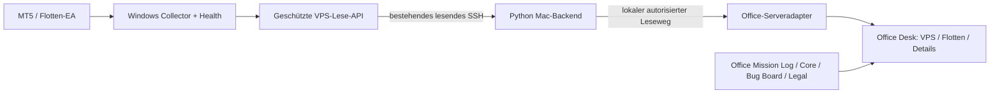

# Fleet Control im Tradegazing Office · gemeinsames Konzept

Stand 14.11.2026 · Office-Mission 7 · Version 1.0 · Konzept zur Abstimmung

[Klickbare Vorschau](../design/fleet-control-unified/index.html) · [Mission 7](http://127.0.0.1:43120/missions?mission=7)

## 1. Ein gemeinsamer Einstieg

Matthias öffnet das **Tradegazing Office Desk**. Fleet Control zeigt zuerst die VPS und darin ihre Flotten. Damit stehen Handelsstand und die dafür verantwortliche Infrastruktur unmittelbar zusammen. Der gemeinsame Office-Rahmen aus Mission 6 bleibt die Oberfläche. Collector, geschützte Lesewege und VPS-Health aus Mission 650 liefern die technische Grundlage.

**Verbindlich vorgegeben** sind Office als Ort des Projektmanagements, die verschachtelten Karten, ihre Pflichtfelder und die beiden Klickwege. Die nachfolgenden Kennzahlendefinitionen, technische Aufteilung und Ausbaufolge sind ein **Konzeptvorschlag**. Ein Review dieses Dokuments ist keine Nutzerabnahme dieser Produktentscheidungen und keine Betriebsfreigabe.

Das Ergebnis dieser Mission umfasst Konzept und lokale Designvorschau. Die laufenden Desks, Datenbanken, Dienste und MT5-Instanzen werden dafür nicht verändert. Historische Missionen werden nicht verschoben oder neu eröffnet.

## 2. Vorhandene Bausteine und Zielverantwortung

| Baustein | Belegter Ausgangspunkt | Verwendung im Zielbild |
| --- | --- | --- |
| Office-Mission 6 | Office Desk auf 43120, React/vinext, Node.js 24+, eigener SQLite-Bestand. Gemeinsamer DeskShell, Originalmarke, responsive Navigation, Hell/Dunkel. Fleet Control enthält feste Beispiele. | Führende Oberfläche und alle Projektmanagementfunktionen. Bestehende Formulare/APIs bleiben in Office. |
| Tradegazing-Mission 650 | Python-Schicht im getrennten Arbeitsordner `/Users/matthiaspape/Tradegazing Office/fleet_desk/`. Mac-Backend auf 8766, automatischer lesender SSH-Abruf. Collector und reine API auf Windows. Native Hostmessung belegt. | Messung, Transport und vorhandene Leseprojektion weiterverwenden; Office rendert deren fachlich aufbereitete Daten. |
| EA-/Flottenquelle | `WAITING_FOR_EA_EXPORTS`, noch keine gebundenen aktuellen EA-Exporte. Flottenidentität, Brokeranzeige, Betriebsstatus und vollständige Tageswerte nicht durch Hostmessung belegt. | Erste Integration zeigt echte VPS-Health und einen ehrlichen leeren Flottenbereich. Demo bleibt ein getrennt benannter Modus. |
| Projektverwaltung | Mission Log, Context Core, Office-Bug-Board und Legal unter Office. | Planung, Implementierungsaufträge und neue Office-Befunde ausschließlich dort führen. M650 bleibt historische technische Referenz. |

Quellen: [Office-UX](TradegazingOfficeDeskUX.md), [M6-Umsetzungsnachweis](../TradegazingOfficeDesk/docs/FLEET_DEMO_VALIDATION.md), [Office-Fachkonzept](FleetControlDeskKonzept.md), [M650-Macbetrieb](</Users/matthiaspape/Tradegazing Office/docs/operations/FleetDeskMac.md>), [Retention](</Users/matthiaspape/Tradegazing Office/docs/operations/FleetDeskRetention.md>). Der Codeabgleich für dieses Konzept umfasst insbesondere `projection.py`, `health.py`, `mac_desk.py`, `server.py` im M650-Arbeitsordner und `DeskShell.tsx`/`FleetControl.tsx` im Office Desk. Er ist keine erneute Betriebsprüfung.

## 3. Übersicht: VPS als Rahmen, Flotten als Karten

Die bestehende Reihenfolge **Controlling → Projektmanagement** bleibt. Fleet Control ist Startseite. Innerhalb von Controlling stehen Übersicht, Journal, Risiko sowie Betrieb & Daten; VPS-Health ist über die VPS-Details direkt erreichbar. Das Logo führt zur Übersicht zurück.

Der Kopf nennt Einsatzart, Kontowährung, Datenstand und „Abruf alle 5 Minuten“. Ein kompakter Hinweis zählt VPS/Flotten mit Datenrückstand. Der erste Ausbau hat keine flottenübergreifenden Geldsummen: Die Karten liefern die gewünschte Übersicht, ohne gemeinsame Konto-Equity doppelt zu zählen. Live, Demo und Research bleiben getrennt.

### Äußere VPS-Karte

| Pflichtfeld | Anzeige |
| --- | --- |
| Name des VPS | Hervorgehobener Link, etwa „Atlas VPS →“. Öffnet dessen Detailseite. |
| IP | Registrierte Anzeigeadresse; keine Zugangsdaten. Bei fehlender Registrierung „IP nicht hinterlegt“. |
| CPU-Last | Mittelwert des letzten verfügbaren Fünf-Minuten-Fensters in Prozent, mit Fensterzeit und Messabdeckung. Keine Beschriftung als sekundengenauer Livewert. |
| RAM-Last | Belegter letzter physischer Verbrauch als Prozent und belegt/gesamt in GiB. Commit/Limit gehört separat ins Detail. |
| Festplattenverbrauch | Belegt/gesamt und Prozent je relevantem Volume. Im Kopf das registrierte Hauptvolume; weitere Volumes direkt darunter, keine Addition über überlappende Laufwerke. |

Ein Datenchip nennt „Aktuell“, „Veraltet“, „Noch keine Messung“ oder „Abruf fehlgeschlagen“. Eine Warnung wegen Ressourcenknappheit bleibt von der Messfrische getrennt. Darunter folgen die Flottenkarten im selben Rahmen. Ein VPS ohne EA zeigt weiterhin Health und „Noch keine EA-Exportquellen angebunden“.

### Innere Flottenkarte

Jede Karte enthält **Flottenname, Broker, Status Active/Inaktive/Failure, kleine Equity-Curve, aktuelle Balance, aktuelle Equity, Profit heute und Unrealized PnL**. Name und Broker stehen oben, Balance/Equity bilden die erste Zahlenzeile, Profit heute/offenes PnL die zweite. Die Vorschaukurve steht darunter. Währung, Datenstand und Kurvenbasis sind unmittelbar sichtbar. Die ganze Karte ist genau ein semantischer Link mit sichtbarem Tastaturfokus, ohne verschachtelte Buttons.

Der Statuschip zeigt das zuletzt belegte Betriebssignal; ein eigener Datenchip ergänzt dessen Alter. Nicht verfügbare Werte sind „—“ mit Grund. Historische Zahlen einer veralteten Quelle stehen unter „Letzter belegter Stand“, nicht als aktuelle Werte. Eine Quellenlücke löscht keine Karte.

**Karteneinheit:** Im ersten Anschluss ein Flotteneinsatz auf einem Konto und einem VPS. Name plus Einsatzkennung identifizieren die Karte. Läuft dieselbe logische Flotte auf mehreren VPS/Konten, erscheint ihr jeweiliger Einsatz unter dem zuständigen VPS, ausdrücklich als Einsatz derselben Flotte. Im Flottendetail sind die anderen Einsätze verlinkt. Bei einem Hostwechsel wandert die aktuelle Einsatzkarte zum neu gebundenen Host; die Historie behält die alte Hostbindung. Gleichzeitige widersprüchliche Bindungen erscheinen als Konflikt, nicht als zwei unabhängige Flotten. Ohne VPS-Bindung bleibt eine Karte in „VPS-Zuordnung offen“ sichtbar.

### Responsive und Interaktion

Ab breiter Desktopansicht stehen höchstens zwei Flotten nebeneinander je VPS-Rahmen, VPS-Rahmen untereinander. Bei 320–700 px folgen Hostwerte und Flotten einspaltig; die vier Flottenwerte bleiben als Zweierspalten lesbar, bei Bedarf einspaltig. IPs brechen um, Tabellen scrollen nur in ihrem Bereich. Das mobile Menü benennt Controlling und Projektmanagement unverändert.

VPS-Namenslink und Flottenkarten sind getrennte Ziele; ein Flottenklick öffnet nicht zusätzlich den VPS. Enter aktiviert den fokussierten Link. Es gibt keine Hoverpflicht. Touchziele sind mindestens 44 px hoch. Diagramme ergänzen Text mit Zeitraum, Start/Ende und Datenlücken. Navy/Teal, Original-Logo, klare Zahlen und zurückhaltende Glasflächen folgen M6; Status enthält immer Text. Hell-/Dunkelmodus gilt im gesamten Office.

## 4. Detailseiten und Wege

| Seite | Inhalt und Navigation |
| --- | --- |
| **VPS-Detail** | Name, Anzeige-IP, letzte Beobachtung/Abholung, Hardwarekontext und Quellenzustand. CPU-Verlauf mit Mittel/Maximum je Fenster, RAM-Verbrauch/Reserve und Commit, belegter/freier Platz je Volume, I/O soweit vorhanden. Messabdeckung und Lücken immer mitführen. |
| **VPS → Prozesse** | Zugeordnete MT5-Prozesse sowie Collector: PID, Prozessstart, Bindungsstatus, CPU-Anteil am VPS, Working Set und privater Speicher. PID allein reicht nicht zur Zuordnung. Ungebundene Prozesse bleiben ungebunden; keine erfundene Flottenzuordnung. |
| **VPS → Flotten** | Dieselben Flottenkarten wie in der Übersicht, plus Quellen-/Terminalbindung im Betriebsbereich. Klick öffnet das Flottendetail. Keine Start-/Stop-/Loginaktionen. |
| **Flottendetail → Überblick** | Name, Broker, Einsatz/Konto, VPS-Link, Betriebsstatus und Datenfrische; große Equity-Curve, Balance/Equity, Profit heute und Unrealized PnL. Kurvenbasis, Kontowährung, Messzeit und verfügbare Historie bleiben sichtbar. |
| **Weitere Flottenregister** | Varianten, Risiko, Journal, Analyse und Betrieb & Daten gemäß bestehendem Fachkonzept. Register sind fachliche Anschlussstellen; fehlende Originale ergeben einen Leerzustand statt Demo als Ersatz. Varianten behalten Revisionen und Poolbezug. Risiko zeigt U/C und UNKNOWN; Konto-Margin bleibt separat. Journal trennt Originaldeals, Positionen und vollständige Zyklen. |

Vorgeschlagene Office-Routen: Übersicht `/controlling/fleet-control`, VPS `/controlling/vps/{vpsId}`, Einsatz `/controlling/fleet-control/{fleetId}/deployments/{deploymentId}`. Die bestehenden M6-Demodetails bleiben während einer späteren Migration ausdrücklich Demo; echte Einsatzlinks haben einen eindeutigen Scope. IDs werden validiert und als Pfadsegmente codiert. Filter für Einsatzart, Währung und Zeitraum stehen im Direktlink; zurück zur Übersicht erhält sie und die Kartenposition. Unbekannte ID: erklärende Nicht-gefunden-Seite mit Rückweg. Die statische Vorschau verwendet dafür Hashrouten und feste Beispieldaten.

## 5. Kennzahlen mit eindeutiger Bedeutung

### Konto und Flotte

Balance und Equity sind **native Kontokennzahlen**. Bei belegter 1:1-Bindung zeigt die Flottenkarte diese Werte mit „Konto-Balance / Konto-Equity“. Einzahlungs-/Credit-Effekte bleiben in der nativen Kurve enthalten; sie wird nicht als reine Strategieperformance bezeichnet.

Teilen sich mehrere Flotten ein Konto, bleiben dessen Werte in den Karten ausdrücklich als „Konto gesamt · geteilt“ beschriftet. Sie werden weder verteilt noch addiert. Ein Detailhinweis benennt die gemeinsam betroffenen Einsätze. Die Kurve heißt dann „Konto-Equity · geteilt“, nicht Flotten-Equity. Zusätzlich zurechenbares Flotten-PnL braucht belastbare Eigentümer-/Kostenbelege; fehlt diese Zuordnung, bleiben Profit heute und Unrealized PnL offen. Bei mehreren Konten/Währungen gibt es getrennte Einsatzkarten, keine implizite FX-Umrechnung.

### Profit heute

Vorschlag für das Kartenlabel: **„Profit heute“**, Unterzeile **„heute gebucht · netto“**. Gemeint ist die Summe aller der Flotte zurechenbaren, heute gebuchten Handelsgewinne/-verluste und Kosten, nicht nur das Ergebnis heute geschlossener Tradezyklen:

`Profit heute = Δ gebuchtes Handelsnetto im Tagesfenster`.

Profit, Kommission, Swap und Gebühren werden mit ihren belegten Vorzeichen einmal erfasst. Ein-/Auszahlungen, Credit und eigene Umbuchungen sind ausgeschlossen. Unzugeordnete Kosten bleiben als Konto-Abgleichsrest sichtbar und machen ein als vollständig behauptetes Flottennetto unmöglich. Ein bekannter Teilbetrag darf nur als solcher bezeichnet werden. Neue Eintritte können bereits gebuchte Kosten auslösen, obwohl die Position noch offen ist.

Kalendertag: Europe/Berlin, von lokalem Tagesbeginn bis zum letzten konsistenten Stand; bei Zeitumstellung 23/25 Stunden. UTC-Grenzen werden aus der Zeitzone berechnet. Der sichtbare Tag kann vom Brokerdatum abweichen. Maßgeblich ist die belegte Buchungszeit, nicht Empfangszeit. Spätere Korrekturen verwenden die explizite Korrekturidentität und Herkunft: Ersatz einer alten Buchung korrigiert deren Tag; eine neue native Kostenbuchung bleibt an ihrem tatsächlichen Buchungstag. Kein doppeltes Hinzuaddieren.

Die aktuelle M650-Projektion hat `period_net=null` und bietet noch keine vollständige Tageskennzahl. Entweder belegt ein konsistentes kumuliertes Buchungspaar die Tagesdifferenz oder ein vollständiger, deduplizierter Buchungsstrom mit Startbindung liefert die Summe. Eine Differenz zweier **Equity**-Werte ist hierfür ungeeignet. Fehlt Tagesstart, Kostenfähigkeit, Korrekturkette oder Abdeckung, lautet der Wert „— · Tagesabdeckung fehlt“. Ein Teilfenster nennt seine tatsächlichen Zeiten.

### Unrealized PnL und Tagesgesamtergebnis

**Unrealized PnL** bezeichnet die noch nicht gebuchte Bewertung der aktuell offenen, eindeutig zugeordneten Positionen zum letzten konsistenten Snapshot (`open_unbooked`). Bereits gebuchter Swap/Kommission wird nicht nochmals offen gezählt. Ohne vollständige Kosten-/Positionsbindung bleibt der vollständige Wert offen. Null ist nur bei belegtem leeren Positionsbestand beziehungsweise belegtem Nullwert zulässig.

Im Detail kann zusätzlich das **Tagesgesamtergebnis** stehen: `ΔB + U(t1) − U(t0)`, mit B = kumuliertes gebuchtes Handelsnetto und U = noch nicht gebuchte offene Bewertung. Es wird nicht mit „Profit heute“ gleichgesetzt. Beispiel: U am Tagesbeginn +100, nach Schließung B-Zuwachs +300, U jetzt 0: Profit heute +300, Tagesgesamtergebnis +200, Unrealized 0. Beide Grenzen müssen konsistent belegt sein; keine Schätzung um Mitternacht. Die bestehende Regel für eine Grenzbeobachtung höchstens ein Messintervall vor der Grenze gilt mit ausgewiesener effektiver Zeit und derselben Grenze für benachbarte Perioden.

### Equity-Curve

Die kleine und große Kurve zeigen dieselbe native Konto-Equity und dieselben sichtbaren Grenzen, standardmäßig die letzten 24 Stunden, alternativ bis sieben Beobachtungstage. Nur aufgezeichnete Messpunkte, keine Rekonstruktion aus geschlossenen Trades und keine geglätteten Zwischenmessungen. Fehlende Fünf-Minuten-Rasterpunkte unterbrechen die Linie. Konto-/Währungs-/Einsatzwechsel bilden getrennte Segmente; nach Hostwechsel bleibt derselbe belegte Kontoscope erhalten. Start/Ende und Lücken sind auch als Text verfügbar. Ein einziger Punkt ergibt einen Punkt mit Zeit, keine Linie. Ohne Punkt bleibt die Fläche leer.

## 6. Statusvertrag

| Betriebsstatus | Voraussetzung und Darstellung |
| --- | --- |
| **Active** | Frische, identitätsgebundene EA-Signale belegen aktiven Kernfortschritt und die für den Einsatz erforderliche Positionsverwaltung. Marktschluss oder ausbleibende Einstiegssignale allein machen die Flotte nicht inaktiv. Pausierte Neueinstiege bei weiterlaufender Verwaltung: Active, Zusatz „Neueinstiege pausiert“. |
| **Inaktive** | Eine frische ausdrückliche Quelle bestätigt den beabsichtigt inaktiven Einsatz ohne unbelegte weiter bestehende Verwaltungsaufgaben. Eine vollständige Nutzerpause wird nur mit ihrem belegten Verwaltungszustand beschrieben. Fehlender Heartbeat ist kein Inaktive-Nachweis. |
| **Failure** | Eine identitätsgebundene Quelle belegt einen ausführungskritischen Fehler, etwa ausgefallene erforderliche Verwaltung oder einen entsprechenden Kernfehler. Ein reiner Entryfilter, offener Markt oder erwartete Pause ist kein Failure. Ursache, betroffener Teil und letzter Zeitpunkt stehen im Detail. |
| **Unbekannt** | Kein belastbares Signal, fehlende Statusfähigkeit oder Bindungskonflikt. Die drei gewünschten Betriebszustände werden nicht aus Prozessanwesenheit, Brokerverbindung oder importierten Dateien geraten. |

Daneben steht **Datenqualität**: aktuell (Beobachtung nicht zukünftig und höchstens 600 Sekunden alt), veraltet, Quelle fehlt, wartet auf EA-Exporte oder Konflikt. Das sind Konzept-Startwerte aus dem vorhandenen Frischefenster, keine Handelsregeln. Ein alter Betriebsstatus heißt beispielsweise „Zuletzt Active · 11:25“, daneben „Daten veraltet“. Aktueller Zustand bleibt unbekannt. Ein fehlgeschlagener Abruf macht nicht alle Flotten Failure; eine erfolgreiche Abholung macht alte Messungen nicht frisch. Health und EA-Signale haben eigene Zeit-/Frischewerte.

## 7. Datenmapping und notwendige Ergänzungen

| Pflichtfeld | Vorhandene Quelle / Ableitung | Noch zu leisten bei Implementierung |
| --- | --- | --- |
| VPS-Name / IP | Health `host_id`; Name und Anzeige-IP aus einer ausdrücklichen Hostregistrierung. SSH-Alias ist keine IP. | Anzeigename/IP registrieren; keine automatischen Netzwerkscans. |
| CPU | `/v1/health`: `windows[].cpu_mean`, `cpu_max`, Fenster `slot`, `cpu_samples` und `expected_samples`. | Fenster/Messabdeckung in Office übernehmen, fehlende CPU-Stichproben gesondert beachten. |
| RAM | Letztes gültiges Healthsample: `total_ram`, `available_ram`; belegt = total − available, Prozent = belegt / total. | Nur endliche plausible Werte und total > 0; sonst unbekannt. `ram_min` ist minimale Reserve des Fensters, kein aktueller Verbrauch. |
| Storage | Letztes gültiges Sample: `volumes[].name/size/free`; belegt = size − free, Prozent = belegt / size. | Hauptvolume binden; 0 ≤ free ≤ size, size > 0. Pro Volume getrennt. |
| Flottenname | Registrierung und belegtes `fleet_snapshot.payload.fleet`, Einsatzbindung über `deployment_id`. | Stabile `fleet_id`, Anzeigename, Host-/Terminal-/Kontobindung abgleichen. Quellenlabel allein genügt nicht. |
| Broker | Explizite Broker-/Serverregistrierung gegen Quellidentität. | Kein Anzeigename aus `account_key`-String geraten; Kontoart und Umgebung getrennt halten. |
| Balance / Equity | `/v1/desk`: `accounts[].account.balance/equity/currency`, `observed_at`, `account_key`, `environment`, ggf. `run_id`. | Konto- und Flottenscope korrekt benennen; Credit und Fremdanteile berücksichtigen. |
| Sparkline | `accounts[].series[].at/value`, identische native Kontobasis im Detail. | Zeitraster/Lücken/Scopegrenzen und Beobachtungsfenster erhalten. |
| Profit heute | `deal_event`-Originale mit Eigentümerbindung, Kosten, Buchungszeit/Korrektursemantik; ggf. konsistentes kumuliertes Flotten-B. | Neue qualifizierte Tagesprojektion; aktuelle M650-Zyklusstatistik ist kein Ersatz. |
| Unrealized PnL | Konsistentes `fleet_snapshot`: `open_unbooked`, Währung, gleiche `history_watermark` und `valuation_watermark`. | Explizite Qualitäts-/Kostenfähigkeiten und vollständige Eigentümerbindung prüfen; kein `equity − balance` als universelles Flottennetto. |
| Active/Inaktive/Failure | Identitätsgebundene, zeitlich aktuelle Kern-/Verwaltungs-/Fehlersignale aus dem EA-Vertrag. | Das vorhandene Desk-DTO garantiert diese Gesamtaussage nicht; Fähigkeitsmapping vor dem Anschluss festlegen. |

Der Office-Adapter liefert je Wert `value`, Einheit/Währung, Scope, `observed_at`, `received_at`, Qualität und Grund bei fehlendem Wert. Geldbeträge bleiben Dezimalstrings bis zur geeigneten Dezimalverarbeitung; kein Rechnen mit JavaScript-Gleitkommazahlen. Host-/Flotten-/Einsatz-/Quell-/Terminal-/Kontokennungen werden explizit gebunden. Originalbelege und Korrekturkennungen bleiben im Detail erreichbar. Kontoidentität enthält Broker/Server, Umgebung und Research-Run; Demo/Live/Research werden nie vermischt. Zwei Transportquellen desselben Kontos erzeugen keine zweite Equity. Hedgingbeleg bleibt Voraussetzung der davon abhängigen Flotten-/Variantenkennzahlen.

## 8. Kleinster technischer Integrationsweg

**Empfehlung:** Der vorhandene Python-Macprozess bleibt zunächst zuständig für VPS-Zugang, Fünf-Minuten-Abruf und den letzten Stand im Speicher. Office erhält serverseitig einen schmalen Adapter zu dessen authentisierten Loopback-Lesewegen `/v1/desk`, `/v1/health?days=7`, `/v1/source-status`. Ein späteres Journal kann den bestehenden begrenzten `/v1/events`-Weg nutzen, benötigt aber dessen eigenen Cursor-/Fehlervertrag. Der Browser erhält nur Office-Daten und seine Office-Sitzung; weder VPS- noch Python-Geräteschlüssel gelangen in Browsercode oder URLs. Für Office einen eigenen widerrufbaren Backend-Lesezugang vorsehen; keine Übernahme des bestehenden Browserzugangs. Beide Seiten prüfen ihre Autorisierung.

Die erste Verbindung ist bewusst auf den vorhandenen registrierten VPS begrenzt. Eine spätere Mehr-VPS-Erweiterung führt je Host eigenen Transport, Cache, Zeitstand und Fehlerzustand im Python-Backend. Office bindet ausschließlich freigegebene Host-IDs an fest konfigurierte Ziele, keine aus Browserparametern übernommene URL oder SSH-Anweisung. Der Ausfall eines Hosts lässt die anderen lesbar. Health wird genau einmal je VPS gerendert, nicht je MT5-Prozess vervielfacht.

Vorgeschlagene neue Office-Lesewege `/api/fleet-control/overview`, `/api/fleet-control/vps/{id}` und `/api/fleet-control/deployments/{id}` sind **Entwürfe**, noch keine vorhandenen APIs. Sie normalisieren die obigen Felder und filtern auf den erlaubten Scope. Der Office-Adapter hat begrenzte Wartezeiten, Größen-/Formprüfungen und überliefert den Originalmesszeitpunkt. Ein 503 oder Timeout ersetzt keine Werte durch null/0. Cursorablauf bleibt als `CURSOR_EXPIRED` mit erklärtem Neustart im vorhandenen Restfenster erkennbar; kein als vollständig bezeichneter Journal-Neuanfang.

Office speichert keine zweite Handels-/Healthhistorie. Projektmanagement bleibt in seiner eigenen Office-Datenbank; Messhistorie bleibt in der bestehenden gebundenen VPS-Ablage. Der bisherige Python-HTML-Desk ist während der späteren Integration eine Übergangsansicht. Sobald die Office-Anbindung fachlich angenommen und die Betriebsumstellung autorisiert ist, wird dessen HTML-Einstieg entbehrlich; Backend/Collector werden weitergenutzt. Ports, App-Verknüpfungen und LaunchAgent werden in dieser Konzeptmission nicht umgestellt. Keine gemeinsame Codebasis oder umfassende Neuentwicklung beider Laufzeiten nötig.

## 9. Frische, Aufbewahrung und leere Zustände

| Situation | Sichtbares Verhalten |
| --- | --- |
| Keine EA-Exporte | VPS-Health sichtbar; keine erfundenen Flotten. Hinweis `WAITING_FOR_EA_EXPORTS`. Bereits registrierter, noch nicht liefernder Einsatz kann als „wartet auf Quelle“ ohne Zahlen erscheinen. |
| Host offline | Letzter Stand mit Originalzeiten; aktuelle Kennzahlen unbekannt, letzte Werte separat. EA-Zustand nicht aus Offlinezustand ableiten. |
| Lücken/fehlerhafte Identität | Karte und Einsatz bleiben sichtbar, betroffene Kennzahlen offen, Lücke/Konflikt erklärt. Native Kontowerte können mit passender Beschriftung weiterhin lesbar sein. |
| Mac schläft | Kein Mac-Abruf; VPS sammelt eigenständig. Nach Aufwachen nur die noch vorhandene Historie, keine garantierte iOS-Hintergrundfunktion. |
| Aufbewahrung | Anzeige maximal letzte sieben **Beobachtungstage**. VPS-Bereinigung täglich: technisch etwa sieben bis acht Tage ab Annahme, spät importierte alte Originale können länger nach Beobachtungszeit im Speicher liegen. Das sichtbare Kurvenfenster bleibt sieben Tage nach Beobachtung; keine Monats-/Allzeitbehauptung. |
| Retention oder Projektionslimit | Fehlende Startpositionen/Tagesgrenzen/Kosten sperren davon abhängige vollständige Kennzahlen. 50.000-Originale-Projektionsgrenze aus M650 bedeutet keine garantierten sieben Tage bei jeder Last. Vorhandener Anfang/Ende, Abdeckung und Grund werden gezeigt. |

Die bindende Sieben-Tage-Entscheidung wird durch das Konzept nicht erweitert. Konfiguration, Zugänge und technische Fortsetzungsmetadaten bleiben erhalten. Der Desk zeigt keine globalen Performance-Rankings auf ungleicher oder fehlender Abdeckung.

## 10. Umsetzungsfolge nach gesondertem Auftrag

1. **Office-Übersicht und VPS-Detail:** M6-Komponenten mit verschachteltem Layout; vorhandene echte Hostquelle über schmalen Backendadapter. EA-loser Zustand ist die erste echte integrierte Anzeige. Bestehende Projektmanagementwege weiterverwenden.
2. **Ein belegter Flotteneinsatz:** Host/Konto/Terminal/Flotte/Revision und Hedging binden. Konto-Balance/Equity samt Kurve anschließen. Status und PnL erst bei den dafür nötigen tatsächlichen Exportfähigkeiten freigeben; bis dahin begründete Leerwerte.
3. **Tagesprojektion und Flottendetail:** Originalbuchungen, offene Bewertung, Kosten und Korrekturen im konkreten Quellkontext qualifizieren. Varianten/Risiko/Journal an vorhandene Semantik anschließen. Weitere VPS danach per Registrierung ergänzen.
4. **Autorisierte Betriebsumstellung:** Den gemeinsamen Office-Einstieg als Nutzeroberfläche einrichten. Bestehende M650-Messdienste erhalten, eigene Übergangsvorschau nur nach erfüllter Funktion und eigener Betriebsfreigabe entfernen.

Gezielte spätere Abnahmefälle: ein VPS mit zwei Flotten; zwei VPS mit unabhängigem Ausfall; fehlender EA; alle drei belegten Betriebszustände; alter Active-Status mit veralteten Daten; geteiltes Konto ohne doppelte Summe; Tageswechsel mit offener Startposition und Ein-/Auszahlung; fehlende Kosten; Replays/Korrekturen; abgelaufener Cursor; 320-px-Ansicht und Tastaturwege. Das sind Kriterien für die tatsächlichen neuen Anschlussstellen, keine Wiederholung unveränderter M6-/M650-Abnahmen.

## 11. Bestehende Grenzen und Risikobehandlung

| Grenze | Wirkung / Wahrscheinlichkeit / Einordnung | Behandlung |
| --- | --- | --- |
| Fehlende aktuelle EA-Exporte | Flottenkennzahlen und Betriebszustand sind derzeit nicht nativ belegt; sicher vorhandene Anschlusslücke, keine behauptete Messung. | Geplanter Anschlussumfang, kein Blocker für dieses Konzept. Im späteren UI unbekannte Werte. |
| BUG-0974, M650 | Verlustfreie JSON-Weitergabe aller Geld-/Arrayformen nicht belegt; MITTEL, native Häufigkeit unbekannt. | Bei späterer Geldwertanbindung gezielt behandeln, wenn der konkrete Anschluss dadurch blockiert ist. Aktuelle Hostanzeige kein neuer Defektbeleg. |
| BUG-0975 / BUG-0966, M650 | Ereignis-/Cursorfehler und Langzeitlücken nach Retention; MITTEL, native Häufigkeit unbekannt. | Grenzen im Journalvertrag berücksichtigen; keine Gesamtvollständigkeit ohne belegte Abdeckung. |
| Weitere historische Befunde | M650-/Retention-/Macreviews blieben CHANGES_REQUESTED; M6-Review ebenfalls historische Paketentscheidung. | [M650-Review](</Users/matthiaspape/Tradegazing Office/docs/operations/Mission650Review.md>), [Macreview](</Users/matthiaspape/Tradegazing Office/docs/operations/FleetDeskMacReview.md>), [Retentionreview](</Users/matthiaspape/Tradegazing Office/docs/operations/FleetDeskRetentionReview.md>) und M6-Nachweis bleiben maßgeblich. Dieses Konzept qualifiziert diese Implementierungen nicht neu. |

Die Einordnung ist eine Konzeptbewertung, kein neuer Reparaturauftrag. Kein nachgewiesener hoher Konzeptblocker aus den vorhandenen Betriebsgrenzen. Neue Dreamteam-Befunde werden im [M7-Prüfnachweis](FleetControlGemeinsamesReview.md) mit tatsächlicher Entscheidung und Behandlung dokumentiert.

## 12. Artefakte und Abnahmeumfang

Die [Vorschau](../design/fleet-control-unified/index.html) illustriert Übersicht, VPS-Detail, Flottendetails, Hell/Dunkel und den EA-losen Zustand mit ausdrücklich fiktiven Daten. Beispiel-IP-Adressen stammen aus Dokumentationsnetzen und sind keine echten Zugänge. Sie lässt sich aus dem Checkout als Datei öffnen und hat keine Daten- oder Handelsschnittstelle. Sie ersetzt keine Implementierung im laufenden Office Desk.

Kriterien C1–C5 der Mission werden durch dieses Dokument und die Vorschau abgedeckt. Entwicklerprüfung und unabhängiges Dreamteam-Review stehen im separaten Prüfnachweis; dessen Paketbindung begrenzt jede dortige Abnahme.
