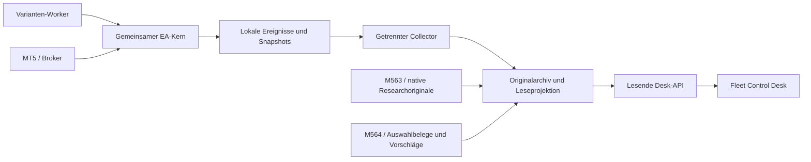

# Fleet Control Desk – technische Grundlage für Flotteninformationen

Version 1.0 · 4. November 2026 · Planungs- und Übergabedokument

**Ziel:** Ein anderes Projekt kann auf dieser Grundlage die Datenanbindung und Anzeigen eines Fleet Control Desk entwerfen. Hauptgrundlage sind das neue Konzept der Flottenzusammenstellung, der Anschluss an Mission 561 und der gemeinsame Originaldatenvertrag für Mission 563/561. Dieses Dokument fasst deren fachliche Bedeutungen zusammen und ergänzt einen konkreten Vorschlag für die lesende Integration.

**Wichtig zum Stand:** Es gibt noch keine vollständig implementierte und abgenommene neue Fleet-Control-API. Mission 561 ist geplant. Mission 563 entwickelt gemeinsame Bausteine und hat die Originaldatenanforderungen in ihrer Entwicklungsdokumentation übernommen; dort ist der vollständige neue wirtschaftliche Exportproduzent noch als offen ausgewiesen. Namen für zusätzliche Desk-Felder, Speicherstrukturen und HTTP-Routen unten sind Entwurfsvorschläge. Bestehende Quellenformate werden über Adapter weiterverwendet.

## 1. Architektur und Verantwortlichkeiten

Der geplante Flotten-EA besteht fachlich aus einem gemeinsamen Ausführungskern je Hedging-Konto und Varianten-Workern. Worker erzeugen Vorschläge; der Kern kontrolliert Risiko, Orders, Positionen, Reservierungen und tatsächliche Brokerwirkungen. Das Desk beobachtet diese Zustände.

| Baustein | Zuständigkeit | Bedeutung für das Desk |
| --- | --- | --- |
| Mission 563: Baukasten, gemeinsamer Kern und ResearchHost | Variantenpakete, Ausführungsbausteine und gemeinsame Originalaufzeichnung | Liefert Identitäten, fachliche Datensemantik und historische technische/wirtschaftliche Belege im tatsächlich qualifizierten Umfang. |
| Mission 561: operative Flottenhülle | Kontoaufnahme, Pools, Worker, Verwaltung, Incidentbetrieb und Monitoring | Verwendet dieselbe Kernbasis und dieselbe Kosten-/PnL-Semantik; ergänzt die operative Instanz- und Manifestbindung. |
| Mission 564: neue Flottenzusammenstellung | Auswahl vorhandener Varianten und fester EUR-Entryrisiken | Konsumiert Originaldaten; erzeugt Modelle, Vergleiche und Vorschläge. Ein Solverergebnis aktiviert keine Flotte. |
| Fleet Control Desk | Darstellung und Analyse mit getrenntem Collector/Lesedienst | Verbindet Livezustand, Historie, Zusammensetzung und Belege, ohne einen zweiten Ausführungs- oder Kostenkern einzuführen. |
| Broker/MT5 | Native Konto-, Order-, Deal- und Positionswerte | Maßgebliche Brokerbeobachtung; enthält keine vollständige interne Pool-, Opportunity- oder Freigabesemantik. |

Vorgesehener Datenfluss:



Der Collector quittiert nur die eigene Übernahme. Sein ACK ist keine Orderquittung, Freigabe oder Auflösung eines UNKNOWN. Der Handel wartet nicht auf das Desk, Internet oder Netzwerkantworten. Ein Ausfall des kritischen Ausführungsjournals ist dagegen ein eigenständiges Ausführungsproblem; das darf nicht als harmloser Dashboardausfall verdeckt werden.

## 2. Was heute vorhanden ist und was geplant bleibt

| Bereich | Belegter Stand der gelesenen Quellen | Konsequenz für das andere Projekt |
| --- | --- | --- |
| Native MT5-Kontowerte, Positionen, Orders, Deals | Von MQL5 lesbar; teilweise bereits durch Legacy-EAs exportiert | Eine begrenzte Konto-/Historienansicht ist technisch möglich, benötigt aber einen konkret eingerichteten Leser. |
| Legacy-Researchdateien | Equity-, Order-, Deal-, Ereignis-, Stopaudit-, Kalender- und Abschlussdateien existieren in passenden Hosts | Dateischema, Laufkontext und Vollständigkeit je Quelle prüfen; nicht als einheitliche Live-API behandeln. |
| Legacy-Liveaudit | Beispielsweise V2-Master schreibt bei aktivierter Auditoption `MASTER.csv` mit Vertrag, Version, Brokerzeit, Profil, Ereignis und Details | Ergänzende Diagnosequelle; kein Ersatz für vollständige neue Snapshots und Finanzhistorie. |
| Neuer gemeinsamer Kern aus M563 | Identitäten, Intents, Ressourcenrahmen und Zustandsbausteine in Entwicklung; begrenzte Komponentenbelege vorhanden | Daraus folgt noch kein fertig konsumierbarer vollständiger Live-/Researchstrom. |
| `fleet-monitoring/1.0` | Vorliegender M561-Monitoringentwurf mit Datensatzarten und Lesevertrag | Fachliche Grundlage für Adapter und UI; konkrete Serialisierung und Fähigkeiten mit dem tatsächlichen Produzenten abstimmen. |
| Gemeinsamer Originaldaten-/Kostenvertrag | Für M563/561 spezifiziert und in M563 als Anforderung zugeordnet | Für neue passende Produzenten vorgesehen; nicht rückwirkend für jeden alten Lauf garantiert. |
| Collector, Desk-HTTP-Endpunkte, vollständiger Fernkanal | In den hier geprüften Konzepten vorgesehen, nicht als fertige Infrastruktur belegt | Im Desk-Projekt planen und implementieren; keine URL oder Zugangsdaten aus diesem Dokument ableiten. |

Bei bestehenden Flotten wie M485 bleiben deren eigene geprüfte Identitäten, Laufzeitpointer und Lesewege maßgeblich. Ein neuer Collector darf sie über einen Legacyadapter darstellen; dieses Dokument ist keine Änderung ihrer Quellen oder Betriebsrechte.

## 3. Identitäten: Wie Informationen zusammengehören

Das Desk braucht mehr als Kontonummer und Strategiename. Gleiche Anzeigenamen beweisen weder dieselbe Strategie noch denselben Ressourcenpool.

| Identität | Bedeutung und Verwendung |
| --- | --- |
| `account_key` | Broker/Server, Kontoidentität, Währung und Kontomodus eindeutig binden. Kontonummer allein reicht nicht. |
| `fleet_id` / `manifest_revision` | Flotte und unveränderlicher Zusammensetzungs-/Risikostand; Sollstand von tatsächlich bestätigtem Iststand unterscheiden. |
| `risk_pool_id` | Dauerhafte wirtschaftliche Poollinie. Revision, Workerwechsel oder Neustart erzeugen kein neues Budget. |
| `variant_revision` / Paketidentität | Ursprüngliche Strategie-/Parameterrevision und unveränderliches Paket samt Hash. |
| Kern-/Workerbuild und Protokollversion | Tatsächlich laufendes ausführbares Artefakt, Strategieidentität und technische Kompatibilität getrennt halten. |
| `source_id`, Terminal-/Instanzbindung | Welcher Produzent auf welchem Host/Terminal beobachtet wurde; in gemeinsamem Dateiverzeichnis zwingend eindeutig. |
| `session_id` und Führungsnummer | Laufzeitgeneration und maßgeblicher Ausführer; PID oder Dateizeit allein reichen nicht als Identität. |
| `opportunity_key` / `intent_id` | Kausale Einstiegsgelegenheit und persistierte Orderabsicht. Erneute Zustellung erzeugt keine neue Gelegenheit. |
| Intent-Magic, Order-/Deal-ID, Positions-ID | Durchgängige Brokerkorrelation. Die stabile Positions-ID bleibt vom gegebenenfalls wechselnden aktuellen Ticket getrennt. |
| `run_id` / Quellen- und Ergebnisbindung | Historischer MT5-Lauf, Modellauftrag, Prüfbericht und zugehörige Originale. Ein Run ist keine Liveinstanz. |

**Darstellungsregel:** Historische Positionen bleiben Eigentum ihrer ursprünglichen Revision und ihres ursprünglichen Pools. Eine neu aktive Revision übernimmt weder deren Erfolgshistorie stillschweigend noch erhält sie eine zweite Poolkapazität. „Draining“ bedeutet weiter bestehende Altverpflichtungen trotz beendeter neuer Einstiege.

## 4. Datenkatalog für das Desk

Die Gruppen sind fachliche Anforderungen. Nicht jeder heutige EA liefert bereits jedes Feld. Der Adapter muss je Quelle die tatsächlich verfügbaren Fähigkeiten ausweisen.

### 4.1 Konto, Terminal und Laufzeit

| Daten | Herkunft | Mögliche Anzeige |
| --- | --- | --- |
| Balance, Equity, Credit, offener Profit, Margin, freie Margin; gegebenenfalls Marginlevel | Native Kontoaufnahme | Kontoverlauf, Floating-Ergebnis, Marginbelastung, Kredit separat. |
| Kontowährung, Hebel, Server, Konto-/Hedgingmodus, Tradeflags | MT5-Kontoeigenschaften | Kontext, Vergleichbarkeit und Kontoerlaubnis. |
| Brokerverbindung, Terminalstatus, letzte Quote je relevantem Symbol | Terminal-/Marktbeobachtung | Verbindung und Marktfrische. Eine Quote bei geschlossenem Markt ist nicht automatisch ein EA-Ausfall. |
| Kernfortschritt, Workerfortschritt, Heartbeat, Build, aktive Manifestrevision | Kern-/Workertelemetrie | Instanzenübersicht, Versionsverteilung, ausbleibender Fortschritt. |
| Ereignis-/Historienwatermarks, letzte echte Beobachtung, Publikation und Collectoraufnahme | Produzent und Collector | Datenalter, Übertragungsrückstand und Konsistenz. |

Native Balance, Equity, Profit und Margin werden als eigenständige Brokerwerte gespeichert. Das Desk ersetzt `ACCOUNT_EQUITY` nicht durch eine eigene vermeintlich identische Summe. Diese Werte sind durch die [MetaQuotes-Kontoeigenschaften](https://www.mql5.com/en/docs/constants/environment_state/accountinformation) definiert.

### 4.2 Flotte, Varianten und Aufnahmezustand

- Zusammensetzung nach Familie, Variante, Paket, Originalsymbol, Timeframe und Revision.
- Aktive, pausierte, auslaufende und noch nicht aufgenommene Bestandteile.
- Gewünschte und bestätigte Kern-/Worker-/Manifeststände.
- Konfiguriertes nominales Entryrisiko und gültige Risikopolicy.
- Zulassung neuer Einstiege mit einzelnen wirksamen Gründen; Fähigkeit zur Positionsverwaltung separat.
- Offene Verpflichtungen alter Revisionen und Fremd-/unzugeordnete Kontoanteile.
- Zugehörige Researchauswahl, technische/native Belege und deren konkrete Grenzen.

Eine zusammenfassende Ampel kann daraus abgeleitet werden, muss aber die Einzelzustände zugänglich halten. `ERROR` bedeutet nicht automatisch gesperrt. Eine endgültige gewöhnliche Brokerablehnung kann bei weiterhin erlaubten neuen Signalen auftreten.

### 4.3 Poolressourcen und Risikozuweisung

Das neue Flottensuche-Konzept unterscheidet ausdrücklich:

```text
x_i       = nominales Risiko pro neuer Einstiegsgelegenheit der Variante i
R         = Summe der ausgewählten nominalen Entryrisiken
w_i       = x_i / R, falls R > 0
C_g       = genehmigter Ressourcenrahmen des wirtschaftlichen Pools g
U_g(t)    = tatsächliche und noch mögliche Belegung dieses Rahmens
```

Ein nominaler Anteil von 20 % ist weder 20 % Kontokapital noch 20 % maximaler Drawdown.

| Ressourcenkomponente | Benötigte Werte |
| --- | --- |
| Stop-/Geldrisiko | Rahmen, mögliche/gebundene Wirkung, verbleibende Kapazität, Einheit und ausdrücklich erlaubte Toleranz. |
| Stressmargin | Deklarierter Modellrahmen und aktuelle Modellbelegung mit Bewertungsprofil. Getrennt von nativer Kontomargin. |
| Bruttoexposure | Symbol, Richtung, Menge/Geldbewertung und jeweilige Grenzen; Long und Short nicht ungeprüft netto verrechnen. |
| Positionen und Brokerorders | Zulässige, tatsächlich belegte und noch mögliche Anzahlen/Mengen. |
| Outstanding-Intents | Reservierte Slots einschließlich unbekannter/versiegelter Vorgänge. |
| Reservierung | Änderung, Ursache, Intent, Beleg und Zeitpunkt; Fill ersetzt den entsprechenden reservierten Anteil. |
| Kapazitätsentscheidung | Erlaubt/abgewiesen, betroffene Komponente, Bedarf, freie Kapazität und Grund. |

Das Desk addiert `C + Reservierung + Fill` nicht als drei Belastungen desselben Vorgangs. Kontozuteilung und Nutzung innerhalb des Pools sind unterschiedliche Ebenen. Die maßgebliche Rechnung liefert der qualifizierte Kernvertrag.

**UNKNOWN bleibt wirtschaftlich sichtbar:** Eine ungeklärte mögliche Wirkung kann Kapazität dauerhaft binden, bei Max-1 auch alle weiteren eigenen Entries verhindern. Keine Uhr, neue Revision, Collectorquittung oder neue Optimierung macht diese Kapazität frei. Andere Pools behalten ihre eigenen genehmigten Rahmen; V1 verleiht ungenutzte Kapazität nicht.

### 4.4 Positionen und Verwaltung

Je Position: Konto/Pool/Originalrevision, stabile Positions-ID und aktuelles Ticket, Symbol/Richtung, Erstfillzeit, anfängliches und verbleibendes Volumen, einzelne beziehungsweise gewichtete Fillpreise, ursprünglicher Stop/Target, ursprüngliches R, nominales und tatsächlich eingegangenes Anfangsrisiko, aktueller SL/TP, Verwaltungszustand, offener Profit/Swap und Bewertungszeit.

Bei besonderen Zielregeln wie W1 bleiben Zielregel, gebundene Wochenquelle, Signal-ATR und Fill-/R-Bezug erhalten. Ein W1-Ziel wird nicht als Fixed-R-Ziel umetikettiert. Spätere Stopänderungen verändern das ursprüngliche R nicht.

Ausreichende aufgezeichnete Zwischenbewertungen ermöglichen MAE/MFE; eine bloße Liste abgeschlossener Deals kann diese Werte nicht vollständig liefern. Positions-ID und Ticket haben laut [MetaQuotes unterschiedliche Lebenszyklen](https://www.mql5.com/en/docs/constants/tradingconstants/positionproperties).

### 4.5 Orders, Deals, Intents und verlorene Gelegenheiten

Vorgesehen sind `order_event`, `deal_event` und `intent_state_event`:

- Ursprünglicher Request mit Action, Typ, Volumen, Preis, SL/TP und Füllregel.
- Signal-, Entscheidungs-, Send-, Antwort- und Fillbezüge mit vorhandenen Zeitpräzisionen.
- Retcodes, Ablehnungsgründe, endgültiger/ungeklärter Status und verbliebene mögliche Wirkung.
- Einzelne Teilfills und Teilabgänge, Restorders, Stornierungen, späte Wirkungen.
- Order-/Deal-/Positionskorrelation, ursprüngliche Eigentümerschaft und Korrekturbezüge.
- Gelegenheit konsumiert, wegen Kapazität/Quote/Policy verworfen oder gar nicht gesendet; konfigurierte und beobachtete Gleichzeitigkeit.

Erfolgreiche Deals allein erklären nicht, warum ein Signal nicht gehandelt wurde. Das Desk muss „kein Signal“, „Signal verworfen“, „nicht gesendet“, „Broker abgelehnt“ und „Wirkung unbekannt“ auseinanderhalten können, soweit der Produzent dies tatsächlich aufzeichnet.

Ein Request erzeugt möglicherweise mehrere Transaktionen in nicht garantierter Ankunftsreihenfolge. Der MQL-Handler muss kurz bleiben; Ereignisstrom und Brokerhistorie benötigen einen konsistenten Abgleich. [MetaQuotes OnTradeTransaction](https://www.mql5.com/en/docs/event_handlers/ontradetransaction)

### 4.6 Kosten, Cashflows und Korrekturen

Der gemeinsame Originaldatenvertrag verlangt die vollständige verfügbare native Buchungshistorie einschließlich Entrykosten, Teilfills, Teilabgänge und separater Kostenbuchungen. Für jedes Buchungsobjekt bleiben Typ, Herkunft, IDs, Originalvorzeichen, Währung und Zeitpunkt erhalten.

| Bereich | Speicherung / Auswertung |
| --- | --- |
| Explizite Handelswerte | `DEAL_PROFIT`, `DEAL_COMMISSION`, `DEAL_SWAP`, `DEAL_FEE` gemäß nativer Bedeutung, genau einmal. |
| Separate Buchungen | Etwa Kommission, Charge, Zins, Steuer und Korrektur mit eigener Klassifikation; nicht auf BUY/SELL reduzieren. |
| Cashflows | Ein-/Auszahlungen und Kreditänderungen getrennt vom Tradingerfolg. |
| Offene Finanzierung | Noch nicht gebuchter Swap und bereits gebuchter Swap auseinanderhalten; bei Teilabgängen nachvollziehbar aufteilen. |
| Zuordnung | Pool/Originalrevision nur bei belegter Korrelationskette; sonst Kontoebene mit Grund „unzugeordnet“. |
| Spread/Slippage | Attribution aus passenden Bid/Ask-, Trigger-, Send- und Fillreferenzen, wenn aufgezeichnet. Bereits im Preis-PnL enthaltene Wirkung nicht nochmals vom Netto abziehen. |
| Kostenprofil | Tatsächlich verwendete Broker-/Tester-/Symbolbedingungen, Quelle und Gültigkeitszeitraum. Aktuelle Parameter beweisen keine historischen Kostenbedingungen. |

Jede Kostenart erhält ihre Messqualität: **nativ gebucht, exakt abgeleitet, modelliert, nicht anwendbar oder unbekannt**. Ein Tester-Nullfeld beweist keine kostenlose Liveausführung. Eine spätere Stressrechnung weist zusätzliche Mehrkosten gegenüber der Basis separat aus.

Die nativen Dealwerte und die verfügbaren Buchungstypen beschreibt [MetaQuotes](https://www.mql5.com/en/docs/constants/tradingconstants/dealproperties). Die darüber hinausgehenden Zuordnungs- und Doppelzählungsregeln stammen aus unserem gemeinsamen Konzept.

### 4.7 PnL und Equity: Drei verschiedene Ansichten

1. **Native Konto-Equity:** Tatsächliche Brokeraufnahme des ganzen Kontos.
2. **Zurechenbarer Pool-/Varianten-Netto-PnL:** Gebuchte zugeordnete Nettoergebnisse plus noch nicht verbuchte offene Bewertung. Startaufnahme und Kostenabgrenzung müssen belegt sein.
3. **Synthetische Varianten-Equity:** Nur mit ausdrücklich benanntem Referenzkapital `K_v`: `K_v + P_v(t) - P_v(t0)`. Analysegröße, kein separates Brokerkonto und keine neue Risikozuteilung.

Für die Kontoveränderung ab einem belegten Referenzpunkt gilt als Abgleich:

```text
Delta native Konto-Equity
  = Delta zurechenbarer Handels-PnL
  + native Cashflowänderungen
  + sonstige oder unzugeordnete Änderungen
  + verbleibender Abgleichsrest
```

Nicht zeitgleiche Beobachtungen, Fremdpositionen, fehlende Kosten und Residualbeträge bleiben sichtbar. Ein Residual wird nicht künstlich auf null gesetzt oder nach Gewicht auf Strategien verteilt. Prozentwerte brauchen eine explizite Kapitalbasis und Rechenregel.

### 4.8 Kalender, Zeitreihen und Datenqualität

Benötigt werden Zeitreihe und Tageszusammenfassungen mit tatsächlichem Beobachtungsumfang:

- Anfangs-/Endwerte von Balance und Equity, beobachtete Minima/Maxima und Marginspitzen.
- Erster/letzter Beobachtungszeitpunkt, Anzahl, Zielintervall und tatsächliche Abdeckung.
- Broker-Tagesstartsaldo getrennt von Europe/Berlin-Auswertung und UTC.
- Brokerrohzeit, verfügbare Millisekunden, Konvertierungsquelle und Reihenfolge.
- Anfangs-/Endzustand mit offenen Positionen/Orders/UNKNOWN; fortgesetzter Pfad oder echter flacher Start.
- Fehlende Grenzen/Tage als Lücken oder belegte Ableitungen; keine künstlichen Nulltage.
- Historisch erzwungene Tester-Endschließungen getrennt vom normalen Strategieverhalten.

Ein Einsekunden-Snapshot ist gesampelt. Der daraus berechnete DD heißt beobachteter/gesampelter DD. EOD-DD, konservative aus Tageshochs/-tiefs abgeleitete Modellschranke und tatsächlich belegter nativer Floating-DD bleiben unterschiedliche Kennzahlen. Summen nicht synchroner Einzeltiefs bilden keinen gleichzeitig beobachteten Kontotiefpunkt.

### 4.9 Incidents und Betriebsentscheidungen

`incident_event` enthält Code, Ursprung, betroffenen Scope, Schwere, erste/letzte Beobachtung, Häufigkeit, echte Handelswirkung, Belege, Policyrevision und Recoverybedingung. `control_event` protokolliert angefragte, verweigerte und bestätigte Entscheidungen einschließlich anderer weiterhin wirksamer Sperren.

Für die Oberfläche getrennt anzeigen:

| Signal | Fachliche Frage |
| --- | --- |
| EA/Kern lebt | Gibt es aktuellen tatsächlichen Fortschritt? |
| Worker bereit | Sind die benötigten Variantenprozesse bereit und ihre Daten aktuell? |
| Broker verbunden | Hat das Terminal Verbindung zum Broker? |
| Telemetrie frisch | Wie alt sind Quelle und Collectorstand? |
| Neueinstiege erlaubt | Welche Variante darf aus welchem Grund neue Gelegenheiten aufnehmen? |
| Verwaltung möglich | Können bestehende Positionen nach ihrem Vertrag verwaltet werden? |
| UNKNOWN/Reservierungen | Welche mögliche Wirkung bleibt gebunden? |
| Aufnahme-/Belegstatus | Ist etwas nur geplant, modelliert, nativ belegt oder tatsächlich operativ aufgenommen? |

Ein Heartbeat allein rechtfertigt kein „alles gesund“.

## 5. Wie die Daten abgeholt werden

### 5.1 Vorgesehener erster Weg: lokale Dateien und getrennter Collector

Der M561-Monitoringvertrag sieht geschlossene, rotierte NDJSON-Dateien beziehungsweise unveränderliche Segmente vor. Jedes Segment benötigt Schema, Quellbindung, Sequenzbereich, Prüfsumme und Veröffentlichungs-/Abschlussbeleg. Vorhandene CSV-/Researchdateien werden über einen eigenen Adapter gelesen; sie müssen nicht nachträglich umgeschrieben werden.

MQL-Dateien liegen innerhalb der Terminal-/Tester-Dateisandbox oder bei `FILE_COMMON` im gemeinsamen Bereich. Dieser Bereich ist **lokal**, kein automatisch erreichbarer Netzwerkordner. Ein Collector auf demselben Host kann dessen reale Betriebssystempfade lesen. [MetaQuotes FileOpen](https://www.mql5.com/en/docs/files/fileopen)

**Pfadauflösung:** Quelle beim Einrichten an `TerminalInfoString(TERMINAL_COMMONDATA_PATH)` plus `\Files` beziehungsweise an den konkreten Terminal-/Testerpfad binden. Benutzer, Installation und Host können unterschiedliche Pfade haben. Ein Beispiel wie `%APPDATA%\MetaQuotes\Terminal\Common\Files` ist keine fest verdrahtete Konfiguration. Quelle/Instanz/Konto/Stream innerhalb des gemeinsamen Bereichs eindeutig trennen. [Terminaleigenschaften](https://www.mql5.com/en/docs/constants/environment_state/terminalstatus)

Geplanter Ablauf:

1. Produzent zeichnet begrenzte Ereignisse und Snapshots lokal auf; Transaktionsjournal und umfangreiche Diagnostik bleiben getrennt.
2. Produzent veröffentlicht einen vollständig geschlossenen Segmentstand. Temporäre/teilweise Enden werden nicht übernommen; das genaue Publikationsverfahren wird mit M563/561 vereinbart.
3. Collector entdeckt neue abgeschlossene Segmente, prüft Manifest, Hash, Schema und Kontobindung.
4. Er archiviert die Originalbytes und übernimmt normalisierte Datensätze in einer Transaktion.
5. Erst nach erfolgreicher Übernahme speichert er seinen Cursor. Wiederholtes Lesen wird dedupliziert.
6. Die Desk-API liest daraus Snapshots, Ereignisse und Serien. Ein UI-Reload liest keine neue Order aus dem EA aus und sendet keine.

`FILE_SHARE_READ` kann den gemeinsamen Zugriff auf aktive Dateien ermöglichen, beweist aber weder einen konsistenten Snapshot noch eine vollständig geschriebene letzte Zeile. Geschlossene Segmente sind der bevorzugte vertragliche Übergabepunkt.

### 5.2 Hostübergreifende Verbindung

Für einen Windows-/VPS-Produzenten und ein Desk auf dem Mac ist ein Collector **nahe am Terminal** der vorgesehene Aufbau. Er kann fertige Originalsegmente über einen eingerichteten authentisierten Transport weiterreichen. Ein späterer Mac-Pull über SSH/SFTP ist ebenfalls ein möglicher Adapterweg. Beides muss konkret eingerichtet und autorisiert werden; hier wird kein Dienst installiert.

Bei Verbindungsabbruch puffert der Collector im definierten Umfang lokal und setzt ab dem gespeicherten Stand fort. Rückstand und tatsächliche Lücken sind sichtbar. Retention richtet sich nach Verbraucherbedarf und vorhandenen Aufbewahrungsrechten. Nicht pauschal neue NAS-/Cloudsynchronisation oder bisher pausierte Dienste voraussetzen.

Die gesamte Aktualisierungslatenz besteht aus **Aufzeichnung + Segmentveröffentlichung + Transfer + Verarbeitung + UI-Abfrage**. „Snapshot alle 1 s“ bedeutet nicht automatisch eine Ende-zu-Ende-Latenz von 1 s. Intervalle, Segmentgröße, Frischegrenzen und Speicherbedarf sind vor dem tatsächlichen Einsatz anhand der geplanten Instanzen zu messen.

### 5.3 Warum keine direkte HTTP-Abhängigkeit im Handelskern?

`WebRequest` arbeitet synchron und steht im Strategy Tester nicht zur Verfügung. Ein Netzwerkrequest im Handelspfad würde den gemeinsamen Produzentenpfad unnötig koppeln. Für Deskkommunikation ist daher der getrennte Collector vorgesehen. [MetaQuotes WebRequest](https://www.mql5.com/en/docs/network/webrequest)

Sockets oder Named Pipes sind mögliche spätere Transporte, aber für diese erste Datenanbindung nicht vorausgesetzt. Sie lösen von sich aus weder Historienaufbewahrung noch Cursor-, Zuordnungs- oder Vollständigkeitsfragen.

### 5.4 Alternative: native Terminalabfrage

Die offizielle MetaTrader-Pythonintegration bietet unter anderem `account_info`, `terminal_info`, `positions_get`, `orders_get`, `history_orders_get` und `history_deals_get` über die Verbindung zum Terminal. Sie kann einen ergänzenden Konto-/Historienadapter tragen. Für die Planung gehört ein solcher Adapter auf den unterstützten MT5-Host; eine native Mac-Fähigkeit wird hier nicht behauptet. [Offizielle Pythonintegration](https://www.mql5.com/en/docs/python_metatrader5)

Die Brokerdaten enthalten jedoch nicht automatisch ursprüngliches R, Poolkapazität, UNKNOWN-Reservierungen, verworfene Signale, Freigabegründe und Paketbelege. Diese Informationen müssen aus dem Kern stammen. Die Integrationsbibliothek enthält auch schreibende Funktionen; eine lesende Desk-Rolle muss ihre erlaubten Aufrufe konkret begrenzen. Das Vorhandensein eines Pythonzugangs macht ihn nicht automatisch zu einem Nur-Lese-Zugang.

## 6. Gemeinsamer Datensatzrahmen

`fleet-monitoring/1.0` ist der vorhandene Schemaentwurf. Die folgende Tabelle konkretisiert die Anforderungen für die Deskplanung; neu vorgeschlagene Namen sind mit dem tatsächlich gelieferten Schema abzugleichen.

Die verbindlich vorgesehenen Datensatzarten des Monitoringentwurfs sind:

| `record_type` | Inhalt |
| --- | --- |
| `account_snapshot` | Native Kontoaufnahme und Kontokontext. |
| `fleet_snapshot` | Flottenzugehörigkeit, aggregierte zurechenbare Ergebnisse und Vollständigkeit. |
| `variant_snapshot` | Pool/Revision, Admissiongründe, Verwaltung und Ressourcen. |
| `position_snapshot` | Originaler Eigentümer, Bestand, R/Schutz/Verwaltung und offene Bewertung. |
| `order_event` / `deal_event` | Brokerdaten, Teilmengen, Preise, Ergebnisse, Kosten und Korrekturen. |
| `intent_state_event` | Zustandsübergang, Reservierung, UNKNOWN und späte Wirkungen. |
| `incident_event` | Ursache, Scope, Wirkung und Recoverybedingung. |
| `control_event` | Angefragte, verweigerte oder bestätigte Betriebsentscheidung. |
| `cashflow_event` | Ein-/Auszahlungen, Kreditänderungen, Korrekturen und separate Kosten mit Zuordnungsstatus. |
| `telemetry_health` | Fortschritt, Frische, Rückstand, Sequenzen, Lücken und ausgelassene Diagnosedaten. |

Historische Researchimporte benötigen zusätzlich das vorhandene Lauf-/Artefaktinventar: Anfangsprofil, tatsächliche Quell-/Buildbindung, Zeit- und Sequenzabdeckung, Dateihashes, Zeilen-/Ereigniszähler, Endzustand und Abschlussbeleg einschließlich tatsächlicher Fehler. Diese Inventare sind keine zusätzlich behaupteten Monitoring-`record_type`s. Ein erfolgreicher Testerprozess allein bestätigt keine vollständige Datenübergabe.

| Feldgruppe | Semantik |
| --- | --- |
| Version und Art | `schema_version`, `record_type`, stabile `record_id`. |
| Quelle und Identität | `source_id`, Konto/Server, Flotte, Manifest, Pool und Originalrevision; nicht zutreffende IDs bleiben null. |
| Generation und Reihenfolge | `session_id`, Führungsnummer, Stream und Sequenz. Cursor bleibt über Neustarts eindeutig. |
| Zeit | Tatsächlicher Ereignis-/Beobachtungszeitpunkt, Brokerrohzeit, UTC-Konvertierung, `published_at_utc` und separat Collector-Eingangszeit. |
| Herkunft | Build-/Paket-/Policybindung und originale Journal-/Historienwatermarks. |
| Qualität | Messart, Abdeckung, Vollständigkeit und `quality_reason`; null bedeutet unbekannt/nicht anwendbar mit Grund. |
| Korrektur | Originalidentität und neuer Wissensstand; `supersedes_record_id` für belegte Korrekturen. |
| Nutzdaten | Datensatzartspezifische Werte mit Einheiten, Vorzeichen und Währung. |

IDs und Sequenzen werden verlustfrei gespeichert; große Zahlen nicht in JavaScript-`Number` runden. Geld-/Preis-/Volumenwerte werden als Dezimaltext mit Einheit übertragen und im Backend dezimal verarbeitet. Frontendformatierung auf zwei Stellen verändert die Originale nicht.

**Illustratives Beispiel, kein bereits vorhandenes Produzentenformat:**

```json
{
  "schema_version": "fleet-monitoring/1.0",
  "record_type": "account_snapshot",
  "record_id": "example-account-snapshot-1842",
  "source_id": "example-terminal-01",
  "account_key": "example-broker/server/account",
  "fleet_id": "example-fleet",
  "manifest_revision": "example-revision-7",
  "risk_pool_id": null,
  "variant_revision": null,
  "session_id": "example-session-3",
  "leader_epoch": "3",
  "stream_id": "account",
  "sequence": "1842",
  "observed_at_utc": "2026-11-04T12:00:00.250Z",
  "published_at_utc": "2026-11-04T12:00:01.000Z",
  "watermarks": {"execution_journal": "920", "broker_history": "510"},
  "quality": {"measurement": "NATIVE_SNAPSHOT", "coverage": "SAMPLED"},
  "payload": {
    "currency": "EUR",
    "balance": "100000.00",
    "equity": "100125.42",
    "margin": "2500.00",
    "free_margin": "97625.42"
  }
}
```

`leader_epoch`, `stream_id`, verschachtelte Objekte und Qualitätscodes sind Beispielcodierungen. Tatsächliche Broker-, Publikations- und Collectorzeiten dürfen nicht aus einer einzigen Dateizeit erzeugt werden.

## 7. Lesevertrag, Wiederaufnahme und Speicherung

### Logische Leseoperationen

Die ersten vier Operationen stammen aus dem M561-Konzept. Die weiteren sind Vorschläge für das Desk. Es sind keine heute erreichbaren Endpunkte.

| Operation | Ergebnis |
| --- | --- |
| `list_fleets` | Bekannte Flotten mit Konto, Status, Datenalter und Fähigkeiten. |
| `get_fleet_manifest` | Gewünschte und bestätigte Zusammensetzung einschließlich Quellen und Revisionen. |
| `read_events(after_cursor, filters, limit)` | Paginierte Originalereignisse mit nächstem Cursor und deklarierter Reihenfolge. |
| `read_snapshot(scope, id)` | Letzte echte Aufnahme mit Beobachtungszeit, Watermarks und Konsistenzstatus. |
| `read_equity_series(scope, id, from, to, resolution)` | Native oder ausdrücklich abgeleitete Serie samt Basispunkt, Messart und Lücken. |
| `read_positions / read_orders / read_intents` | Bestand und ungeklärte Wirkungen einschließlich ursprünglicher Eigentümer. |
| `read_pool_resources` | Genehmigte Rahmen, Nutzung und Aufnahmekapazität nach Ressourcenkomponente. |
| `read_costs / read_reconciliation` | Kostenarten, Zuordnung, Cashflows und Abgleichsrest. |
| `read_capabilities / read_artifact_manifest` | Verfügbare Daten und vollständige Herkunft des verwendeten Standes. |

Ein möglicher HTTP-Adapter könnte daraus `GET /api/v1/fleets/{id}/snapshot` und `GET /api/v1/events?after_cursor=...` machen. Route, Host, Authentisierung und Responseformat sind noch zu entscheiden. WebSocket/SSE kann später Änderungen ankündigen; der wiederaufnehmbare Ereignis-/Serienlesevertrag bleibt die Grundlage.

### Anforderungen an den Leser

- Stabile Datensatzidentität und Quellenbindung zur Deduplikation verwenden; tatsächliche spätere Korrekturen derselben Broker-ID nicht verwerfen.
- Beobachtungszeit und Zeitpunkt des Bekanntwerdens getrennt halten, damit verspätete Fills und Korrekturen nachvollziehbar bleiben.
- Fehlende Sequenzen, unvollständige Snapshots und unterschiedliche Watermarks melden. Ein gemeinsam geladenes UI ist kein atomarer Kontosnapshot.
- Abgelaufenen Cursor mit `CURSOR_EXPIRED` und neuem belegtem Basispunkt melden. Lücke nicht still mit einem frischen Snapshot überdecken.
- Letzte Zeile einer aktiven CSV/NDJSON-Datei erst nach vollständig belegter Veröffentlichung übernehmen. Quellenkodierung, Separator und Dezimaldarstellung je Legacyadapter binden.
- Ein Snapshot ist Beobachtung; das Fehlen einer Position beweist ohne vollständigen Zustandsabgleich nicht deren Schließung.
- Unbekannte Schema-Hauptversionen nicht raten. Rohoriginal erhalten und die betroffene Ansicht als nicht unterstützt ausweisen.

Für einen lokalen ersten Ausbau genügt konzeptionell eine transaktionale Datenbank für Index/Projektionen plus ein komprimiertes Originalarchiv. Eine konkrete Datenbanktechnologie ist nicht durch das Flottenkonzept festgelegt. Sinnvolle logische Bereiche sind Sources/Capabilities, Manifeste/Pools/Revisionen, RawRecords, Snapshots, Handels-/Kostenbuchungen, Intents/Reservierungen, Kalender, Incidents, Abgleich und Importcursor.

Die vorhandenen Researchkapseln und Archive sollen weiterverwendet werden. Das Desk braucht keine zweite Kopie jeder gemeinsamen Marktquelle; eine stabile Hashreferenz muss aber tatsächlich auflösbar bleiben.

## 8. Was im Desk dargestellt und berechnet werden kann

| Ansicht/Kennzahl | Benötigte Grundlage | Aussagegrenze |
| --- | --- | --- |
| Flotten-/Kontenübersicht | Konto-, Flotten-, Worker- und Telemetriesnapshots | Gesundheit, Frische, Brokerverbindung und Entryfreigabe getrennt. |
| Kontokurve und Margin | Native Beobachtungsserie | Messintervall und Lücken bestimmen die Aussage. |
| Ergebnis nach Pool/Revision/Symbol | Vollständige Zuordnung plus offene Bewertung und Anfangszustand | Kein natives Strategiekonto; Fremdanteile und Residual ausweisen. |
| Kostenanalyse | Vollständige Kosten-/Deal-/Cashflowhistorie | Entrykosten und separate Buchungen berücksichtigen; unbekannte Kosten nicht als null. |
| Positions-/Orderdetail | Bestand, historische Fills, R-/Schutz-/Managementbelege | Originalwerte von aktuellen Stop-/Targetwerten trennen. |
| Kapazitätsanzeige | Autoritatives C/U, Reservierungen und Policy | Nominales Entryrisiko, native Margin und Stressmargin nicht vermischen. |
| Verpasste Gelegenheiten | Signal-/Intententscheidungen und Gründe | Aus abgeschlossenen Trades allein nicht ableitbar. |
| Winrate, PF, Haltedauer, Tradezahl | Vollständige geschlossene Tradezyklen mit versionierter Gruppierung | Dealanzahl ist keine Tradeanzahl; Teilabgänge nicht als neue vollständige Trades zählen. |
| MAE/MFE | Ausreichende Zwischenbewertungen/Quotes im Positionslebenszyklus | Nachträglich ohne aufgezeichneten Pfad gegebenenfalls unmöglich oder nur eingeschränkt. |
| Tages-/Monats-/Jahresbericht | Belegter Kalender, Tagesbasis, vollständige Quellen | Berlin, Brokerdatum und Cashflows nicht vermischen. |
| Korrelation, gemeinsame Verlusttage | Synchronisierte vergleichbare Netto-Tagesreihen | Gemeinsame Quellen und kleine Stichproben sichtbar halten. |
| CVaR/CDaR, ERC und Konzentration | Passende Reihen, definierte Niveaus/Zeiträume und eingefrorene Rechenregel | Abgeleitete Researchgrößen; keine EA-Aufgaben und keine Garantie künftigen Risikos. |
| Soll-/Istvergleich einer Flottenauswahl | M564-Modellbeleg plus tatsächliches Manifest, Risiko und Ausführungsregime | Modellgewichte sind nicht automatisch operative Freigaben. |
| Incident-/Ausführungstimeline | Ereignisse, Journalwatermarks und Korrekturbezüge | „Ungeklärt“ bleibt sichtbar; keine erfundene endgültige Wirkung. |

Verdichtete Zeitreihen sollten mindestens ersten/letzten Wert, Min/Max samt Zeitpunkten und Beobachtungszahl bewahren. Eine stündliche Durchschnittskurve allein kann beobachtete Verlustspitzen verdecken. Tooltip/Export sollte Messart, Einheiten, Scope, Quelle, Zeitraum und Qualitätsgründe zugänglich machen.

## 9. Anschluss an die neue Flottensuche

Das Desk kann operative und historische Daten über denselben Vertrag zugänglich machen. Die neue Zusammensetzung verwendet im ersten Ausbau feste nominale EUR-Entryrisiken ohne Compounding:

```text
q_i(t) = kumulierter Netto-PnL je EUR ursprünglichem Nominalrisiko
P(t,x) = Summe_i x_i * q_i(t)
E(t,x) = einmaliges Flottenstartkapital + P(t,x)
```

Diese lineare Mischung ist ein Modell auf passenden gebundenen Einzelpfaden. Gemeinsame Slots, Lotschritte, Ausführung, Margin, Kosten- und Kapazitätsregeln können davon abweichen; der notwendige native Nachweis einer neuen endgültigen gemeinsamen Flotte bleibt separat.

Für den Anschluss müssen folgende Informationen zusammenpassen:

1. **Historische Herkunft:** Zulässige Register-/Paketrevision, Kern/Host, Originalsymbol/TF, Broker/Server, Währung, Kosten-/Kalender-/Risikopolicy.
2. **Pfadregime:** Anfangszustand, Fenster, feste nominale Risikoquelle, offene Altpositionen, Änderung von Entryrisiken oder Kapazität.
3. **Poollinie:** Zuordnung von Kandidat und Revision zur wirtschaftlichen Poolidentität; auslaufende Verpflichtungen bleiben enthalten.
4. **Messqualität:** Tatsächliche Zeitreihenauflösung, Quellenabdeckung und vollständiges Ledger/Journal. Dashboarddaten sind nicht automatisch ein qualifizierter Researchinput.
5. **Modellherkunft:** Auftrag, Mitgliedschaft, x/R/w, Grenzen, Methoden, Zeitblöcke, eingefrorene Datenverwendung, Solverstatus, Schranke/Ziellücke und Gegenrechnungsbeleg.
6. **Verwendungsstatus:** Historisch vorhanden → für die konkrete Analyse ausreichend → im vorgesehenen Kern nativ belegt → operativ aufgenommen. Keine Stufe impliziert die nächste.

Ändert eine Liveflotte im Zeitverlauf Entryrisiken oder wirksame Kapazitätsregeln, entsteht daraus nicht automatisch ein einzelner linear skalierbarer q-Pfad. Nach Regime trennen oder eine konkret belegte Normalisierung verwenden. Eine aktuelle Gesamtkontokurve darf nicht als unabhängige Einzelvariante in die Suche zurückfließen.

Die Oberfläche kann historische Gewinnoptimierung, robusten Vorschlag, Gleichgewichtung, ERC und bestehende Referenzflotte vergleichen. Sie zeigt bei unterschiedlicher Mitgliedschaft ausdrücklich den Zusammensetzungseffekt. Ein optionaler Challengebericht benötigt dieselbe vorher festgelegte Startmenge; Kandidaten dürfen ungünstige Starts nicht aus dem Vergleich entfernen.

Vollständige erhaltene Originale erlauben viele neue Ableitungen auf dem Mac ohne MT5-Wiederholung. Fehlende Equitybeobachtungen, zeitgleiche Quotes oder tatsächlich nicht aufgezeichnete Kosten werden dadurch nicht nachträglich bekannt. Ein linearer Vorschlag ersetzt keine operative Aufnahme oder Risikoerhöhungsfreigabe.

## 10. Empfohlener Entwicklungsstart im anderen Projekt

1. **Lesendes UI mit Beispieldaten bauen:** Kontoübersicht, Pools/Revisionen, Positionen/Intents, Kosten und Datenqualität; Beispieldaten sichtbar markieren.
2. **Quellenadapter und Capabilities definieren:** Legacy-CSV, vollständiger Researchrun und künftiger Monitoringstrom getrennt anbinden, aber dieselben fachlichen Bedeutungen verwenden.
3. **Konkreten M563-/M561-Lieferstand übernehmen:** Tatsächliche Version, Feldbelegung, Pfade und Beispieloriginale beim jeweiligen Produzenten abgleichen. Kein zweites MQL-ABI aus dieser Markdown implementieren.
4. **Originale, Cursor und lesende Projektion verbinden:** Kleinen durchgängigen Import mit wiederholter Zustellung, Neustart und sichtbarer Lücke verwenden.
5. **Gezielt fachliche Fälle abgleichen:** Entrygebühr, Teilfill/Teilabgang, separater Swap/Korrektur, Cashflow, Fremdposition, UNKNOWN und alte Revision. Vorhandene passende akzeptierte Belege wiederverwenden.
6. **Erst dann die benötigten historischen Analysen ergänzen:** Kalender-/PnL-Normalisierung, Kostenstatistik und konkrete M564-Verbraucherfähigkeit. Nicht jede Zukunftskennzahl zur Voraussetzung des ersten Desk machen.

Vor einer echten Anbindung sind Produzentenversion und Datenfähigkeiten, Host-/Terminalbindung, Transferweg, Rollen, Retention, Aufzeichnungs-/Publikationsrhythmus und Frischegrenzen konkret zu entscheiden. Für die UI sind unbekannte Felder und nicht unterstützte Fähigkeiten bereits im ersten Datenmodell nötig.

## 11. Schreiben und Fernsteuerung als getrennter späterer Umfang

Das aktuelle Dokument plant die Informationsabholung. Der Flotten-EA-Entwurf kennt zusätzlich Beobachtung, gezielten Abgleich, Pause/Drain, Wiederfreigabe und Paket-/Manifestübernahme. Daraus entstehen für einen Desk-Leser keine Befehlsrechte.

Ein späterer schreibender Kanal braucht den vorgesehenen getrennten Betriebsdienst, Rollen, gebundene authentisierte Aufträge, Konto-/Instanz-/Revisions- und Führungsbindung, Replay-Schutz und einen nachvollziehbaren Ergebnisstatus. Telemetrie-ACK ist kein Resume. Keine beliebige Shell, kein Löschen von Journalen und kein pauschaler Reset. Eine Risikoänderung bleibt eine fachliche Entscheidung auch dann, wenn sie in einem Manifest transportiert wird.

Brokerpasswörter, private Bearer, Schlüssel und Befehlsgeheimnisse gehören nicht in Datenexporte oder Frontend. Der Collector kann für die Dateiabholung mit begrenzten Leserechten arbeiten. Authentisierter Transport und Zugriffsschutz sind tatsächliche Betriebsanforderungen, keine mitgelieferte Infrastruktur.

## 12. Bekannte Grenzen und Quellenstand

Die historischen Konzeptreviews sind keine Implementierungs- oder Liveabnahmen. Das Flottensuche-Konzept 1.2 hat weiterhin offene Umsetzungspunkte und historische CHANGES_REQUESTED-Entscheidungen. Diese Übergabe ändert weder Bugs noch Reviewstatus.

Für die Deskplanung besonders relevant:

- **BUG-0100/0101, MITTEL:** Pool-/Handoffdetails sind in der tatsächlichen Version konkret zu binden. Wahrscheinlichkeit laut bisheriger Konzeptakte unbekannt. Diese Markdown beschreibt die benötigte Bedeutung, erklärt aber keine fertige Aufnahme-/Export-API. Umsetzung gehört in die betroffenen Missionen.
- **BUG-0069, akzeptierte Kapazitätsgrenze:** Dauerhafte eigene Kapazitätsbindung bei ungeklärter Wirkung muss sichtbar bleiben; kein automatischer Reset durch das Desk.
- **BUG-0084, HOCH im betroffenen Altvergleich:** Kandidatenabhängige Startmengen verzerren Challengevergleiche. Solche Vergleiche nicht als faire neue Kennzahl übernehmen. Das ist kein Reparaturauftrag an den alten Solver.
- Weitere historische numerische, Pool-, Modell- und Belegdetails bleiben in den verlinkten Konzeptakten. Für die reine Planung und lesende UI entstehen daraus keine zusätzlichen Reparatur- oder Gesamtprüfschleifen.

Es wurden für dieses Dokument keine laufenden Flotten geändert, keine MT5-Läufe gestartet und keine Collector-/Netzwerkdienste eingerichtet.

### Lokale Primärgrundlagen

Die fachlichen Inhalte sind oben eigenständig beschrieben, damit die Datei in ein anderes Projekt übernommen werden kann. Die absoluten Links dienen der Rückverfolgung auf diesem Rechner.

| Quelle | Verwendung |
| --- | --- |
| [Neue Flottenzusammenstellung 1.2](</Volumes/Tradegazing SSD/Tradegazing/outputs/flottenzusammenstellung-konzept-20261104/KONZEPT.md>) | Mitglieder-/Risikoauswahl, feste EUR-Einheiten, Modelle, Vergleich und Aussagegrenzen. |
| [Anschluss an Mission 561](</Volumes/Tradegazing SSD/Tradegazing/outputs/flottenzusammenstellung-konzept-20261104/M561_ANSCHLUSS.md>) | Poollinie, Handoff, Altverpflichtungen, Aufnahme und spätere Monitoringnutzung. |
| [Vorbereitung 563/561, Version 1.0](</Volumes/Tradegazing SSD/Tradegazing/outputs/flottenzusammenstellung-konzept-20261104/VORBEREITUNG_563_561.md>) | Gemeinsamer Produzent, Zuständigkeiten, Retention und gezielter Verbraucherabgleich. |
| [Vollständige Daten-/Kostenanforderungen](</Volumes/Tradegazing SSD/Tradegazing/outputs/flottenzusammenstellung-konzept-20261104/DATENANFORDERUNGEN_563_561.md>) | Originaldaten, Kosten, Kalender und technische Verwendungsgrenzen. |
| [M561-Monitoringvertrag 1.0](</Volumes/Tradegazing SSD/Tradegazing/outputs/flotten-ea-konzept-20261104/MONITORING_DATENVERTRAG.md>) | Datensatzarten, lokale Segmente, Cursor, PnL-Zurechnung und Frische. |
| [M561-Architekturkonzept 1.6](</Volumes/Tradegazing SSD/Tradegazing/outputs/flotten-ea-konzept-20261104/KONZEPT.md>) | Kern/Worker, Betriebsweg, Steuergrenzen und Update-/Incidentsemantik. |
| [Reservierung und Abschluss 1.3](</Volumes/Tradegazing SSD/Tradegazing/outputs/flotten-ea-konzept-20261104/RESERVIERUNG_UND_ABSCHLUSS.md>) | C/U, UNKNOWN, Poolisolation und dauerhafte Identitäten. |
| [M563: Zuordnung der Exportanforderungen](</Volumes/Tradegazing SSD/Tradegazing/.mission-clones/mission-563/docs/research/mission-563-mt5-baukasten-v1/EXPORT_ANFORDERUNGEN.md>) | Gelesener Entwicklungsstand und ausdrücklich noch offener vollständiger Produzent. Aktiver Arbeitsstand, keine versiegelte Abnahme. |
| [Historische Reviewgrenzen](</Volumes/Tradegazing SSD/Tradegazing/outputs/flottenzusammenstellung-konzept-20261104/REVIEW.md>) | Offene Befunde und tatsächliche frühere Prüfentscheidungen. |

Gelesener integrierter Research-main: `2159a0dd3647f854b15947bdff21a55f180fe408`. M563-HEAD bei der Quellenaufnahme: `d76ae89482ff02e211db180ad556029d5cac24fa`; zusätzlich gelesene aktive Dokumente können uncommittiert sein. Der genaue Inhaltshash des gelesenen M563-Exportdokuments lautet `efd6e9f416f6425c35e5bb643cd4abdb49ea36c7ad87e6203e45b410bfb70317`. Kein vollständiges Review dieses Codebestands.

Hauptbindung dieser Zusammenfassung: `VORBEREITUNG_563_561.md` SHA256 `174fa528168038c2565a2e7d5b2c34acd1e465be065ab83381913968cc89a770`; Monitoringvertrag SHA256 `f7b3ca9f8a822ee22c8897ed8f015e4c193ce6d10b0db5ed3a31c6c3bfd1433f`. Aktueller M561-Katalogstatus beim Lesen: PLANNED. Spätere Implementierungsänderungen sind gegen deren tatsächlichen Liefervertrag abzugleichen.
